# The admin pages

The task: the people who run the platform see it and act on it from a browser, as Django's admin lets them, with more
of what a platform needs: a dashboard of the last minutes (requests, failures, the time of a request, refusals and
the signs of bots, jobs), the users, the tenants and their roles changed in place, the events and the log as they
come, the jobs and the webhooks run again, the files, the settings, the data of every kind changed through its
checks, the trail of what the admins changed, the keys of programs and the feature flags, and a user's second factors
taken away when he lost his device. And the app adds its own pages, columns and actions in a few lines. The pages
speak English or French, the language the server speaks to the super-admin.
The code is `src/admin/admin.ce` (the module) and `src/admin/pages/` (the pages); the tests are `tests/admin.test.ce`
and, in a browser, `examples/invoices/tools/admin-shot.sh`. The pictures of this chapter are the pages of the invoices
filled with a month, taken by `tools/shots.sh` (the same steps, played by Chrome without a window).

What it uses: pages of [Ceres](https://www-celestial.github.io/ceres/) written in Cesia and compiled to WebAssembly
(`cesia build --target wasm`), the endpoints of the role super of [the administration](administration.md), the live
screen of [chapter 9](live.md), and nothing else: no new way into the app.

## 1. Mount it

```cesia norun hide=code
(* For the check of this page: the packages its code uses, and the names it takes from the invoices of
   examples/invoices, unknown here. *)
use deps/www-celestial/centauri/src/api
use deps/www-celestial/centauri/src/app
use deps/www-celestial/centauri/src/apptest
use deps/www-celestial/centauri/src/auth
use deps/www-celestial/centauri/src/hooks
use deps/www-celestial/centauri/src/i18n
use deps/www-celestial/centauri/src/jobs
use deps/www-celestial/cepheus/cesia/cepheus
use std/bug
use std/check
use std/dict
use std/result
use std/text
use std/value
use std/json
Invoice = json.Parse("{}")!
Module = json.Parse("{}")!
Report = json.Parse("{}")!
Statuses = json.Parse("{}")!
byOffice = json.Parse("{}")!
e = json.Parse("{}")!
paying = json.Parse("{}")!
words = json.Parse("{}")!
```

```cesia norun
(* src/invoices/module.ce *)
use deps/www-celestial/centauri/src/admin

App = app.Of([auth.Module(), jobs.Module(every = [Report]), hooks.Module(), admin.Module(folder = "admin"), Module], name = "invoices", (* ... *))
```

```cesia norun
(* admin/page.ce: the app's entry of its admin pages *)
use deps/www-celestial/centauri/src/admin/pages

pages.Run(title = "Invoices — admin")
```

```sh
cesia build --target wasm admin/page.ce     # admin/page.wasm, its loader page.js, the glue ceres.js and admin.js
brotli -k -q 11 admin/page.wasm admin/*.js  # optional: the browser then gets 144 KB in all
APP_ADMIN_EMAIL=ana@example.com APP_ADMIN_PASSWORD=... cesia do admin   # the first super-admin
```

The module serves the folder at the setting `APP_ADMIN_PATH`, `/admin` by default (`off` serves no page; the endpoints
stay, for programs), with the page that loads it: `index.html` holds no script of its own, no data and no secret, so
the Content-Security-Policy of every answer (`script-src 'self' 'wasm-unsafe-eval'`) holds for it too. The files are
read once at the start and kept in memory, each with its ETag: a second visit costs a `304` a file; a file `name.br`
beside it goes to a browser that takes brotli. They pass the same door as any request: the limit of the address, the
headers of security, the log.

The pages sign in by HTTP (`POST /auth/signin`), the session a cookie no script reads; an account that isn't a
super-admin's is signed out at once and told so. When the app asks a second factor (the super-admin's TOTP is on, or
`APP_TWO_FACTOR_ROLES` names `super`), the sign-in shows its second step: a field for the code of his app or a
recovery code, sent to `POST /auth/second`; and when he has none yet, first the secret to type into his app, its
`otpauth://` address and his recovery codes, shown that once (`POST /auth/second/setup`). A wrong code shows its
problem; an ended step goes back to the password ([passkeys](passkeys.md#5-the-second-step-of-a-sign-in)). Then they open the live screen (`/live`), which reads the session
again, checks the role `super` of each show, and runs each action, an endpoint by its name, through the same door as
over HTTP: the session, the role, the limits of the user, the shapes, the log, the metrics. A page in the browser is
never trusted: it holds nothing the server would not give any program with the same cookie.

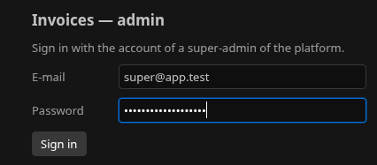

With a second factor on, a right password opens the second step: the field of the code of his app, and Send.

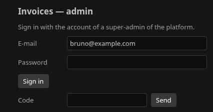

```python
# Django: the admin is an app of the project, its pages made on the server from the models
INSTALLED_APPS = ["django.contrib.admin", "django.contrib.auth", "django.contrib.contenttypes", "django.contrib.sessions", ...]
urlpatterns = [path("admin/", admin.site.urls)]
# python manage.py createsuperuser
```

## 2. The pages

On the web the admin is laid out as the pages of a web site (Ceres's `web.Shell`, the chapter Pages of a web app of
its book): the app and its pages in a side bar at the left, by what they are about (Data, People, Activity, Setup),
with their counts and the jobs that failed; where one is at the top, with the palette of Ctrl+K that finds a page or a
kind by its name, the button of the density of the rows and the one of the theme; the page in the middle, which scrolls;
a thing opened in a sheet at the right, beside the page on a wide window, over it on a narrower one, the whole window on
a phone, where the side bar is a drawer. Who is signed in and Sign out (Ctrl+Q) stand at the foot of the side bar. The
same pages laid out as a desktop tool, docked panels with tabs, are one choice away in the settings.

| page | what it shows | what it does, through which endpoint |
|---|---|---|
| Dashboard | a board that watches the platform live: a strip of its state (the connection, the requests of the last minute, p50 and p99 of a request, the errors, the jobs that failed, the sessions, how long the app has run); six graphs that share a crosshair, over 15 minutes, an hour, a day or a week: requests, the time of a request, 5xx errors, refusals at the door by reason (another site, a limit, no session, a role), failed sign-ins, jobs ready, running and dead; the log as it is written, by level, with a pause; the first steps of a fresh app | the show `admin.series` (each second, from the metrics and the log of the process), `admin.logs`, `GET /admin/stats`, `GET /admin/app` |
| Users | 50 a page, by the start of their e-mail or of a tenant, sorted by a click on a title | disable, enable, sign out everywhere, make or unmake a super-admin, each asked first (`POST /admin/users/:id/disable`...) |
| A user | his account, his tenants with his roles in a field each; his ways of signing in and second factors (a password or not, TOTP and the recovery codes left, each passkey with when it was made and last used and whether its device verified him, the providers); his sessions | roles saved in place (`PUT /admin/tenants/:id/members/:user`); his TOTP and recovery codes, or his passkeys, taken away when he lost his device (`POST /admin/users/:id/factors/reset`); a session chosen in the table ended alone (`DELETE /admin/sessions/:id`); each asked first |
| Tenants, a tenant | by the start of their name; its members and their roles | roles in place, a user added by his id with roles; someone invited by mail with roles (`POST /admin/tenants/:id/invites`) |
| Events | by kind, user, tenant, route, and a time range on the viewer's clock, page after page; or live, the last hour as it is written | `GET /admin/events`, the show `admin.events` |
| Log | the lines this process keeps, by level and a text; or live | `GET /admin/logs`, the show `admin.logs` |
| Jobs | by state and kind | a dead one run again, a waiting one cancelled (`POST /admin/jobs/:id/retry`, `/cancel`) |
| Webhooks | their deliveries (jobs `centauri.hook`) and their endpoints, their secrets never sent | a delivery run again |
| Files | each kind of `app.Files` and its things | |
| Settings | each setting, its variable, its value, where it came from (env, the app's code, Centauri's default); a secret is `(secret)`, masked by the server | |
| Data | each kind of `app.Kind`; the things of one, 50 a page (All reads them all, 200,000 at most); the one chosen with all its fields | its fields changed in place (`PATCH /admin/data/:kind/:id`), the app's actions |
| Audit | what the super-admins changed: who, when, from where, by which route, what | |
| Keys | the keys of programs, 50 a page, of a tenant by its id or of all: their tenant, name, roles, when made, when they end, when last used; never a secret | a key chosen revoked, asked first (`DELETE /admin/keys/:id`) |
| Flags | each feature flag the code declares: its name, what it is for, its state in words, what is set for tenants and users | on or off for everyone, on for a share of the users, back to the default, on, off or cleared for a tenant or a user by its id (`PUT /admin/flags/:name`) |

Every time is shown on the viewer's clock (a day that Cepheus keeps at 00:00 UTC as the day); every problem with its
status, its message, the fields that are wrong and the number of its request to quote (`urn:request:...`), and the
seconds to wait on a 429. Every list is a table of Ceres: only the rows in sight are drawn, so 100,000 rows scroll as
50 do (Speed).

Each task, as the page shows it:

**See the platform.** The Dashboard: the strip of its state at the top, then six graphs of this process, a point a
second over the last 15 minutes (a minute a point over longer ranges, as the server keeps them); the mouse over one
shows the same moment in all of them, each with its number then. The log runs under them, the newest line first: All,
Warnings or Errors, and Pause keeps the lines in sight while one reads them.


**Disable a user.** Users, a click on his row, then Disable: the page asks first, Yes does it, and the table is read
again. Enable, Sign out everywhere and Make a super-admin work the same way.

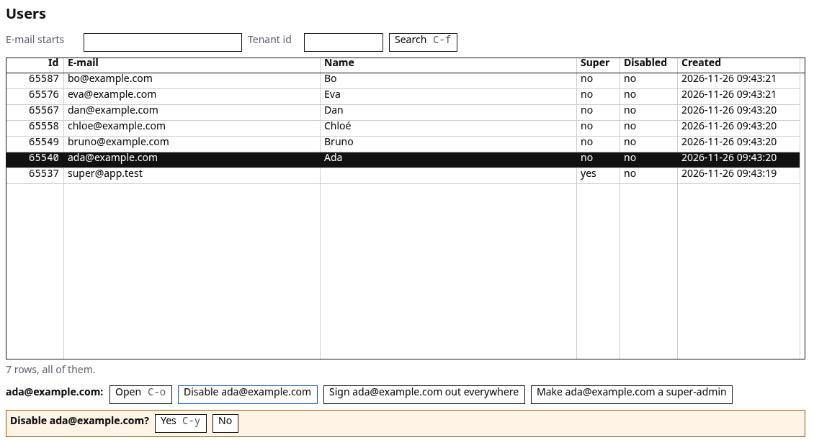

**A user lost his phone; end one of his sessions.** Users, his row, Open: his tenants and roles, his ways of signing
in (password, TOTP and the recovery codes left, each passkey), Take away the TOTP or the passkeys; under them his
sessions: a click on one, End session, Yes.


**Invite someone to a tenant.** Tenants, its row, Open: its members and their roles; type the e-mail and the roles,
then Invite by mail. The invitation goes by mail; its code is never shown.

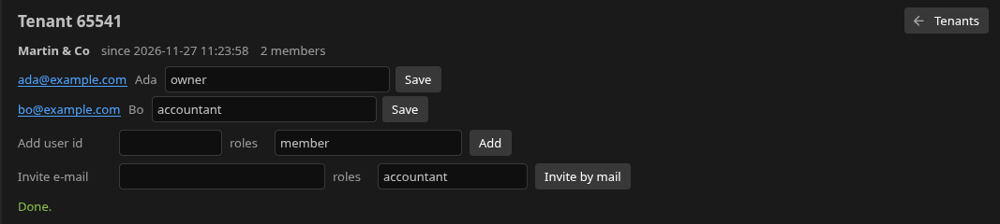

**Find what happened.** Events: a kind, a user, a tenant, a route, a time range, then Search; or Live, the last hour as
it is written. The Log is the same for the lines of this process.

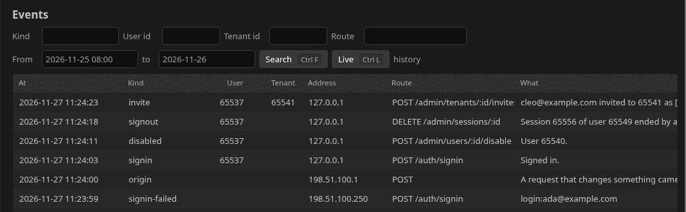

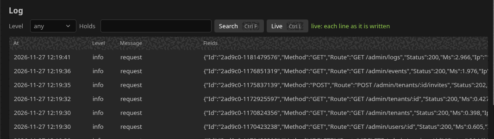

**Run a job again.** Jobs shows the dead ones first: a click on one, Run job … again, Yes. A waiting one is cancelled
the same way. Webhooks shows the deliveries (jobs `centauri.hook`), run again the same way, and their endpoints.

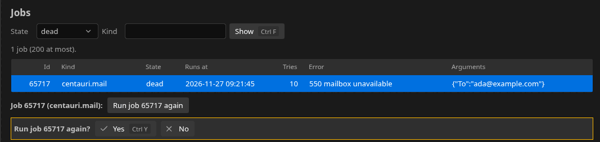

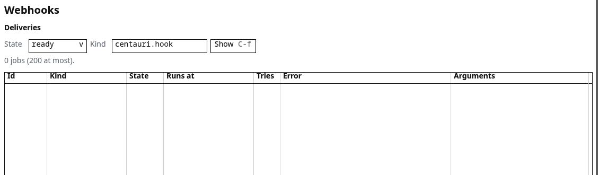

**See the files and the settings.** Files lists each kind of files and its things; Settings each setting, its
variable, its value (a secret is `(secret)`) and where it came from.

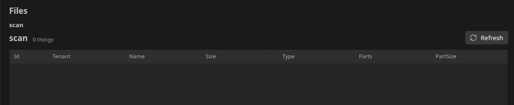

**Find things.** A kind in the side bar (its name in capitals and plural, as Clients, with its count): its page says
how many it holds, chips of the values of a field that has few (its Status or State first, as All 30, Unpaid 20, Paid
10) with their counts, and a search over its texts, which / reaches from anywhere. A link shows the title of the thing
it names (its first text), its id only beside, muted; an amount its two decimals, its thousands apart as the language
writes them (1,280.50 €, 1 280,50 €).

**Change a thing in place.** A click on the thing: it opens in the sheet at the right, at its own address
(`/admin/#/data/invoice/65616`), each field with its name over its input; a link with the title of the thing it names,
a link to its page; the app's actions on it; under them its activity, who changed what and when, from the history the
database keeps. Change a field, then Save (Ctrl+S). A value of the wrong type is refused with its field, and the change
is in the Audit. The fields an app keeps for itself are left out: a field named Search (the folded copy of its search)
and those a rule gives; `pages.Kind(fields = [...])` names those the sheet shows instead.

**Make, act on several, delete.** New (Alt+N) opens an empty sheet (`/admin/#/data/invoice/new`) for a kind of the app;
Save makes it and opens it at its address. A box before each row checks it, the one of the header all those shown; the
band that comes says how many are checked and holds the kind's actions (pages.Action) and Delete, each asked first.
Delete is in the sheet's foot too; the database's rules may refuse it, and say why. `pages.Kind(create = false)` keeps a
kind's things made only by the app.

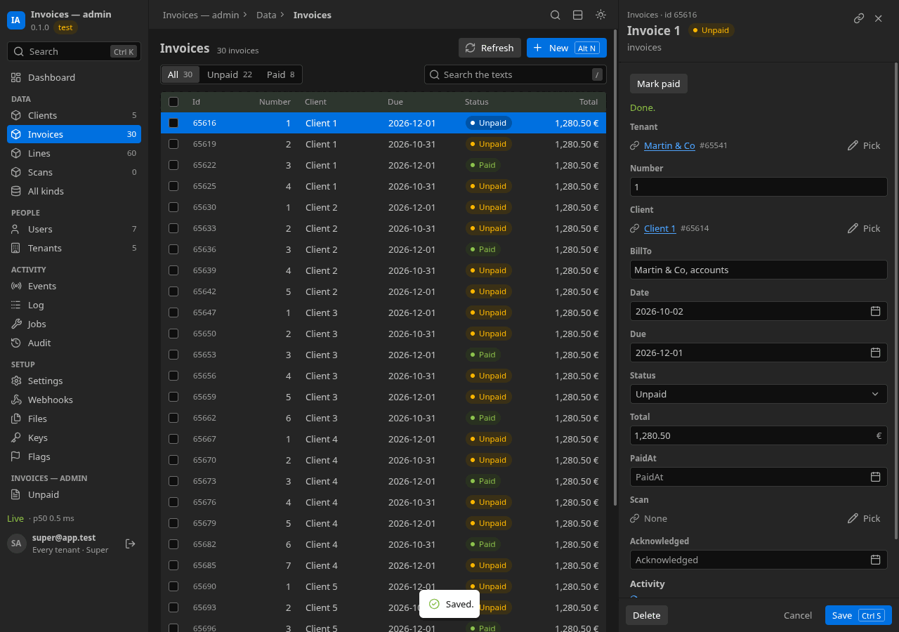

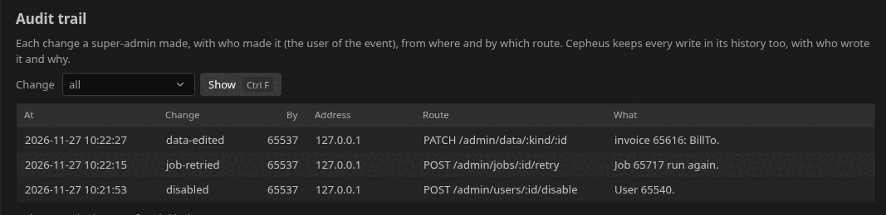

**Revoke a key of a program.** Keys, its row, Revoke key …, Yes: the key is refused at its next request.

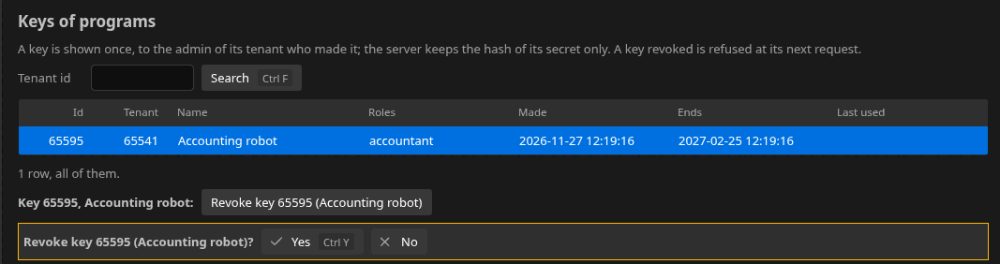

**Turn a feature on.** Flags: each flag with what it is for and its state; On for everyone, a share, or a tenant or a
user by its id.

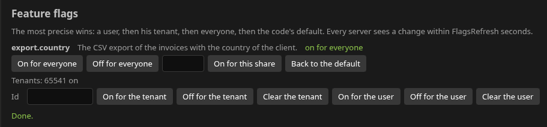

A thing's fields are changed through the shape of their type in Cepheus (a text, a whole number, a number, an amount
of its scale, true or false, a day or an instant, a link), each wrong one named; Cepheus then checks its unique values
and its rules, and keeps in its history who changed it and why. A field that `app.Kind` names secret (the hash of a
password, a webhook's secret) is never sent to a page, shown `(secret)`, and never changed. Each change is an event,
`data-edited`, that names the fields and never their values.

**Each page at its own address.** The pages are those of a web site: each has its address, the admin's own with the
page after a `#` (`/admin/#/users`, `/admin/#/data/invoice`), and so has a thing opened (`/admin/#/data/invoice/65616`).
Back and Forward of the browser go through the pages visited, an address kept or sent opens its page (after the
sign-in, when the session is gone), and a row of the side bar pressed with Ctrl or the middle button opens its page in
a new tab. A list found again has its order and its scroll of before, a thing opened and closed too. A thing changed in
the sheet and not saved holds the way to another page: the sheet asks first, under its title, Keep editing (Esc),
Discard changes (Ctrl+D) or Save and leave (Ctrl+S), and closing the tab asks too.

**The look, on this machine.** Settings, Look: the theme (System follows the device, Light, Dark), the density of the
rows (24, 30 or 44 pixels; the rows button of the top bar goes round them too), the layout on the web (Pages, or Dock:
panels like a desktop app, the outliner at the left, the details at the right, the events, the log and the jobs at the
bottom) and the tabs (On keeps the pages opened as tabs under the top bar, as in an editor; Off leaves that to the
browser's own tabs). Each choice applies at once and stays on this machine; the setting `AdminTheme` of the server
gives the theme of a machine that chose none.

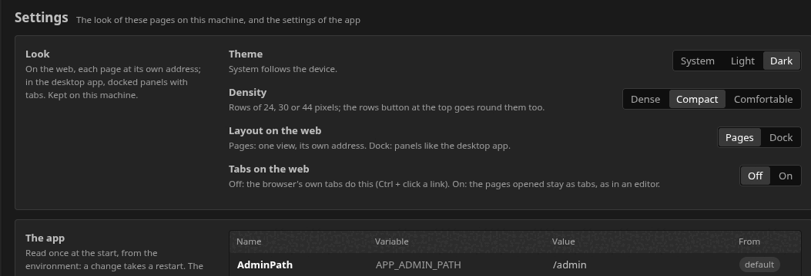

## 3. Your own admin page: the invoices of every office

The support of the platform wants the unpaid invoices of every office, their sum by office, and to mark one paid when
a client pays by phone. Two endpoints of the role super on the server, and a page in the admin's entry:

```cesia norun
(* src/invoices/endpoints/endpoints.ce *)
AdminRow = check.Record({Id: check.Id(), Tenant: check.Id(), Number: check.Int(1), BillTo: check.Text(), Due: check.Date(),
  Status: check.OneOf(Statuses), Total: check.Money(2, 0, 1e15)})
AdminInvoices = api.Get("/admin/invoices", query = check.Record({Status: check.OneOf(["unpaid", "paid"], optional = true, default = "unpaid")}),
  out = api.Page(AdminRow, 50), role = api.Super, about = "The invoices of every office.")
AdminPay = api.Post("/admin/invoices/:id/pay", role = api.Super, about = "Marks an invoice paid, for the support.")
```

```cesia norun
(* src/invoices/invoices.ce: an invoice of any office paid by the support, as its office would pay it *)
defn adminPaying(r)
  id = app.IdOf(r.Params.id)
  inv = if value.IsMissing(id) missing else cepheus.Get(Invoice, id, r.Db)? end
  if value.IsMissing(inv) or value.IsMissing(inv.Tenant)
    return app.Missing()
  end
  office = r
  office.User = dict.Put("Tenant", inv.Tenant, r.User)
  office.Params = {id: "$id"}
  paying(office)?   (* the payment of chapter 3: once, its partner told in the same group *)
  result.Ok(missing)
end
adminPay(r) = app.Retry(() -> adminPaying(r))
```

```cesia norun
(* admin/page.ce; e is the package of the invoices' contracts, src/invoices/endpoints, and words their catalogue *)
use deps/www-celestial/centauri/src/admin/pages
use deps/www-celestial/ceres/src/web
use std/plot

defn unpaid(p)
  l = pages.Lister(e.AdminInvoices, {Status: "unpaid"}, p)   (* 50 a page, More and All under the table *)
  rows = pages.ListRows(l)
  asking = web.Signal(missing)
  said = web.Signal(missing)
  table = web.Table(rows, [web.Column(pages.Say("Office"), i -> i.Tenant, sort = "Tenant", width = 90), web.Column(pages.Say("Number"), i -> i.Number, sort = "Number", width = 90),
    web.Column(pages.Say("Bill to"), i -> i.BillTo, sort = "BillTo"), web.Column(pages.Say("Due"), i -> pages.Local(i.Due), sort = "Due", width = 120),
    web.Column(pages.Say("Total"), i -> web.Money(i.Total), sort = "Total", width = 140)], height = 340, label = pages.Say("Unpaid invoices"))
  web.Stack([
    web.Title(pages.Say("Unpaid invoices")),
    web.Plot(() -> byOffice(web.Get(rows)), height = 200, width = 640, label = pages.Say("Unpaid by office")),
    table,
    pages.ListState(l, rows),
    () -> paying(pages.Chosen(table, rows), p, l, asking, said),   (* Mark paid, asked first *)
    pages.Question(asking),
  ], gap = 8)
end

pages.Run(title = "Invoices — admin", words = words.Words,
  kinds = [pages.Kind("invoice", title = "Invoices", columns = [pages.Column("Number"), pages.Column("BillTo", title = "Bill to"), pages.Column("Status"),
    pages.Column("Total", show = v -> "$(pages.Num(v)) €")], actions = [pages.Action("Mark paid", e.AdminPay)])],
  more = [pages.Page("Unpaid", "/unpaid", unpaid)])
```

The whole file is `examples/invoices/admin/page.ce` (with `byOffice` and `paying`). Each text goes through
`pages.Say`, so that the page speaks French too (step 4). What it gives:

- `pages.Page(title, path, view)`: a page in the menu after Centauri's; `view(p)` gives its widgets, and calls the
  app's endpoints by `pages.Call(endpoint, args, p)`, or reads one of pages by `pages.Lister`.
- `pages.Kind(name, title, columns, actions)`: how the data browser shows a kind; `pages.Column(field, title, show,
  width)` a column (its first fields when none); `pages.Action(label, endpoint, args, confirm)` a button on the thing
  chosen, `{id: its id}` by default, asked first unless `confirm = false`.
- the tools of every page: `pages.Lister`, `ListRows`, `ListState`, `More`, `Again`, `Chosen` (the row a click chose,
  in the order the table shows), `Confirm` and `Question`, `Replied` (a reply shown, or its problem), `Local` (a time
  on the viewer's clock), `Cell`.

An action of the app is an endpoint of the role super: the page never writes past the server's checks, and the
support's payment is the office's payment of chapter 3 (once, with `Expect`; the partner told in the same group).

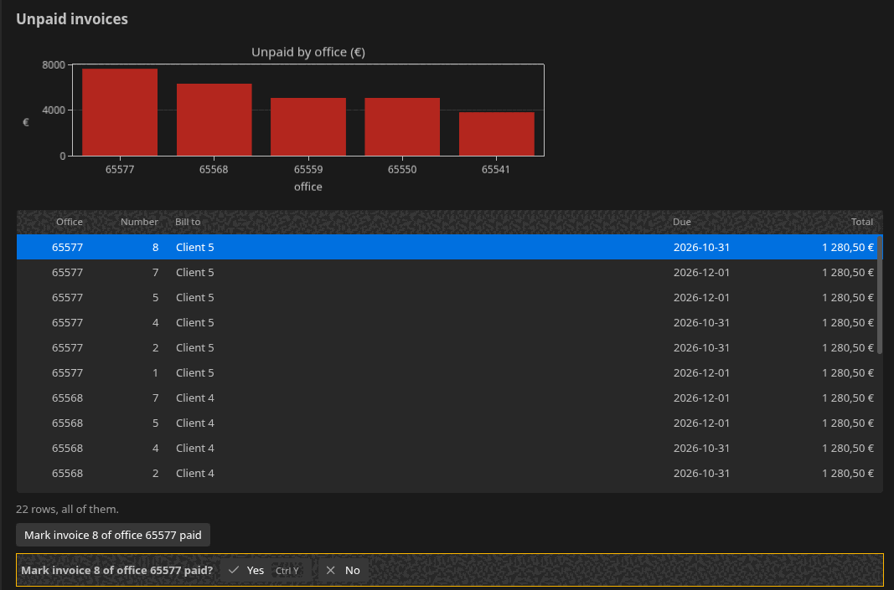

```python
# Django: the same with the admin of the model, made on the server
@admin.register(Invoice)
class InvoiceAdmin(admin.ModelAdmin):
    list_display = ("number", "bill_to", "status", "total")
    list_filter = ("status", "office")
    actions = ["mark_paid"]

    @admin.action(description="Mark paid")
    def mark_paid(self, request, queryset):
        for inv in queryset.select_for_update():   # the webhook of the partner: by hand, after the commit or not?
            inv.pay(by=request.user)
# a page of one's own: a view, a template, its URL in get_urls(), the admin's CSS to look like it, a chart by a JS library
```

What the browser test plays (`examples/invoices/tools/admin-shot.sh`, Chrome without a window driven from Cesia, and
the same in Firefox): sign in (the password a field of dots, a password input for the browser's manager), each page,
a user chosen and disabled once asked, the table read again; an invoice's name changed in place and a total that is no
number refused with its field; Mark paid on the Unpaid page; each change in the Audit; on Keys, the accounting robot's
key chosen and revoked once asked (the step `revoke`); on Flags, the flag `export.country` and its office, then on for
everyone (the step `flag`); sign out. Each page visited fits the window, no button over another, and markup typed into
a field (`<b>`, ``) stays a text: no element is made of it.

## 4. In French

The pages speak the language the server speaks to the super-admin: they ask `GET /auth/me` first, and its
`Content-Language` says it, chosen as for every request of the app (chapter 15): his account's language, else the
one his browser prefers, among the app's languages (`APP_LANGS`); English when the app speaks English alone. The
actions of the live screen carry the browser's language too, so the server's errors come in it. Centauri's texts in
French come with the pages (`pages.Words`, 254 of them, the band of keys of Ceres and the errors of the screen too):
titles, the menu, buttons, columns, help lines, empty lists, questions. Numbers are written as French writes them
(`12 345,5`, the thousands apart by a narrow space that no line breaks), times day first (`26/11/2026 09:22:01`),
plurals by CLDR (`0 ligne`, `1 ligne`, `2 lignes`). A text with no French shows in English, never empty. The data stay
as written: names, the details of the events and the lines of the log, the names of the fields. The fields of the
editor keep the point of numbers (a list in them is cut at its commas); a time is typed either way, `25/11/2026 08:00`
or `2026-11-25 08:00`.

An app's own page says each of its texts by `pages.Say(text, args)`, values in `args` (`{Number}`, `{N}`), never
written into the text; the titles given to `pages.Page`, `Kind`, `Column`, `Action` and `Run` are said where they
show. Its French is a catalogue of i18n, given to `pages.Run(words = ...)`, after Centauri's, so that the app's wins
for a text in both; the invoices give the one their server speaks (`src/invoices/words/words.ce`):

```cesia norun
(* src/invoices/words/words.ce: what the admin page says, beside the errors of the server *)
Words = i18n.Catalog("fr", [
  (* ... *)
  ["Unpaid invoices", "Factures impayées"],
  ["Mark invoice {Number} of office {Office} paid", "Marquer payée la facture {Number} du cabinet {Office}"],
])

(* tests/l3.test.ce: each text of the page has its French, with the names of its values *)
defn isAdminInFrench()
  wrong = apptest.Untranslated(["admin/page.ce"], i18n.Of([pages.Words, words.Words]), "fr")
  bug.Assert(value.Len(wrong) == 0, text.Join("\n", wrong))
  (* ... *)
end
```

`apptest.Untranslated(paths, words, lang)` reads the pages' files: each text said (`Say("…")`, a title of a page, a
kind, a column, an action) must be in the catalogue, not empty, with the names of its values in each form; a text
given straight to a widget of Ceres (`web.Text("…")`, `label = "…"`) shows in English in every language, and is named
with its line. Centauri's own pages pass the same check (`tests/translated.test.ce`).


```python
# Django:  in the templates and gettext in the code, makemessages then compilemessages,
# LocaleMiddleware for the language of the request; the admin's own texts come translated with Django.
MIDDLEWARE = [..., "django.middleware.locale.LocaleMiddleware", ...]
LANGUAGES = [("en", "English"), ("fr", "French")]
```

## 5. Its tests

`tests/admin.test.ce`: the files served with their type, ETag, 304 and brotli, no script of its own in the page, no
source and nothing outside the folder (`isPagesServedWithTheirHeaders`); off by its setting (`isTurnedOffBySetting`);
each endpoint of `api.AdminOfApp`, `api.AdminOfAccounts` and the jobs refused without a session (401) and without the
role (403) (`isEveryEndpointForSuperOnly`);
no secret sent (`isSecretNeverSent`); a field changed through its type, a secret refused, a unique value checked, the
audit naming fields only (`isEditCheckedByTheKind`); a job cancelled, not while it runs, and run again
(`isJobCancelledAndRetried`); events by time and route (`isEventsFilteredByTimeAndRoute`); a request of another site
refused (`isCrossSiteRefused`); the log read once a line (`isLogTailedOnce`); the three shows for the role super only,
over a real WebSocket (`isLiveForSuperOnly`). `tests/people.test.ce`: the endpoints of the pages Keys and a user's
factors, sessions and invitations ([the administration](administration.md)); `tests/flags.test.ce`: those of Flags; `isEveryEndpointForSuperOnly` lists `AdminFlags` and `AdminFlag` too.
In French: `tests/translated.test.ce` (each text of the pages said and in French, Centauri's catalogue whole, the walk
catching a text unsaid; `/auth/me` in the language of the account, then of the browser; a header made to inject; a
translation with markup; an action of the screen in the browser's language), `src/admin/pages/pages.test.ce` (numbers,
times, plurals, a text without French in English, the sign-in drawn in French with Ceres's band), and the browser
test with `LANG=fr` (`examples/invoices/tools/admin-shot.ce`), which plays every step in French.

Next: [Speed](speed.md), where the pages' size, first paint and frames are measured.
