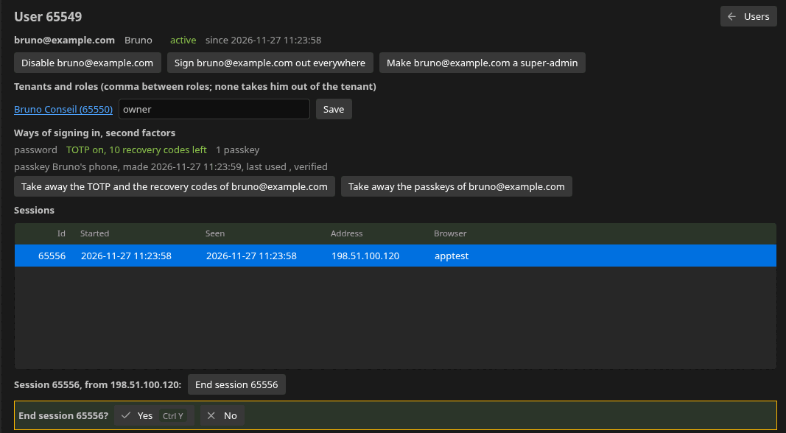
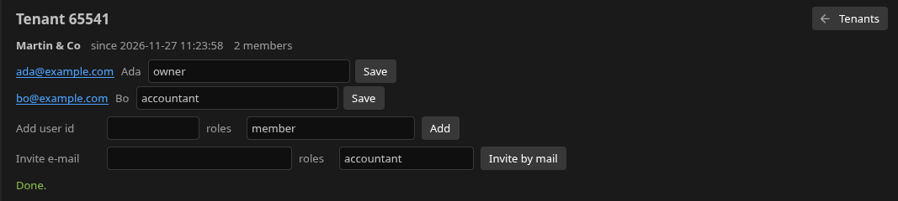

# The administration

A super-admin is a user of the whole platform, above every tenant (`Super` on his account, the role `api.Super`); the
first one is made by a task, `APP_ADMIN_EMAIL=... APP_ADMIN_PASSWORD=... cesia do admin` (`auth.Admin`), the others by
him (`PUT /admin/users/:id/super`). The endpoints below are the contract of the admin pages, in package api
(`src/api/platform.ce`): [the admin pages](admin.md) call them, and any program may. Each change is an
event of the history, and nobody disables himself or takes the role from himself, so the platform keeps one.

| endpoint | what it gives or does |
|---|---|
| `GET /admin/app` | the app: name, version, profile, start, uptime, modules, counts of endpoints and kinds |
| `GET /admin/stats` | users, tenants, sessions, requests, refusals, failed sign-ins of the last minute |
| `GET /admin/settings` | every setting: its variable, its value (`(secret)` for a secret), where it came from (env, code, default) |
| `GET /admin/logs?Level=&Search=` | the last lines of the log of this process, the newest first |
| `GET /admin/metrics` | the metrics of this process, one row a value |
| `GET /admin/endpoints` | every endpoint of the app, by module, with its role and its limit |
| `GET /admin/events?Kind=&Tenant=&User=` | the history: sign-ups, sign-ins and their failures, lockouts, refusals, invitations, roles, users disabled |
| `GET /admin/kinds`, `GET /admin/data/:kind?Tenant=` | the kinds of the database with their fields, and the things of one, by pages |
| `GET /admin/users?Search=&Tenant=`, `GET /admin/users/:id` | the users, newest first; one, with his tenants, roles and sessions, and his `Factors`: TOTP on or not, the recovery codes left, a password or not, his passkeys, the providers he signs in with |
| `DELETE /admin/sessions/:id` | one session ends; the user's others go on |
| `POST /admin/users/:id/factors/reset {Totp, Passkeys}` | his TOTP and recovery codes, his passkeys, taken away when he lost his device; his sessions go on ([passkeys](passkeys.md#6-when-a-device-is-lost)) |
| `POST /admin/users/:id/disable`, `/enable`, `/signout`; `PUT /admin/users/:id/super` | a user out (his sessions end), back, signed out everywhere; a super-admin made or unmade |
| `GET /admin/tenants?Search=`, `GET /admin/tenants/:id` | the tenants; one, with its members |
| `PUT /admin/tenants/:id/members/:user` | the roles of a user in a tenant (none: he leaves it) |
| `POST /admin/tenants/:id/invites {Email, Roles}` | an invitation to a tenant by mail: `202`, a job makes its code and mails its link (`APP_INVITE_PAGE`), so the code is in no answer and no database |
| `GET /admin/keys?Tenant=`, `DELETE /admin/keys/:id` | the keys of programs of every tenant or of one, the newest first, never their secrets; one revoked ([partner API](partner-api.md)) |
| `GET /admin/flags`, `PUT /admin/flags/:name` | the feature flags the code declares, with what was set over them; one set for everyone, a share of the users, a tenant or a user, or cleared (served by `flags.Module`: [flags](flags.md)) |
| `GET /admin/jobs?State=&Kind=`, `POST /admin/jobs/:id/retry`, `POST /admin/jobs/:id/cancel` | the jobs of a state and a kind; a dead one run again; a waiting one made dead (a running one: 409) |
| `PATCH /admin/data/:kind/:id` | fields of a thing changed (`Fields`, a JSON object), each through the shape of its type; a secret one refused |
| the live shows `admin.series`, `admin.events`, `admin.logs` | the points of the dashboard, a second's for 15 minutes and a minute's for 7 days, the events of the last hour as they come, the log of the process as it goes |

`admin.series` is the history of the process, sampled once whatever the pages that watch it: from the start of the app
(from the first page that asks, when `AdminPath` is `off`), a point each second, the last 900 kept, and a point each
minute, the last 10,080, in memory (about 6 MB once full, after 7 days). A page asks the last `Seconds` (0 to 900, 300
unless it says) and the last `Minutes` (0 to 10,080, none unless it says): `{"Show": "admin.series", "Args":
{"Seconds": 900, "Minutes": 10080}}`. It gets them at once, 500 points a frame at most, then each new point, and the
points that leave its window as `Removed`. `Step` tells a second's point (1) from a minute's (60); `At` is the end of
its second or the start of its minute. A minute's point sums its seconds (requests, 5xx, refusals, sign-ins), keeps its
last second's `Failures`, jobs and `Screens`, and its `P50` and `P99` are those of every request of the minute, within
1 % (DDSketch: Masson, Rim and Lee, *PVLDB* 12(12), 2019). The other fields: `Screens`, the live screens open on the
process; `SignedIn` and `FailedSignIns`, the sign-ins that opened a session and those refused.

`GET /admin/events` also takes `Route`, `Since` and `Until` (ISO 8601). `GET /admin/data/:kind` and `GET /admin/kinds`
never give a field that `app.Kind(..., secret = [...])` names: it comes as `(secret)`, and `Secret` marks it among the
fields of its kind; Centauri's own (the hashes of passwords, sessions, invitations and codes, of the keys of programs,
the recovery codes, the tickets of a second step, the ceremonies of passkeys and the flows of providers, the sealed
secrets of TOTP, a webhook's secret) are named so. Each change of `PATCH /admin/data`, `retry` and `cancel` is an
event (`data-edited`, `job-retried`, `job-cancelled`), and so are a session ended (`signout`), factors taken away
(`factors-reset`), an invitation (`invite`), a key revoked (`key-revoked`) and a flag set (`flag`), with the others:
[the admin pages](admin.md) show them as the audit trail.

A user's page in the admin shows `GET /admin/users/:id`, his factors with the buttons of
`POST /admin/users/:id/factors/reset`, and his sessions, one ended by `DELETE /admin/sessions/:id`:



A tenant's page shows `GET /admin/tenants/:id` and sends `POST /admin/tenants/:id/invites`:



```cesia norun hide=code
(* For the check of this page: the packages its code uses, and the names it takes from the invoices of
   examples/invoices, unknown here. *)
use deps/www-celestial/centauri/src/api
use std/json
a = json.Parse("{}")!
made = json.Parse("{}")!
t = json.Parse("{}")!
```

```cesia norun
boss = t.Super()?
users = boss.Call(api.AdminUsers, {Search: "ana"})?
boss.Call(api.AdminDisable, {id: users.Rows[1].Id})?
```

```cesia norun
boss.Call(api.AdminResetFactors, {id: a.User, Totp: true, Passkeys: true})?
boss.Call(api.AdminRevokeKey, {id: made.Id})?
```

A tenant's own admins manage its members and its keys with the endpoints of the accounts (`/auth/members`,
`/auth/invites`, `/auth/keys`), not these. The tests of these endpoints are `tests/people.test.ce`: the keys of every
tenant seen and revoked (`isKeysSeenAndRevokedBySuper`), one session ended and not the others (`isOneSessionEnded`),
a user's factors seen and taken away (`isFactorsShownAndReset`), invitations by mail of a super-admin and of a tenant's
admin, their code in no answer and no database (`isInvitedByMail`, `isTenantAdminInvitingByMail`); and each refuses
who has no session (401) and who isn't a super-admin (403) (`isEveryEndpointForSuperOnly` in `tests/admin.test.ce`).
