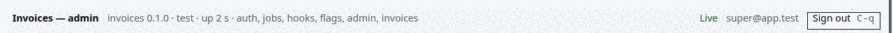
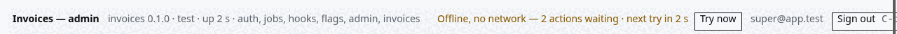
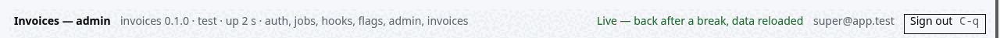

# When the connection drops

The task: an accountant works on the admin pages in a train. The wifi goes for a minute, comes back on 4G with another
address; at the office, the app is deployed again at noon; a proxy cuts the connections that stay quiet. Nothing of
this may show as a broken page: the page says what is going on in one plain line, stays usable, keeps what she does
meanwhile, and carries on when the network is back, **without a reload**. A payment asked during the cut is paid
**once**, not zero times and not twice; the live list misses no change and shows none twice; a change over something
someone else changed meanwhile is shown as a conflict, never written over in silence; an upload cut at 60 % goes on
from there.

What it uses: nothing to write. Every page of Ceres with a live screen gets it, the admin pages among them, and
`live.js` for a page in JavaScript; the app's handlers stay as they are. An app that wants other bounds or delays sets
them, [below](#7-the-settings). What is new for a handler is `app.Unchanged`, for a change that must not overwrite
another, and for a program, `client.Upload` and `client.Download`.

What it does is what Socket.IO calls *connection state recovery*, SignalR *stateful reconnect* and MQTT *persistent
sessions*: a drop of seconds to minutes is invisible. Most frameworks give none of it built in: [the giants](#10-beside-the-others).

```cesia norun hide=code
(* For the check of this page: the packages its code uses, and the names it takes from a page and from the admin
   pages, unknown here. *)
use deps/www-celestial/centauri/src/app
use deps/www-celestial/centauri/src/client
use deps/www-celestial/cepheus/cesia/cepheus
use deps/www-celestial/ceres/src/web
use std/json
use std/list
Note = json.Parse("{}")!
p = json.Parse("{}")!
email = json.Parse("{}")!
password = json.Parse("{}")!
said = json.Parse("{}")!
step = json.Parse("{}")!
signingIn = json.Parse("{}")!
bytes = "%PDF-"
key = "k"
```

## 1. The line that says it

The band of the admin pages shows the state of the page's connection to its app, in words, at its right:



The line is `web.Connection(p)`, a widget of Ceres any page can show; a page in JavaScript gets the same state from
`live.onStatus`. It says, in this order of what matters:

| the line | when |
|---|---|
| Live | connected, nothing waits |
| Live — sending 2 actions… | back, the actions asked meanwhile on their way |
| Live — back after a break, nothing missed | back on the screen the app kept: every change of the break came, once |
| Live — back after a break, data reloaded | back on a new screen (the app restarted, or the break was too long): the lists read again, not the page |
| Offline — 2 actions waiting · next try in 4 s, **Try now** | cut: the actions wait, the page tries again by itself |
| Offline, no network — … | the same, when the browser itself says it has no network |
| Signed out — sign in again, 2 actions kept | the session ended while the page was away: the page asks to sign in, and keeps the actions for after |
| Screen closed: … **Again** | the app refused the screen for another reason |

## 2. The network goes

The wifi goes. The browser says so (its `offline` event): the line turns at once. When the network goes without the
browser knowing (a router gone, a cable pulled, a proxy that keeps the connection open and drops what goes through),
the page sees it by its heartbeat: it pings the app every `PingEvery` seconds (15), and no word from the app for
`DeadAfter` seconds (30) is a break. A *heartbeat* is a small message sent at a steady pace only to prove that the
other side still hears.

The accountant keeps working: she changes the client's name on an invoice and saves, then marks it paid. The page
shows what it showed before (a list asked again keeps its rows until the new ones come), and the two changes wait:



Each action waits **in order**, with an **Idempotency-Key** made when it was asked: a random name of 128 bits that
the app keeps with the action's answer, so that the same action sent again gets the first answer instead of running
again ([the IETF's draft](https://datatracker.ietf.org/doc/draft-ietf-httpapi-idempotency-key-header/)). An action
sent just as the connection broke, whose answer never came, waits too, with its key: it may have run, and its key
makes sure that it runs at most once.

The page tries again after a wait drawn at random between 0 and a bound that doubles at each failure, from
`ReconnectFirst` (500 ms) to `ReconnectMax` (30 s). This is *exponential backoff with full jitter* (Marc Brooker,
"Exponential Backoff And Jitter", AWS Architecture Blog, 2015): when an app restarts, its thousand pages don't all
come back in the same instant, which would knock it over again ([measured](#9-what-it-costs)). It tries at once when
the browser says it is online again, when its tab is shown again, or on **Try now**.

## 3. The network comes back

The page comes back to the screen the app kept for it. A *screen* is the app's side of a page's live connection: its
shows (the lists that follow the database) and its actions. The app keeps a screen whose connection broke for
`ResumeTime` seconds (120): its shows go on following the database, and the frames it would have sent wait, at most
`ResumeBytes` (1 MiB). The page comes back with the screen's token and the number of the last frame it has; the app
sends it every frame after that one, once. *Nothing missed, nothing twice*: the unpaid list shows every invoice paid
meanwhile, and none twice.

Then the two changes go, in order. The payment is made once. The change of the name is refused: Bruno, at another
office, renamed the client meanwhile. The page shows it, with the value seen, the value now and its own, and the two
choices:


**Keep mine** sends the change again over the value now; **Take theirs** drops it. Nothing is written over in silence.

When the app could not keep the screen (it restarted, it was deployed, the page came to another server behind the
balancer, the break lasted more than `ResumeTime`, or more than `ResumeBytes` of frames waited), the page gets a new
screen: its lists are read again, the page is not, and the line says so. The actions waiting are sent there, each with
its key, which runs it once whatever happened before:



## 4. The same account, from any address

A phone that goes from wifi to 4G comes back from another address: the screen is the page's all the same, since the
app checks the account and the shows, not the address (`isResumedFromANewAddress`). The other way round, a token is no
key: the token of another account's screen, or of another list of shows, gets a screen of its own, and the screen of
the token goes on (`isScreenOfAnotherAccountNotResumed`).

The key of an action is the **account's**, not the session's (`APP_IDEMPOTENCY_SCOPE=account`): when the session
ended during the break and the accountant signs in again, a payment whose answer the break lost gets its first answer,
not a second payment (`isKeyOfTheAccountAfterASignInAgain`). The sign-in happens in the page, the actions kept:

```cesia norun
(* in the admin pages: the screen ended with a 401, a sign-in in the page, then the screen comes back *)
done = () -> web.Again(p.Screen)
go = () -> signingIn(email, password, said, step, done = done)
```

And the next person at the same browser never sends the first one's actions: each screen tells its page a tag of its
account (`Who`, a BLAKE2b of the account under the app's keys, which names no one); the page stamps each action with
it, drops those of another account when it comes back signed in as someone else, and the app refuses an action whose
tag isn't its screen's, a 403 (`isScreenOfAnotherAccountNotResumed`).

## 5. A change over a change

The app must refuse a change that was asked over values that changed since, or the last one to arrive wins and the
other is lost. The page sends what it saw, the *base*; the handler checks it with `app.Unchanged`:

```cesia norun
defn edit(r, x)
  (** PUT /notes/:id: a new text, refused when the page saw another one than the note has now. *)
  n = app.Own(Note, r.Params.id, r)?
  seen = app.Unchanged(Note, n.Id, n, r)?
  cepheus.Write(list.Append(cepheus.Add(n.Id, Note.Text, x.Text), seen), r.Db, by = r.User.Id, why = r.Why)?
  {Id: n.Id, Text: x.Text}
end
```

- `app.Unchanged(kind, id, current, r)` reads the base of the request (the header `Centauri-Base`, a JSON object of
  the fields seen; a live action sets it from `web.Act`'s `base`). A field whose value now isn't the one seen is a
  conflict: a 409 whose `conflict` lists each field, `{Field, Base, Now}`, which the page shows.
- Otherwise it gives the `Expect` of each field seen, written **in the same group** as the change: a change that
  lands between the read and the write is refused by Cepheus too.
- Without a base, it gives nothing and the change is made as before: an old page or a program that doesn't send one
  sees no difference.

On the page:

```cesia norun
web.Act("PUT /notes/:id", {id: 7, Text: "oat milk"}, p, base = {Text: "milk"})
```

The data browser of the admin pages sends the values it showed of each field changed, and `PATCH /admin/data/:kind/:id`
checks them: what the screenshot above shows.

## 6. Uploads and downloads that go on

An upload cut at 60 % goes on from the bytes the app holds, with the headers of the
[tus protocol 1.0](https://tus.io/protocols/resumable-upload) on the app's own endpoint (`api.Upload`), nothing to
change in it:

```sh
# the first try, cut: the app keeps the whole parts it stored (UploadPart, 1 MiB each), under the key
curl -X POST 'https://app.example/invoices/7/scan?name=scan.pdf' -H 'Idempotency-Key: 4f1c...' \
  -H 'Upload-Length: 3000000' -H 'Content-Type: application/pdf' --data-binary @scan.pdf
# how much the app holds
curl -I 'https://app.example/invoices/7/scan' -H 'Idempotency-Key: 4f1c...'     # 204, Upload-Offset: 2097152
# the rest, from there; a wrong offset gets a 409 that says the right one
tail -c +2097153 scan.pdf | curl -X POST 'https://app.example/invoices/7/scan' -H 'Idempotency-Key: 4f1c...' \
  -H 'Upload-Offset: 2097152' -H 'Upload-Length: 3000000' -H 'Content-Type: application/pdf' --data-binary @-
```

The first bytes are checked against the declared type when they come (offset 0); the file is made once, whatever the
cuts, and its answer kept with its key: a retry after a lost answer gets the same file, not a second one. In a program
or a page, `client.Upload` does the asking and the resuming:

```cesia norun
use deps/www-celestial/centauri/src/client
got = client.Upload("https://app.example/invoices/7/scan?name=scan.pdf", bytes, "application/pdf", headers = [{Name: "authorization", Value: "Bearer $key"}])?
```

A download has a strong `ETag` and honours `If-Range` (RFC 9110 §13.1.5): a download cut goes on from where it stopped
with `Range`, and if the file changed meanwhile the app sends it whole, never a mix of two versions. Chrome's own
downloads resume this way; `client.Download` reads by parts and checks each against the first's tag.

## 7. The settings

Every choice is a setting; the defaults are those above.

| setting | default | what it is |
|---|---|---|
| `APP_OUTBOX` | `on` | `on`: actions asked while away wait and go when the page is back; `off`: refused at once, as before |
| `APP_OUTBOX_COUNT`, `APP_OUTBOX_BYTES` | 100, 1 MiB | the most actions, and their bytes, that wait in a page; past them the next is refused at once |
| `APP_OUTBOX_WAIT` | 3600 | the seconds an action may wait; past them it fails, saying whether it was ever sent |
| `APP_RECONNECT_FIRST`, `APP_RECONNECT_MAX` | 500, 30000 | the bounds, in milliseconds, of the wait before a new try (full jitter) |
| `APP_PING_EVERY`, `APP_DEAD_AFTER` | 15, 30 | the heartbeat, in seconds, and the silence that is a break |
| `APP_RESUME_TIME`, `APP_RESUME_BYTES` | 120, 1 MiB | how long the app keeps a screen whose connection broke, and its frames (0: never) |
| `APP_IDEMPOTENCY_SCOPE` | `account` | whose a key is: the account's, or the session's (`session`, as before) |
| `APP_IDEMPOTENCY_LEASE` | 0 | after how many seconds a key left running by a server that stopped is let go for a retry; 0 never (a 409 until `APP_IDEMPOTENCY_TIME`) |

The page gets its settings with its screen. `APP_IDEMPOTENCY_LEASE`: a server that stops in the middle of a handler
leaves its key "running", and Centauri can't know whether the handler's writes were made. With 0, the safe default,
a retry gets a 409 until the key is forgotten; a lease lets a retry run again after it, which is safe for a handler
that writes with an `Expect` of what it read, as `invoices.pay` does (the second run finds the invoice paid).

Kept for a later version: the actions kept in the browser's storage, so that they survive a closed tab (hours of work
offline), sealed under a key of the account; today they live in the page's memory.

## 8. The tests

The tests cut the network for real, three ways:

- `tests/drop.test.ce`: the app on a free port, a proxy of `std/net` between the page and the app that the test cuts.
  An action sent again after a break runs once, on the screen the app kept (`Heard`) and on a new one (its key); a
  key after a sign-in again; a key reused for another body (422); another account's token and actions; a new address;
  a change over a change, live and over HTTP; an upload cut at 60 % that sends only the rest (the proxy counts the
  bytes: 1.0 MB in all, not 1.6); a download that never mixes two versions; a key left running.
- Ceres's `tests/drop.test.ce`: the page itself, without a window: offline, an action kept and run once, nothing
  missed; an app that forgot (a new screen, data reloaded); a silent network seen in 2 to 6 s; the outbox bounded; an
  action asked while a page is made, asked once; a conflict and its choices.
- `examples/invoices/tools/drop-shot.ce` (`cesia do drop-shot`): the admin pages in Chrome without a window, the
  network cut by Chrome's offline mode, by a proxy that drops every TCP connection as a change goes, and by a restart
  of the app on the same database. The pictures of this chapter are its own.

## 9. What it costs

Nothing on a request: a request without an `Idempotency-Key` takes the path it took. On a live screen, a frame of
version 2 is numbered and kept until the page says it has it, in a queue whose cost doesn't grow with its length.
Measured by `bench/drop.ce` and `bench/storm.ce`, 21 rounds alternated:

| what | before | now |
|---|---|---|
| a request, Centauri public (`bench/micro.ce`, A/B alternated) | 27.9 µs [22.4, 108.2] | 29.9 µs [23.3, 140.1] |
| a request signed in, a thing by its id | 54.0 µs [40.1, 131.5] | 49.5 µs [41.9, 231.6] |
| a request signed in, a page of 20 things | 176.1 µs [145.3, 992.3] | 179.2 µs [147.5, 360.4] |
| a change of a live screen, to a page that reads them as fast as they come (`bench/drop.ce`, 20,000 a round) | 13.1 µs [8.0, 47.5] (version 1) | 14.9 µs [9.8, 89.2] (version 2) |

Medians of 21 rounds [min, max], on a machine shared with other work (a load of 6 to 8 on 8 cores): the same
`std/http` route in both columns moved by -12 % to +52 % between them, so the requests' differences are noise: a request
pays nothing. A change of a live screen pays about 2 µs for its number and its place in the queue of frames kept.

- **Back online to the actions sent**: 100 actions waiting, the network back (the browser's `online`), every reply
  in 10.6 ms [8.9, 63.4] (21 rounds, a page of Ceres in a program); in Chrome, the admin pages back to *Live* 0.1 to
  0.2 s after the network (the test's own polling is 0.1 s).
- **An action waiting** takes about 2.1 KB of the page's memory (its arguments, its key, its reply): 500 then 4,500
  actions in a fresh process, 5 runs each, 14.0 then 22.5 MB of medians.
- **A storm after a restart** (`bench/storm.ce`): 1,000 pages live on one app, the app gone 3 s, every connection
  dropped. Measured: 4,298 tries in all, at most 302 in one 100 ms, 99 % of the pages back 10.5 s after the cut, all
  after 16.2 s. A model of the same pages: with no jitter all 1,000 come back in the same 100 ms (3,000 tries, back
  after 3.5 s), with the waits of Centauri before (0.25 to 8 s, times 0.5 to 1.5) at most 396 in 100 ms (99 % back
  after 8.5 s). Full jitter takes the most a server must answer at once down by a quarter against before, and by
  more than three times against none, for a few seconds more before the last page is back: Brooker's trade, the less
  work for the server the better when it has just restarted. A page whose own network came back doesn't wait for it:
  it tries at once on `online`.

## 10. Beside the others

| | a drop of seconds | a page's actions during it | live views | uploads |
|---|---|---|---|---|
| Centauri | the screen kept, frames replayed from the last one the page has | kept in order, each with its key: run once | nothing missed, nothing twice; else reloaded, and said | go on from the bytes held |
| Socket.IO 4.6+ | *connection state recovery*, off by default, 2 min: packets replayed from an offset | its emits buffered while disconnected, sent again, no key: may run twice | as its packets | nothing built in |
| SignalR (.NET 8+) | *stateful reconnect*, opt in, up to 100,000 bytes buffered on each side, acked by sequence | buffered as its messages, no key: a server restart loses them | as its messages | nothing built in |
| MQTT | *persistent sessions* (clean start 0), QoS 1 and 2 by packet ids | QoS 1: at least once; QoS 2: exactly once, per broker | as its messages | not its business |
| Firestore | offline persistence | writes queued, applied later, last write wins: no conflict shown | from its cache | Cloud Storage resumable uploads |
| Workbox | Background Sync | failed POSTs queued in IndexedDB, replayed when the browser's Background Sync fires (Chromium), else when the service worker starts again; no key | not its business | not its business |
| Phoenix LiveView | reconnects, remounts the view, recovers its forms | none queued: lost while away | the view mounted again, no replay | `allow_upload`, no resume |
| Spring Boot, Django, Rails | nothing built in | nothing built in | nothing built in | nothing built in |

With Spring Boot, each piece is written by hand: a filter that keeps the `Idempotency-Key`s (a table, a Redis), a
client that retries with the same key, a STOMP broker relay for messages kept, an ETag on each resource:

```java
@Component class IdempotencyFilter extends OncePerRequestFilter {
  @Autowired StringRedisTemplate redis;
  protected void doFilterInternal(HttpServletRequest req, HttpServletResponse res, FilterChain chain) throws IOException, ServletException {
    var key = req.getHeader("Idempotency-Key");
    if (key == null || req.getMethod().equals("GET")) { chain.doFilter(req, res); return; }
    var scoped = "once:" + SecurityContextHolder.getContext().getAuthentication().getName() + ":" + key;
    if (!redis.opsForValue().setIfAbsent(scoped, "running", Duration.ofDays(1))) { res.sendError(409); return; }
    // ... keep the answer, give it again, let the key go on a 5xx, compare the body's hash (422) ...
  }
}
```

and nothing of a page's side: the reconnection, the queue of actions, the line that says it, the resume of a live
view.

Next: [Tell a partner, and take his answers](partner.md).
