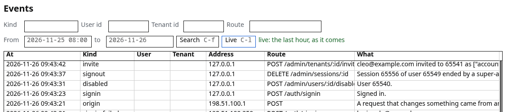

# The unpaid invoices, live

The task: every page that shows the unpaid invoices of an office changes as they change, when an accountant pays one
from another page, another browser or another server of the app; a page that pays from the screen itself goes through
the same door as over HTTP; and a page of another office, of another site, or of a user who signed out, sees nothing.
The code is `src/app/live.ce` (on `std/live` of Cesia), its tests `tests/live.test.ce`; the invoices' list is `unpaid`
in `examples/invoices/src/invoices/month.ce`, checked by `isUnpaidLiveOnEveryPage` on two servers.

What it uses: `api.Live`, `app.Live`, a `cepheus.Watch` written by the server, `std/live` mounted at `/live` with the
session and the rights, the endpoints as actions.

## 1. The contract and the question

```cesia norun hide=code
(* For the check of this page: the packages its code uses, and the names it takes from the invoices of
   examples/invoices, unknown here. *)
use deps/www-celestial/centauri/src/api
use deps/www-celestial/centauri/src/app
use deps/www-celestial/cepheus/cesia/cepheus
use std/json
Invoice = json.Parse("{}")!
InvoiceRow = json.Parse("{}")!
e = json.Parse("{}")!
```

```cesia norun
Unpaid = api.Live("invoices.unpaid", out = InvoiceRow, role = "accountant")

unpaid(s, args) = cepheus.Watch(7, (i, no, b, d, u, st, t) -> {Where: [[i, Invoice.Tenant, s.User.Tenant], [i, Invoice.Number, no],
  [i, Invoice.BillTo, b], [i, Invoice.Date, d], [i, Invoice.Due, u], [i, Invoice.Status, st], cepheus.Not([i, Invoice.Status, "paid"]), [i, Invoice.Total, t]],
  Give: {Id: i, Number: no, BillTo: b, Date: d, Due: u, Status: st, Total: t}}, s.Db, until = s.Ended)

Module = app.Module("invoices", (* ... *) serve = [(* ... *) app.Live(e.Unpaid, unpaid), (* ... *)])
```

The handler gets the screen `s` (`{User, Db, Ended, Settings, Env, Now}`) and the arguments the page asked, read
through the endpoint's shape. It writes the question itself, with the office of `s.User` in it: the page never sends a
question, only the name of a show. `until = s.Ended` ends the watch with the screen.

A page opens its screen with its cookie, from the app's origin, and names its shows (the page's side is `live.js` of
`std/live`, at `/live/live.js`):

```text
ws://app.example/live?shows=[{"Show":"invoices.unpaid","Args":{}}]
```

The first message of a show is its answer, `{Show, Group, Rows}`; each next one a change, `{Show, Group, Added,
Removed}`. When the front's page sends its shows in its hello (the protocol 2 of `std/live`, to come), the same check
reads them there.

```java
// Spring Boot: spring-boot-starter-websocket with STOMP, a @MessageMapping, a SimpMessagingTemplate that each write
// must call, and a broker (RabbitMQ or Redis) between the instances, or each server tells only its own pages
@Transactional public InvoiceOut pay(long id, Principal u) {
  var inv = ...; inv.status = "paid";
  messaging.convertAndSend("/topic/offices/" + u.officeId() + "/unpaid", new Removed(inv.id));   // and if the commit fails?
  return InvoiceOut.of(inv);
}
@Bean MessageBrokerRegistry broker(MessageBrokerRegistry r) { r.enableStompBrokerRelay("/topic").setRelayHost("rabbitmq"); return r; }
```

## 2. No broker: the writes are the events

A show is a `cepheus.Watch`: Cepheus computes its changes from the writes, whichever process of whichever server made
them, and only once their group is on the disk. So there is nothing to send after a write (a write that fails sends
nothing), no broker between the servers, no message lost or doubled when a connection breaks (the watch goes on from
its last group): the test pays an invoice through a second server of the same database, and the first server's page
sees the row go (`isShownAsWritesComeAcrossServers`, `isUnpaidLiveOnEveryPage`).

The admin pages are made so too: their page Events, with Live pressed, is the show `admin.events` on the screen of the
page, the events of the last hour, each new one at the top as it is written, by any server.



## 3. Actions: the endpoints, through the same door

A page's action is an endpoint of the app by its name, `{"Act": "POST /invoices/:id/pay", "Id": 7, "Args": {"id":
65540}}`: Centauri sends it through the same door as an HTTP request of the same page (its session, its limits, its role,
its shapes, its output), and the page gets `{Ack, Ok}` or `{Ack, Err}`, `Err` the same `{Kind: "api", Status, Message,
Fields}` as over HTTP. One definition, one handler, two transports. The parameters of the path come by their names,
the rest is the body (or the query of a GET).

## 4. Rights, and the end of a screen

- The screen's session is read from its cookie at the opening; a page without one gets `Sign in first.` and closes.
- `http.SameOrigin` refuses an opening from another site (a `403`), as Centauri's door does for any request of another
  site that changes something.
- Each show's role is checked, its arguments read through its shape (a `422` with the fields); a show that doesn't
  exist, or more than 64 shows, or more than 16 screens a session, are refused (`isRefusedWithoutRights`).
- A sign-out, a user disabled, a role taken away end the screens of the session at once, whichever server did it (the
  module of the accounts gives a watch of the session's facts, `auth.Ends`); a session that ends by its time ends them
  at its time (`isEndedBySignOut`).
- Another office's rows never come: the office of the user is in the question the server writes.

## 5. What it costs

A write seen by a page on this machine, through the watch, `std/live` and a WebSocket: 0.12 ms [0.11, 0.12] (median
of 20 writes, 21 runs, a fork in the program; `bench/month.ce`). Through a Cepheus server, add its `fsync` and the
delivery of its watch (19 µs, measured by Cepheus).

A break of the page's connection is no end of its screen: the app keeps it two minutes, the page comes back to it and
gets every change of the break, once; past that it gets the answers again. What it takes is in
[When the connection drops](connection.md).

Next: [When the connection drops](connection.md).
