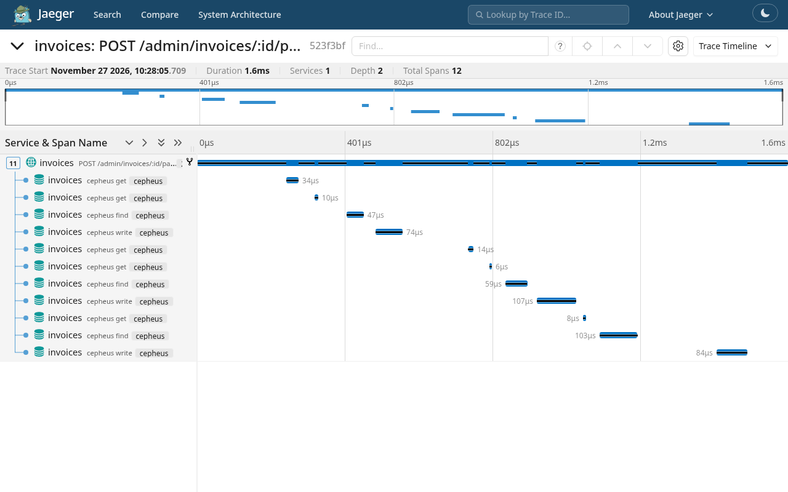

# Telemetry: what the app and its pages tell

The task: the accountant says that marking an invoice paid is slow, once in a while. Find that click, and follow it
through the app to the reads of Cepheus it made, in a viewer of traces; then see what the pages of the app learn of
each visit, their speed, their errors, the devices, what the law lets the app keep without asking, and what it costs.

What it uses: two settings. `APP_OTEL=on` sends the app's **traces**, **metrics** and **logs** to a collector of
[OpenTelemetry](https://opentelemetry.io/), in its own protocol, OTLP over HTTP; `APP_TELEMETRY_CLIENT`, on by default,
lets the pages of Ceres tell their app what they see. Nothing to write in a handler. In Cesia, it is
[std/otel](https://github.com/www-celestial/cesia/blob/main/docs/book/http.md#opentelemetry), which any program can use.

A few words first. A **trace** is the story of one request: a **span** for its whole, and a span for each thing it did
inside, a read of the database, a call to another service, each the *child* of the span it was made in, with its
start, its length and what it was about (its *attributes*). The W3C's header `traceparent` carries a trace from a
browser to a server and from it to the next, so that the spans of every program join one story. A **collector** takes
the spans and keeps or forwards them; a **viewer** shows them on a time line. **OTLP** is OpenTelemetry's protocol
for that, in protobuf (a compact binary form) or in JSON.

## 1. A trace from the click to the database

Jaeger is a viewer of traces with a collector inside, one file to download: no Docker, no database.

```sh
# Jaeger 2.23 for Linux on x86-64, from its releases on GitHub, checked against its sha256 sum
mkdir -p ~/.cache/otel/jaeger && cd ~/.cache/otel/jaeger
curl -LO https://github.com/jaegertracing/jaeger/releases/download/v2.23.0/jaeger-2.23.0-linux-amd64.tar.gz
tar xzf jaeger-2.23.0-linux-amd64.tar.gz && mv jaeger-2.23.0-linux-amd64/jaeger .
./jaeger --config file:config.yaml      # OTLP on 127.0.0.1:4318, its pages on http://127.0.0.1:16686
```

`config.yaml` keeps everything on this machine (Jaeger's own default listens on every address):

```yaml
service:
  extensions: [jaeger_storage, jaeger_query]
  pipelines:
    traces: {receivers: [otlp], processors: [batch], exporters: [jaeger_storage_exporter]}
extensions:
  jaeger_query: {storage: {traces: mem}, http: {endpoint: 127.0.0.1:16686}, grpc: {endpoint: 127.0.0.1:16685}}
  jaeger_storage: {backends: {mem: {memory: {max_traces: 100000}}}}
receivers:
  otlp: {protocols: {http: {endpoint: 127.0.0.1:4318}}}
processors:
  batch:
exporters:
  jaeger_storage_exporter: {trace_storage: mem}
```

Then the invoices, with a month of data, their admin pages and OpenTelemetry on:

```sh
cd examples/invoices
cesia build --target wasm admin/page.ce
cesia do trace-serve
# http://127.0.0.1:8090/admin, super@app.test, "correct horse super"
```

`tools/trace-serve.ce` is the app of `tools/admin-serve.ce` with four settings more:
`APP_OTEL=on`, `APP_OTEL_ENDPOINT=http://127.0.0.1:4318`, `APP_OTEL_EVERY=1` (send each second, for the tutorial) and
`APP_TELEMETRY_EVERY=5`. A real app sets them in its environment:

```sh
export APP_OTEL=on APP_OTEL_ENDPOINT=http://127.0.0.1:4318
```

Open the unpaid invoices and mark one paid. In Jaeger, the service `invoices-browser` holds what the page told: the
click on **Mark paid**, from the press to the answer, 62 ms here. Its span links to the trace of the server that took
the action; the service `invoices` holds that one: `POST /admin/invoices/:id/pay`, and under it each read and write
of Cepheus it made, `cepheus get`, `cepheus find`, `cepheus write`, with their times:



The slow ones are found the same way: in Jaeger, the search by service and *Min Duration*; in the admin pages, the
data of `centauri_client_action` ([section 4](#4-what-the-pages-tell)), each action with its time and both traces.

Why two traces linked, and not one: a `traceparent` that comes from the internet is anybody's, the page's own as well
(anybody can send one). By default (`APP_OTEL_TRUST=restart`) the app starts a trace of its own at its door, which
*links* to the page's; nobody outside can choose its trace, nor make it sampled. A service behind another of its own
sets `APP_OTEL_TRUST=trust`, and the traces join into one.

## 2. What the app sends

| | what | where it comes from |
|---|---|---|
| a span of each request | `GET /notes/:id`: its route, never its path (ids and words in a path would make a name for each request, and may be data), the method, the status, the scheme, the host; `client.address` and `enduser.id` only as [the settings](#5-the-settings) say; a status of 500 or more is an error | the door (`src/app/serve.ce`) |
| a span of each call of Cepheus | `cepheus get`, `cepheus find`, `cepheus write`...: `db.system.name` `cepheus`, `db.operation.name`, and the code of an error | Cesia: every call of a native engine made in a sampled trace |
| a span of each call to another service | `app.Call`: the method, the host and the port (`url.full` without its path nor its query, which may hold a secret: a webhook's address, a signed link), the status; the call carries `traceparent` on | `src/app/call.ce` |
| a trace of each job | `process report`, of kind consumer, linked to the trace of the request that asked for it (kept with the job), sampled when that one was | `src/jobs/jobs.ce` |
| a span of each mail sent | `mail send`: its transport and server, never an address | `src/mail/mail.ce` |
| a live action | the span of its request, child or link of the page's click (the page sends its `traceparent` with the action), and the page learns the server's trace in the answer | `src/app/live.ce`, std/live |
| metrics | std/metrics as they are, `http_*`, `centauri_requests_total`, `centauri_refused_total`, `job_seconds`, `mails_total`, `otel_dropped_total`...: **one source** of numbers, read every `APP_OTEL_METRICS_EVERY` seconds and sent as OTLP (a counter loses its `_total`), the same that `/metrics` gives Prometheus | Cesia's std/metrics |
| logs | every line of std/log, its `trace_id` and `span_id` with it when it was written in a trace (on the standard output too); the `info` lines of a request not sampled stay out, its warnings and errors go | Cesia's std/log |

A request answered with a sampled trace tells the page its trace in a header, `Server-Timing: traceparent;desc="00-…"`,
which a page reads from its navigation (OpenTelemetry's code for browsers reads the same).

**Sampling.** `APP_OTEL_SAMPLE` is the share of new traces kept, 1 by default (every one), as OpenTelemetry's SDKs do:
decided on the trace id, so that every service that samples by the same share keeps the same traces. A trace not
sampled carries its ids on (flags `00`) and makes no span at all: its children are never made. `APP_OTEL_ALWAYS`
(`errors,slow`) keeps all the same the span of a request not sampled that failed, or took more than `APP_OTEL_SLOW`
milliseconds (1,000): its own span alone, since none of its children was made, which costs nothing more.

**The queue.** Spans and lines wait in a queue of `APP_OTEL_QUEUE` (2,048) that never makes a request wait: past it,
they are dropped and counted in `otel_dropped_total`. A fiber sends them by batches of 512, every `APP_OTEL_EVERY`
seconds (5); a collector busy or gone (429, 502, 503, 504, or no answer) is tried again after a pause drawn at random
under a bound that doubles from a second, or the `Retry-After` it asks, five tries, then the batch is dropped, counted.
Each waits encoded as it will leave: a queue full of 2,048 spans takes 1.2 MB of memory with protobuf, 2.3 with JSON
(beside a queue of 16, with a collector that answers nothing).

**One connection.** The exports go on one connection kept open to the collector, as the SDKs of Go and Java keep
theirs (Cesia's `http.Kept`), opened again when the collector closed it. Against a connection each, as at first: an
export of 2 KiB took 87 µs of CPU instead of 131 over http, and 142 instead of 1,399 over https, whose TLS handshake
it no longer pays; 2,350 bytes on the wire instead of 6,328 over https, the same 2.3 KB over http without the
handshakes of TCP (21 rounds of 500 exports alternated, the program pinned to one physical core, the collector and a
proxy that counts the bytes to another, p < 0.001). An https collector: `APP_OTEL_ENDPOINT=https://...`, its authority
in `APP_OTEL_CA` when the system doesn't know it.

## 3. Protobuf or JSON

Measured by `bench/otel.ce`: the same requests to an app with OpenTelemetry off, on with no trace sampled, and on with
every one sampled and sent, the time of sending them counted in the request's (21 rounds of 2,000 requests, the order
alternated; the program pinned to one physical core, the collector, `bench/otel-sink.ce`, to another; a load of 3 to 4
on 8 cores from other work):

| a request of Centauri, in the program | off | on, none sampled | on, sampled, protobuf | on, sampled, JSON |
|---|---|---|---|---|
| public, a JSON of one field (1 span) | 23.1 µs [20.5, 38.3] | 31.3 µs [28.9, 40.2] | 58.7 µs [53.9, 203.2] | 57.1 µs [51.6, 247.4] |
| signed in, a thing by its id (2 spans) | 39.0 µs [36.1, 59.3] | 46.7 µs [44.1, 66.1] | 96.8 µs [90.1, 261.7] | 88.7 µs [82.6, 472.9] |
| signed in, a page of 20 things (2 spans) | 135.3 µs [125.1, 192.0] | 141.8 µs [133.5, 266.5] | 196.2 µs [181.8, 1,254.6] | 183.5 µs [174.3, 687.1] |
| bytes on the wire, a request | | 0 | 210 to 349 | 498 to 860 |

Medians [min, max]; each column differs from off (Mann-Whitney, p < 0.02). Protobuf is the default
(`APP_OTEL_PROTOCOL`): 2.4 times fewer bytes than JSON, for 5 to 10 % more time, which Cesia spends writing protobuf
where it writes JSON natively; JSON is there for a collector that takes only it, or on this machine, where the bytes
cost nothing, to spare those microseconds. `APP_OTEL_COMPRESSION=gzip` (zlib, with the permission `ffi=z`) cuts the
bytes again, for a collector across a network: 6 spans and 3 lines took 1,163 bytes with gzip, 1,853 without.

So a trace sampled costs a request of Centauri 35 to 60 µs, about 20 to 25 µs a span from its start to the collector,
all of it in Cesia; a request not sampled, 7 to 8 µs (its ids, its context, its door's checks). On a real Cepheus over
the network, whose read takes 100 µs to 1 ms, this is a few percent; in memory, as here, it doubles the cheapest
requests: a busy app lowers `APP_OTEL_SAMPLE` and keeps the failed and slow ones with `APP_OTEL_ALWAYS`. With
OpenTelemetry off, a request costs what it did: `bench/micro.ce` against the binaries and the code of before
(Cesia, Centauri and Ceres of 2026-11-27), 42 processes a side alternated, the program pinned to one physical core,
gave 15.79 µs and 15.62 µs for the public request (p 0.26), 29.30 and 28.52 for a thing by its id (p 0.24), 5.05 and
5.19 µs for a route of std/http alone that reads Cepheus (p 0.24): no difference to measure. A first version cost the
cheapest request 1 µs: its tracer and three values more made the app's record 36 fields, and a record of more than 32
is no longer one block, each of its reads 30 ns slower. They live in the state of the process now, and the door opens
a span only with `APP_OTEL` on.

The start pays for some of it, though. `bench/serve.ce` to its first answer, against the binaries and the code of
before, 21 starts alternated on a calm machine (a load of 2), took 68.5 ms [65.3, 140.5] before and 73.8 ms [70.6,
81.4] with the first version of this (p < 0.001), its memory 37.3 MiB then 41.4. The kinds of the pages' telemetry
were 2.2 ms and 3.7 MiB of it: Cepheus declares each field of a kind at every start of an app in memory, about 27 µs and
45 KB a field, and they held 81; they hold 41 now, the rest in `Detail`. Measured again since on a machine loaded by
other work (a load of 8 to 15, where medians wander by tens of ms), the quickest of 41 starts took 65.4 ms before and
69.5 now, the memory 37.9 MiB and 40.9. What is left is the code that came with them (std/otel, the endpoint of the
pages, 25 settings), which Cesia loads with the program, and Cepheus's 41 fields. Most of the memory is what the start
allocates, which the heap keeps for later: OCaml's heap itself holds 0.7 MiB more. None of it would be paid if Cepheus
declared a kind at its first write and Cesia loaded a module at its first call, which neither does yet.

## 4. What the pages tell

A page of Ceres learns what only the browser can tell, and its app keeps it as things of three kinds, which the data
pages of the admin list and filter like any other: **`centauri_client_view`**, one a load of a page, its speed, its
device, its journey; **`centauri_client_action`**, each action from the click to its answer, with the trace of the
click and the server's; **`centauri_client_error`**, each error. Everything is the page's word: marked `Untrusted`,
never used for a decision of the app. Each kind holds as fields what the data pages sort and count by (a view: its
route, its Web Vitals and first paint, its browser, system and place, its errors), and the rest in `Detail`, a JSON
object that the search of the data pages reads too (its journey, the page it came from, its navigation, resources,
frames, WebAssembly, live screen, the rest of the device): 41 fields in all, since Cepheus declares each field at every
start of the app.

![The admin's data pages, the kind centauri_client_view: eight loads of the admin pages, the first one open in its sheet: View, Session, Route /, At 2026-11-27 13:51:52, Lcp and Inp empty (a canvas is no candidate of LCP, and no one typed), Cls 0.039, Fcp 1120.0, Ttfb 25.8, FirstPaint 571.8, Browser HeadlessChrome, Os Linux, Mobile false, no country, city, address nor user (the defaults), Errors 0, Untrusted true, and Detail, its JSON: ActionCount 8, Ref same, the browser's version, its language, its network...](images/telemetry-views.png)

| what | when | why | the law |
|---|---|---|---|
| **speed**: Web Vitals, LCP, INP, CLS, FCP, TTFB, in ms (CLS a score), as the `web-vitals` library of Google counts them | default | what a visitor waits for, by page; Google's thresholds: LCP good under 2.5 s, INP under 200 ms, CLS under 0.1 | audience measurement, "mesure des performances" (CNIL 2020-091 §50) |
| the navigation (its type, its protocol, its bytes), the resources (how many, their bytes, the failed ones, the slowest by its path), the long tasks, the frames of Ceres (first paint, median, p95, longest), the WebAssembly (its fetch, its bytes, its start), the live screen (its first connection, its breaks) | default | where a slow page spends its time; a page of Ceres draws in a canvas, which the browser never counts for LCP: its first paint is its LCP | same |
| **errors**: a Cesia error with its place in the `.ce` and its calls, a trap of WebAssembly, an exception, a rejected promise, a CSP refusal, a file that didn't load; masked | default | what broke, where | "détection de problèmes de navigation" (§50); no text exempts error tracking by itself: it stays within the measure, anonymous, the site's alone |
| **the device**: browser and its major version, system, mobile (the low-entropy client hints only, or the user agent's name and version), screen and window in pixels, density, dark scheme, reduced motion, language, the clock's offset from UTC, cores, memory, network type, round trip, bandwidth, data saver, online | default | for which devices to make the pages fit | same; never more: no canvas, fonts or audio read, no high-entropy hint (EDPB 2/2023 §43: such reads can make a fingerprint) |
| **the journey**: the views by their route, `/invoices/:id`, never their path; the page the visit came from, its origin only; the `utm_*` of the address; the actions by their name (an endpoint of the app, else "(other)"), never their values; the time on the page | default | which pages, from where, what is done | same; no tracking across sites, a session of a tab only |
| a session: a random id of the tab, in its `sessionStorage` | default | the views of one visit together | allowed for the measure; lives as long as the tab |
| **country and city** of the address, from a database of DB-IP | default with `APP_TELEMETRY_GEO_FILE` (`APP_TELEMETRY_GEO`: `city`, `country` or `off`) | where the visitors are | the address used for the city, no finer, then not kept (CNIL, self-assessment tool of July 2025) |
| the address | `APP_TELEMETRY_IP`: `none` (default), `truncated` (the last byte of IPv4 taken away, IPv6 cut to its network /48), `full` | abuse, support | outside the exemption: with `APP_TELEMETRY_CONSENT=ask` (default), only from a visitor who said yes |
| the account and its tenant | `APP_TELEMETRY_USER=on` | to see one user's visits, for support | same |

**The law.** In the EU, reading or storing anything in a visitor's device needs his consent (the ePrivacy directive,
art. 5(3); in France art. 82 of the loi Informatique et Libertés), unless it is strictly needed for the service he
asked for. The EDPB says that JavaScript that sends what it reads of the device is such a reading (Guidelines 2/2023,
v2 of 7 October 2024, §33). The CNIL exempts **audience measurement** from consent on its conditions (délibération
2020-091 §51): for the site alone ("pour le compte exclusif de l'éditeur"), no tracking across sites or apps,
anonymous statistics only, no crossing with other data, nothing given to others; the address used for the city at most,
then cut (its self-assessment tool, July 2025). The defaults above are built on these conditions: first party, the
app's own address, no address nor account kept, a session of a tab, `APP_TELEMETRY_KEEP` days (30, under the 25 months
the CNIL allows). The visitors must still be told, in the app's notice, and be able to object: the page then dispatches
`ceres-consent` with `"off"` (kept in the site's `localStorage`), and the browser's Global Privacy Control is honored
the same way: nothing is measured nor sent. What is outside the exemption, the address and the account, waits for a
yes: the app's banner dispatches `ceres-consent` with `true`, and each batch says it. `APP_TELEMETRY_CONSENT=none`
takes it as given, for an app whose visitors agreed elsewhere (a contract, an intranet): the app answers for it.

```js
// the app's banner, in the page: yes, no, or no measure at all
dispatchEvent(new CustomEvent('ceres-consent', { detail: true }))     // or false, or 'off'
```

**What a page sends.** A batch every `APP_TELEMETRY_EVERY` seconds (30) while something happened, and the last one by
the browser's beacon when the tab is hidden or closes, to `POST /telemetry` of its own app (an app that served that
route before keeps it, and its pages then tell nothing): no other site, so no third
party, no CORS, and the app's limits apply. The page masks its texts (addresses of mail, runs of 6 digits or more,
tokens, the query and fragment of addresses) and the app masks them again; its routes, names of actions and kinds of
errors are checked against those the app knows. With `APP_OTEL` on, the actions are spans and the errors lines of log
of a service of their own, `<app>-browser`.

## 5. The settings

| setting | default | what it is |
|---|---|---|
| `APP_OTEL` | `off` | `on`: traces, metrics and logs to a collector of OTLP |
| `APP_OTEL_ENDPOINT` | `http://127.0.0.1:4318` | the collector, its `/v1/traces`, `/v1/metrics`, `/v1/logs` |
| `APP_OTEL_PROTOCOL` | `protobuf` | or `json` |
| `APP_OTEL_COMPRESSION` | `none` | or `gzip` (zlib: the permission `ffi=z`) |
| `APP_OTEL_HEADERS` | none, a secret | headers of each export, `name=value` with commas, values percent-encoded, as a vendor's key |
| `APP_OTEL_CA` | none | the authority of an https collector that the system doesn't know, a PEM file |
| `APP_OTEL_SAMPLE` | 1 | the share of new traces kept, 0 to 1 |
| `APP_OTEL_ALWAYS`, `APP_OTEL_SLOW` | `errors,slow`, 1000 | keep the span of a request not sampled that failed, or that took more than these milliseconds |
| `APP_OTEL_TRUST` | `restart` | a `traceparent` from outside starts a new trace, linked to it; `trust` goes on with it |
| `APP_OTEL_SIGNALS` | `traces,metrics,logs` | what is sent |
| `APP_OTEL_SERVICE` | the app's name | `service.name`; its version is the app's, `deployment.environment.name` its profile, `service.instance.id` a random id a process |
| `APP_OTEL_QUEUE`, `APP_OTEL_EVERY`, `APP_OTEL_METRICS_EVERY` | 2048, 5, 60 | the spans and lines that wait at most; the seconds between two exports, of spans and of metrics |
| `APP_TELEMETRY_CLIENT` | `on` | the pages tell their app what they see; `off`: they send nothing, and the app keeps nothing |
| `APP_TELEMETRY_SAMPLE` | 1 | the share of the loads of pages that tell |
| `APP_TELEMETRY_EVERY` | 30 | the seconds between two batches of a page |
| `APP_TELEMETRY_CONSENT` | `ask` | the address and the account only from a visitor who said yes; `none`: always |
| `APP_TELEMETRY_IP` | `none` | `truncated` or `full`, in the views and in the spans' `client.address` |
| `APP_TELEMETRY_USER` | `off` | `on`: the account and its tenant, in the views and in the spans' `enduser.id` |
| `APP_TELEMETRY_GEO`, `APP_TELEMETRY_GEO_FILE` | `city`, none | the country and the city, from a database of MMDB, as DB-IP's "IP to City Lite" (CC BY 4.0: the app names DB-IP.com where it shows them) or "IP to Country Lite" |
| `APP_TELEMETRY_KEEP` | 30 | the days a view, an action or an error is kept (1 to 760) |
| `APP_TELEMETRY_MOST` | 6000 | the batches a minute a process takes in all; past them, dropped and counted in `centauri_telemetry_dropped_total` |

The database of DB-IP is read whole at the start: its countries take 8 MB, its cities 127 MB, in each process.

## 6. What the pages pay

The telemetry of a page of Ceres adds 6,672 bytes to it with Brotli: `telemetry.js`, the glue, 3,676 (10,263 plain),
and the code of WebAssembly that keeps the batch, 2,988 (the admin's `page.wasm`, 171,859 bytes with Brotli before,
174,847 now). The libraries of the others, built by their quick start (esbuild, minified, Brotli at 11):


| | Brotli | what it collects by default |
|---|---:|---|
| Centauri's telemetry | 6,672 | the table of [section 4](#4-what-the-pages-tell) |
| web-vitals 6.2.3 alone | 3,009 | the five Web Vitals, nothing else |
| Elastic APM RUM 5.17.5 | 20,933 | page load, route changes, user interactions, errors, fetch and XHR spans |
| Sentry browser 11.19, errors | 28,809 | errors, breadcrumbs, the address and the user's data by default since v11 |
| OpenTelemetry JS for the web (sdk-trace 3.1.1, OTLP over HTTP, document load, fetch, zone.js) | 32,741 | document load and fetch spans; Web Vitals need web-vitals (35,539) |
| Grafana Faro 2.15 | 37,893 | errors, Web Vitals, sessions, views, logs of the console |
| Sentry with tracing | 49,999 | + page loads, navigations, fetch spans, Web Vitals, INP, long tasks |
| Datadog RUM 7.19 | 74,914 (60,792 its first load) | views, actions, resources, errors, long tasks, a sample of replays |

What they cost the page as it loads, in Chrome for Testing 153 without a window, each page loaded 21 times in a new
context, the order alternated, the CPU counted by Chrome (DevTools' `Performance.getMetrics`) two seconds after its
`load`; Chrome pinned to one physical core. A page of only the library and its start, beside a blank page;
Centauri's is the glue as the page's WebAssembly calls it (its own part, the fiber that keeps the batch, runs after
the first paint):

| | JavaScript run | all the page's tasks, over a blank page | memory of JavaScript, over a blank page |
|---|---:|---:|---:|
| Centauri's telemetry | 3.2 ms [2.6, 12.8] | +9.6 ms | +109 KiB |
| web-vitals alone | 4.1 ms [3.7, 24.8] | +15.5 ms | +155 KiB |
| Sentry, errors | 8.0 ms [7.0, 52.2] | +23.7 ms | +496 KiB |
| Elastic APM RUM | 10.5 ms [7.2, 81.0] | +33.2 ms | +626 KiB |
| OpenTelemetry JS for the web | 18.1 ms [15.4, 32.2] | +27.8 ms | +1,258 KiB |
| OpenTelemetry JS with web-vitals | 21.1 ms [17.5, 45.7] | +29.3 ms | +1,432 KiB |
| Grafana Faro | 27.0 ms [24.1, 107.3] | +42.3 ms | +1,645 KiB |
| Datadog RUM | 35.4 ms [29.3, 305.8] | +77.8 ms | +1,259 KiB |
| Sentry with tracing | 43.8 ms [37.5, 198.7] | +59.9 ms | +1,524 KiB |

Medians [min, max], all different from a blank page (Mann-Whitney, p < 0.001). Centauri's and web-vitals' were measured
again together on a quieter machine (a load of 4 against 10 for the others; web-vitals gave the same in both runs,
4.3 ms and 4.1). The first measure of Centauri's glue took 16.9 ms: the name of the time zone, which
`Intl.DateTimeFormat` took 12 ms to give at the first call; the glue sends the clock's offset from UTC instead, which is
coarser too.

Where the others win: Sentry and Datadog read the source maps of minified JavaScript and group errors across releases;
Datadog and Sentry replay a session, which Centauri doesn't (a replay of a page of Ceres would be its draw lists, which
the canvas paints from: a few hundred bytes a frame changed, far less than the DOM recorded by rrweb, but nothing of it
is built); OpenTelemetry JS traces every `fetch` of a page, where a page of Ceres talks to its app by its live screen,
whose actions are traced. Their collectors and their pages are services of their own, with alerts; Centauri sends
OTLP, and any of them that takes OTLP can show it (Grafana, Datadog, Honeycomb, Elastic, Jaeger, SigNoz).

## 7. Beside the others

Spring Boot sends traces with Micrometer Tracing and its bridge to OpenTelemetry, or with OpenTelemetry's agent for
Java, which rewrites the classes as they load; Django with `opentelemetry-instrument`, Node with
`@opentelemetry/auto-instrumentations-node`, Go by wrapping each handler and client with `otelhttp` and each database
with its own wrapper:

```java
// Spring Boot: spring-boot-starter-actuator, micrometer-tracing-bridge-otel, opentelemetry-exporter-otlp, and
// management.tracing.sampling.probability=1.0, management.otlp.tracing.endpoint=http://localhost:4318/v1/traces
```

Centauri needs no agent, no wrapper and no dependency: its door, its calls, its jobs and Cesia's engines are traced
where they are. What it costs beside them, on the same tiny app (`GET /hello` answering a JSON of one field, one span a
request, every one sampled and sent by OTLP over HTTP in protobuf to a collector that takes and drops), in Cesia with
std/otel, in Go 1.26 with OpenTelemetry's SDK and `otelhttp`, and in Spring Boot 4.2 on Java 21 with OpenTelemetry's
agent: 21 rounds, off and on alternated, 16 connections kept open, the server pinned to one physical core, the load
and the collector to another, on a machine shared with other work (a load of 4.5 to 36, 18.7 in the median: the
requests a second moved by a factor of ten from round to round, so the time of processor a request is the measure to
read):

| a request of `/hello` | off | on | OpenTelemetry costs | bytes a span on the wire |
|---|---:|---:|---:|---:|
| Cesia, std/otel | 71.6 µs [47.7, 102.6] | 147.9 µs [94.9, 185.8] | +76 µs | 173 |
| Go 1.26, OpenTelemetry's SDK 1.47 and `otelhttp` 0.72 | 41.1 µs [26.3, 68.0] | 125.4 µs [81.1, 186.8] | +84 µs | 430 |
| Spring Boot 4.2 and OpenTelemetry's agent 2.34 for Java | 309.4 µs [58.2, 810.9] | 734.7 µs [270.0, 1,266.9] | +425 µs | 491 |

The time of processor of the server a request, medians [min, max]; each "on" differs from its "off" (Mann-Whitney,
p < 0.001). OpenTelemetry costs a request of Cesia what it costs one of Go, and a fifth of what the agent for Java
costs; a span of Cesia takes 2.5 times fewer bytes, since it names what it must (the route, the method, the status,
the scheme, the host) and not more (Go and Java add the client's address and port, the user agent, the protocol, the
peer's details). Where Go wins: its request without OpenTelemetry is cheaper (41 against 72 µs: Cesia's interpreted
code against Go's compiled one), its memory is a fourth of Cesia's (15.7 MiB against 65.5 for two processes), and its
SDK writes protobuf in compiled code, where Cesia writes it in Cesia. Java's agent instruments everything it finds,
with nothing to write, at the price of 90 MiB more memory under load. To the first answer, 21 starts each: Cesia 12.7 ms
off, 11.9 on (27.8 and 28.9 MiB), Go 4.2 and 5.5 ms (7.9 and 16.2 MiB), Java 3.5 s and 10.8 s (158 and 308 MiB).

## 8. The tests

`tests/otel.test.ce`: a request traced with its reads of Cepheus, never its path in a name, the page told its trace
(`isRequestTracedWithItsReads`); a call that carries the trace on, a job in a trace of its own linked to its request's
(`isCallAndJobInTheTrace`); a `traceparent` from outside restarted with a link, or trusted
(`isTraceparentFromOutsideRestarted`);
the client's address and account only as said (`isClientNamedOnlyAsTheSettingsSay`); a request not sampled that leaves
nothing but its failure (`isNotSampledLeavingNothing`); a line of log in its trace (`isLogLineInItsTrace`); wrong
settings named (`isOtelSettingChecked`); off by default (`isOffByDefaultAndCostsNothing`).
`tests/telemetry.test.ce`: a batch kept as a view, its actions and its errors (`isBatchKeptAsAView`); what a page says,
masked (`isWhatAPageSaysMasked`); markup kept as text (`isMarkupKeptAsText`); a flood bounded (`isFloodBounded`);
another session's view untouched (`isViewOfAnotherSessionUntouched`); the visitor named only as said and asked
(`isVisitorNamedOnlyAsSaidAndAsked`); off keeps nothing (`isOffKeepingNothing`); its days only (`isKeptItsDaysOnly`);
the views added up (`isLastBatchEndingTheView`); sent on to OpenTelemetry (`isForwardedToOpenTelemetry`); a database of
countries, the address kept nowhere (`isPlacedByTheDatabaseOnly`). Cesia's `tests/net/otel.ce` checks std/otel against a
collector: the queue, a dead collector, a collector that asks to wait, the series of a metric bounded.

What it doesn't do yet: a session replay; the source maps of the minified JavaScript of an app (Ceres's own code is
Cesia, whose errors name their `.ce` line already); the spans of a page's own `fetch` calls (a page of Ceres talks to
its app by its live screen, whose actions are traced); charts of it in the admin's dashboard, which lists the views,
actions and errors as data for now: the 75th percentile of LCP, INP and CLS by route and by day, against Google's
thresholds; the errors by kind and by route; the slowest actions by name, each with its two traces; the browsers, the
systems and the countries of the visits; the time to the live screen and its breaks; the spans sent and dropped. The
reads of Cepheus in this chapter take microseconds, a database in memory; on a Cepheus server they show the network
too.
