# Les pages d'administration

La tâche : ceux qui font tourner la plateforme la voient et agissent sur elle depuis un navigateur, comme le permet
l'admin de Django, avec en plus ce dont une plateforme a besoin. Un tableau de bord des dernières minutes : les
requêtes, les échecs, la durée d'une requête, les refus et les signes de bots (un bot : un programme qui se fait passer
pour un visiteur), les jobs (un job : un travail fait en arrière-plan, hors de la requête). Les utilisateurs, les
tenants (un tenant : un client de la plateforme, comme un cabinet ou une entreprise, avec ses données à lui) et leurs
rôles, changés sur place. Les événements et le log (le journal que tient le processus, une ligne par fait), à mesure
qu'ils arrivent. Les jobs et les webhooks (un webhook : un appel HTTP que l'app envoie à un partenaire quand quelque
chose arrive) relancés. Les fichiers, les réglages, les données de chaque kind (une sorte de chose dans la base de
données, comme les factures ou les clients), changées à travers leurs vérifications. La trace de ce que les admins ont
changé, les clés de programme (un secret qu'un programme envoie à la place de la session d'une personne) et les feature
flags (un feature flag : un interrupteur qui ouvre une fonction à tous, à une part des utilisateurs, à un tenant ou à
un utilisateur). Et les seconds facteurs d'un utilisateur, retirés quand il a perdu son appareil. L'app (l'application,
le serveur et ses pages) ajoute ses propres pages, colonnes et actions en quelques lignes. Les pages parlent anglais ou
français : la langue que le serveur parle au super-admin (l'administrateur de toute la plateforme, au-dessus des
tenants).
Le code est `src/admin/admin.ce` (le module) et `src/admin/pages/` (les pages) ; les tests sont `tests/admin.test.ce`
et, dans un navigateur, `examples/invoices/tools/admin-shot.sh`. Les images de ce chapitre sont les pages des factures
remplies d'un mois, prises par `tools/shots.sh` (les mêmes étapes, jouées par Chrome sans fenêtre).

Ce qu'il utilise : des pages de [Ceres](https://www-celestial.github.io/ceres/) écrites en Cesia et compilées en
WebAssembly (le code compilé que le navigateur exécute ; `cesia build --target wasm`), les endpoints (un endpoint : une
adresse de l'API avec sa méthode HTTP, comme `POST /clients`) du rôle super de [l'administration](administration.md),
l'écran en direct du [chapitre 9](live.md), et rien d'autre : aucune nouvelle voie d'entrée dans l'app.

## 1. Le monter

```cesia norun hide=code
(* For the check of this page: the packages its code uses, and the names it takes from the invoices of
   examples/invoices, unknown here. *)
use deps/www-celestial/centauri/src/api
use deps/www-celestial/centauri/src/app
use deps/www-celestial/centauri/src/apptest
use deps/www-celestial/centauri/src/auth
use deps/www-celestial/centauri/src/hooks
use deps/www-celestial/centauri/src/i18n
use deps/www-celestial/centauri/src/jobs
use deps/www-celestial/cepheus/cesia/cepheus
use std/bug
use std/check
use std/dict
use std/result
use std/text
use std/value
use std/json
Invoice = json.Parse("{}")!
Module = json.Parse("{}")!
Report = json.Parse("{}")!
Statuses = json.Parse("{}")!
byOffice = json.Parse("{}")!
e = json.Parse("{}")!
paying = json.Parse("{}")!
words = json.Parse("{}")!
```

```cesia norun
(* src/invoices/module.ce *)
use deps/www-celestial/centauri/src/admin

App = app.Of([auth.Module(), jobs.Module(every = [Report]), hooks.Module(), admin.Module(folder = "admin"), Module], name = "invoices", (* ... *))
```

```cesia norun
(* admin/page.ce: the app's entry of its admin pages *)
use deps/www-celestial/centauri/src/admin/pages

pages.Run(title = "Invoices — admin")
```

```sh
cesia build --target wasm admin/page.ce     # admin/page.wasm, its loader page.js, the glue ceres.js and admin.js
brotli -k -q 11 admin/page.wasm admin/*.js  # optional: the browser then gets 144 KB in all
APP_ADMIN_EMAIL=ana@example.com APP_ADMIN_PASSWORD=... cesia do admin   # the first super-admin
```

Le module sert le dossier à l'adresse du réglage `APP_ADMIN_PATH`, `/admin` par défaut (`off` ne sert aucune page ; les
endpoints restent, pour les programmes), avec la page qui le charge. `index.html` ne contient aucun script à lui, aucune
donnée et aucun secret : la Content-Security-Policy de chaque réponse (un header, une ligne d'en-tête de la réponse
HTTP, qui dit au navigateur quels scripts il peut exécuter : `script-src 'self' 'wasm-unsafe-eval'`) vaut donc pour elle
aussi. Les fichiers sont lus une fois au démarrage et gardés en mémoire, chacun avec son ETag (une empreinte du fichier,
que le navigateur renvoie pour savoir s'il a changé) : une seconde visite coûte un `304` par fichier. Un fichier
`name.br` posé à côté va à un navigateur qui accepte brotli (un format de compression). Ils passent par la même porte
(ce que Centauri vérifie à l'entrée de chaque requête) que toute requête : la limite de l'adresse, les headers de
sécurité, le log.

Les pages se connectent par HTTP (`POST /auth/signin`). La session (le temps où un utilisateur reste connecté) est un
cookie (un petit texte que le navigateur garde et renvoie à chaque requête) qu'aucun script ne lit. Un compte qui n'est
pas celui d'un super-admin est déconnecté tout de suite, et on le lui dit. Quand l'app demande un second facteur (le
TOTP du super-admin est activé, ou `APP_TWO_FACTOR_ROLES` nomme `super`), la connexion montre sa seconde étape : un
champ pour le code de son app ou un code de secours, envoyé à `POST /auth/second`. TOTP est le code à six chiffres d'une
app d'authentification, qui change toutes les 30 secondes. S'il n'en a pas encore, elle montre d'abord le secret à
taper dans son app, son adresse `otpauth://` et ses codes de secours, montrés cette fois-là seulement
(`POST /auth/second/setup`). Un mauvais code montre son problème ; une étape terminée ramène au mot de passe
([passkeys](passkeys.md#5-la-seconde-étape-dune-connexion)). Puis elles ouvrent l'écran en direct (`/live`). Il relit
la session, vérifie le rôle `super` de chaque show (une liste en direct qu'une page demande par son nom), et fait passer
chaque action, un endpoint appelé par son nom, par la même porte que par HTTP : la session, le rôle, les limites de
l'utilisateur, les formes (ce qu'une valeur doit être : un texte de 1 à 120 octets, un nombre entier...), le log, les
métriques. Une page dans le navigateur n'a jamais la confiance du serveur : elle ne contient rien que le serveur ne
donnerait à n'importe quel programme qui a le même cookie.


Avec un second facteur activé, un bon mot de passe ouvre la seconde étape : le champ du code de son app, et Envoyer.

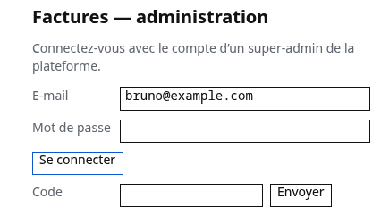

```python
# Django: the admin is an app of the project, its pages made on the server from the models
INSTALLED_APPS = ["django.contrib.admin", "django.contrib.auth", "django.contrib.contenttypes", "django.contrib.sessions", ...]
urlpatterns = [path("admin/", admin.site.urls)]
# python manage.py createsuperuser
```

## 2. Les pages

Sur le web, l'administration est disposée comme les pages d'un site (le `web.Shell` de Ceres, le chapitre Pages of a
web app de son livre) : l'app et ses pages dans une barre latérale (*side bar*) à gauche, rangées par sujet (Données,
Personnes, Activité, Réglages), avec leurs compteurs et les jobs en échec ; l'endroit où l'on est en haut, avec la
palette de Ctrl+K qui trouve une page ou un kind par son nom, le bouton de la densité des lignes et celui du thème ; la
page au milieu, qui défile ; une chose ouverte dans un panneau à droite (la *sheet*), à côté de la page sur une fenêtre
large, par-dessus sur une plus étroite, toute la fenêtre sur un téléphone, où la barre latérale devient un tiroir
(*drawer*). Qui est connecté et Se déconnecter (Ctrl+Q) sont au pied de la barre latérale. Les mêmes pages disposées
comme un outil de bureau, des panneaux ancrés avec des onglets (*dock*), sont à un choix près dans les réglages.

| page | ce qu'elle montre | ce qu'elle fait, par quel endpoint |
|---|---|---|
| Tableau de bord | un tableau de bord qui surveille la plateforme en direct : une bande de son état (la connexion, les requêtes de la dernière minute, le p50 et le p99 de la durée d'une requête — la durée sous laquelle passent la moitié, et 99 %, des requêtes —, les erreurs, les jobs en échec, les sessions, le CPU et la mémoire du processus, le disque du dossier d'`AdminDisk` quand il est
réglé, depuis quand l'app tourne) ; six graphiques qui partagent un réticule (*crosshair*, la ligne qui suit la souris), sur 15 minutes, une heure, un jour ou une semaine : les requêtes, la durée d'une requête, les erreurs 5xx (les réponses d'erreur du serveur), les refus à la porte par raison (un autre site, une limite, pas de session, un rôle), les connexions échouées, les jobs prêts, en cours et morts ; le log à mesure qu'il s'écrit, par niveau, avec une pause ; les premiers pas d'une app neuve | l'historique `GET /admin/series` (en colonnes, lu une fois par plage), le show `admin.series` (chaque seconde après lui, à partir des métriques et du log du processus), `admin.logs`, `GET /admin/stats`, `GET /admin/app` |
| Utilisateurs | 50 par page, filtrés par le début de leur e-mail ou par un tenant, triés d'un clic sur un titre | désactiver, activer, déconnecter partout, faire ou défaire un super-admin, chaque action confirmée d'abord (`POST /admin/users/:id/disable`...) |
| Un utilisateur | son compte, ses tenants avec ses rôles, chacun dans un champ ; ses moyens de connexion et ses seconds facteurs : un mot de passe ou non, TOTP et les codes de secours restants, chaque passkey (une clé d'accès gardée par l'appareil, qui remplace le mot de passe) avec sa date de création, son dernier usage et si son appareil l'a vérifié, les fournisseurs (providers), comme Google ; ses sessions | les rôles enregistrés sur place (`PUT /admin/tenants/:id/members/:user`) ; son TOTP et ses codes de secours, ou ses passkeys, retirés quand il a perdu son appareil (`POST /admin/users/:id/factors/reset`) ; une session choisie dans le tableau terminée seule (`DELETE /admin/sessions/:id`) ; chaque action confirmée d'abord |
| Tenants, un tenant | filtrés par le début de leur nom ; ses membres et leurs rôles | les rôles sur place, un utilisateur ajouté par son id avec des rôles ; quelqu'un invité par mail avec des rôles (`POST /admin/tenants/:id/invites`) |
| Événements | par type, utilisateur, tenant, route (un endpoint et la fonction qui y répond) et une plage de temps à l'heure de celui qui regarde, page après page ; ou en direct, la dernière heure à mesure qu'elle s'écrit | `GET /admin/events`, le show `admin.events` |
| Log | les lignes que ce processus garde, par niveau et par un texte ; ou en direct | `GET /admin/logs`, le show `admin.logs` |
| Jobs | par état et par type | un job mort relancé, un job en attente annulé (`POST /admin/jobs/:id/retry`, `/cancel`) |
| Webhooks | leurs envois (les jobs `centauri.hook`) et leurs endpoints, dont les secrets ne sont jamais envoyés | un envoi relancé |
| Fichiers | chaque kind de `app.Files` et ses choses (*things* dans le code) | |
| Réglages | chaque réglage, sa variable, sa valeur, d'où elle vient (env, le code de l'app, le défaut de Centauri) ; un secret est `(secret)`, masqué par le serveur | |
| Données | chaque kind de `app.Kind` ; les choses de l'un d'eux, 50 par page (Tout les lit toutes, 200 000 au plus) ; celle qui est choisie, avec tous ses champs | ses champs changés sur place (`PATCH /admin/data/:kind/:id`), les actions de l'app |
| Audit | ce que les super-admins ont changé : qui, quand, d'où, par quelle route, quoi | |
| Clés | les clés de programme, 50 par page, d'un tenant par son id ou de tous : leur tenant, leur nom, leurs rôles, leur création, leur fin, leur dernier usage ; jamais un secret | une clé choisie révoquée, après confirmation (`DELETE /admin/keys/:id`) |
| Flags | chaque feature flag que le code déclare : son nom, ce à quoi il sert, son état en mots, ce qui est réglé pour des tenants et des utilisateurs | activé ou désactivé pour tous, activé pour une part des utilisateurs, revenu au défaut, activé, désactivé ou effacé pour un tenant ou un utilisateur par son id (`PUT /admin/flags/:name`) |

Chaque heure est montrée à l'heure de celui qui regarde (une date, que Cepheus garde à 00:00 UTC, reste ce jour-là).
Chaque problème est montré avec son statut, son message, les champs qui sont faux et le numéro de sa requête à citer
(`urn:request:...`), plus les secondes à attendre sur un 429 (le code « trop de requêtes »). Chaque liste est un tableau
de Ceres : seules les lignes visibles sont dessinées, donc 100 000 lignes défilent comme 50 (Vitesse).

Chaque tâche, telle que la page la montre :

**Voir la plateforme.** Le Tableau de bord : la bande de son état en haut, puis six graphiques de ce processus, un
point par seconde sur les 15 dernières minutes (une minute par point sur les plus longues périodes, telles que le
serveur les garde) ; la souris sur l'un montre le même moment dans tous, chacun avec son nombre à ce moment. Le log
défile dessous, la ligne la plus récente d'abord : Tout, Avertissements ou Erreurs, et Pause garde les lignes en vue
le temps de les lire.

![L'administration, en sombre : la barre latérale des pages (Tableau de bord choisi ; les kinds sous Données ; Utilisateurs 7 et Tenants 5 sous Personnes ; Jobs avec « 1 en échec » en rouge sous Activité ; les réglages ; la page de l'app, Impayées), la barre du haut avec le chemin et les boutons de recherche, de densité et de thème, et le tableau de bord : la bande Direct, requêtes/min, p50 et p99, erreurs, « 1 tâche en échec », sessions, « en marche depuis » ; six graphiques ; le journal en direct.](images/admin-dashboard.png)

**Désactiver un utilisateur.** Utilisateurs, un clic sur sa ligne, puis Désactiver : la page demande d'abord, Oui le
fait, et le tableau est relu. Activer, Déconnecter … partout et Faire de … un super-admin marchent de la même façon.


**Un utilisateur a perdu son téléphone ; terminer une de ses sessions.** Utilisateurs, sa ligne, Ouvrir : ses tenants
et ses rôles, ses moyens de connexion (mot de passe, TOTP et les codes de secours restants, chaque passkey), « Retirer
le TOTP et les codes de secours de … » ou « Retirer les passkeys de … » ; en dessous, ses sessions : un clic sur l'une
d'elles, « Terminer la session … », Oui.


**Inviter quelqu'un dans un tenant.** Tenants, sa ligne, Ouvrir : ses membres et leurs rôles ; tapez l'e-mail et les
rôles, puis Inviter par mail. L'invitation part par mail ; son code n'est jamais montré.

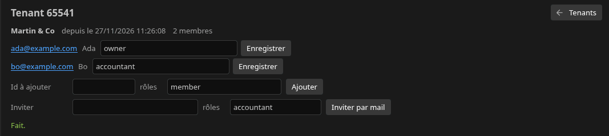

**Trouver ce qui s'est passé.** Événements : un type, un utilisateur, un tenant, une route, une plage de temps, puis
Chercher ; ou Direct, la dernière heure à mesure qu'elle s'écrit. Le Log fait de même pour les lignes de ce processus.

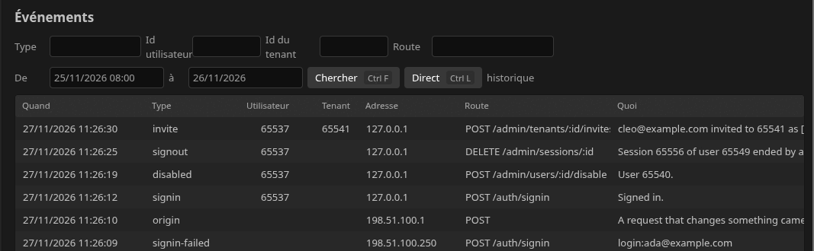

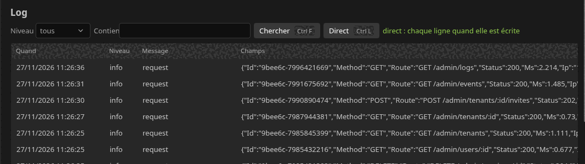

**Relancer un job.** Jobs montre d'abord les jobs morts : un clic sur l'un d'eux, « Relancer le job … », Oui. Un job en
attente s'annule de la même façon. Webhooks montre les envois (les jobs `centauri.hook`), relancés de la même façon, et
leurs endpoints.

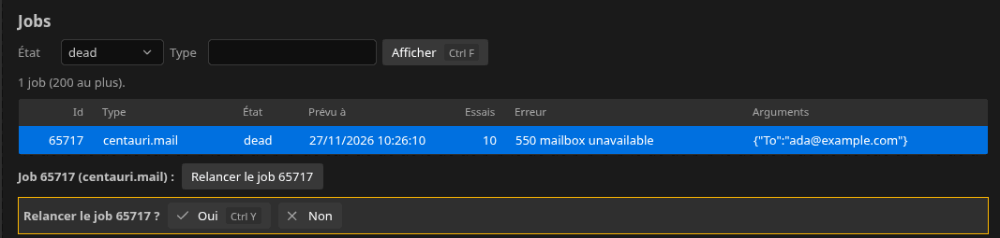

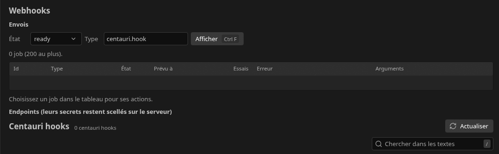

**Voir les fichiers et les réglages.** Fichiers liste chaque kind de fichiers et ses choses ; Réglages, chaque réglage,
sa variable, sa valeur (un secret est `(secret)`) et d'où il vient.

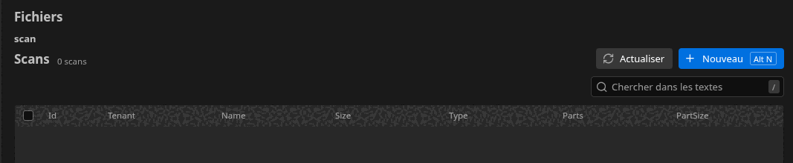

**Trouver des choses.** Un kind dans la barre latérale (son nom avec une majuscule et au pluriel, comme Clients, avec
son nombre) : sa page dit combien il en a, des pastilles (*chips*) des valeurs d'un champ qui en a peu (son Statut ou
son État d'abord, comme Tout 30, Impayées 20, Payées 10) avec leurs nombres, et une recherche dans ses textes, que la
touche / atteint de partout. Un lien montre le titre de la chose qu'il nomme (son premier texte), son id seulement à
côté, en gris ; un montant ses deux décimales, ses milliers séparés comme la langue les écrit (1,280.50 €, 1 280,50 €).

**Changer une chose sur place.** Un clic sur la chose : elle s'ouvre dans le panneau de droite, à sa propre adresse
(`/admin/#/data/invoice/65616`), chaque champ avec son nom au-dessus de sa case ; un lien avec le titre de la chose
qu'il nomme, un lien vers sa page ; les actions de l'app sur elle ; dessous, son activité, qui a changé quoi et quand,
tirée de l'historique que garde la base. Changez un champ, puis Enregistrer (Ctrl+S). Une valeur du mauvais type est
refusée avec son champ, et le changement est dans l'Audit. Les champs qu'une app garde pour elle sont laissés de côté :
un champ nommé Search (la copie repliée de sa recherche) et ceux qu'une règle donne ; `pages.Kind(fields = [...])` nomme
plutôt ceux que le panneau montre.

**Créer, agir sur plusieurs, supprimer.** Nouveau (Alt+N) ouvre un panneau vide (`/admin/#/data/invoice/new`) pour un
kind de l'app ; Enregistrer la crée et l'ouvre à son adresse. Une case devant chaque ligne la coche, celle de l'en-tête
toutes celles montrées ; la bande qui vient dit combien sont cochées et porte les actions du kind (pages.Action) et
Supprimer, chacune confirmée d'abord. Supprimer est aussi au pied du panneau ; les règles de la base peuvent le
refuser, et disent pourquoi. `pages.Kind(create = false)` laisse les choses d'un kind créées par l'app seulement.

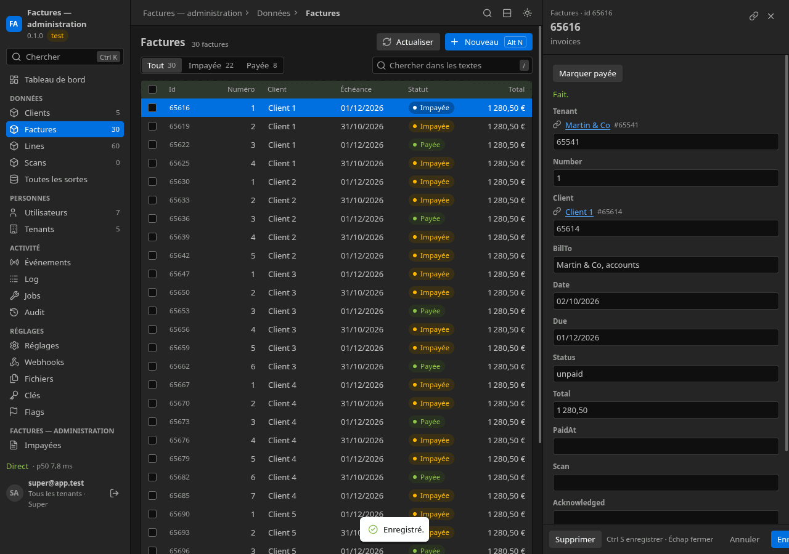

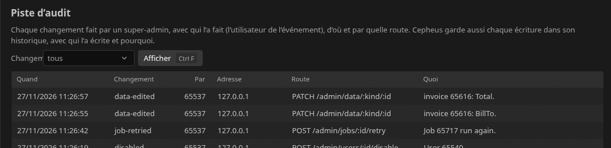

**Révoquer une clé de programme.** Clés, sa ligne, « Révoquer la clé … », Oui : la clé est refusée à sa requête
suivante.

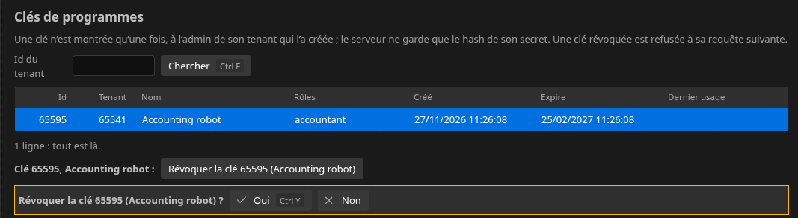

**Activer une fonction.** Flags : chaque flag avec ce à quoi il sert et son état ; Activer pour tous, une part, ou un
tenant ou un utilisateur par son id.

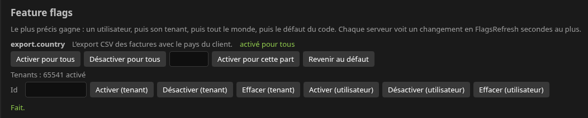

Les champs d'une chose sont changés à travers la forme de leur type dans Cepheus (un texte, un nombre entier, un
nombre, un montant à son échelle, vrai ou faux, un jour ou un instant, un lien), et chaque champ faux est nommé.
Cepheus vérifie ensuite ses valeurs uniques et ses règles, et garde dans son historique qui l'a changée et pourquoi. Un
champ que `app.Kind` dit secret, comme le hash d'un mot de passe (une empreinte : un nombre calculé à partir d'un texte,
d'où on ne peut pas revenir au texte) ou le secret d'un webhook, n'est jamais envoyé à une page : il est montré
`(secret)`, et jamais changé. Chaque changement est un événement, `data-edited`, qui nomme les champs et jamais leurs
valeurs.

**Chaque page à son adresse.** Les pages sont celles d'un site web : chacune a son adresse, celle de l'administration
suivie de la page après un `#` (`/admin/#/users`, `/admin/#/data/invoice`), et une chose ouverte aussi
(`/admin/#/data/invoice/65616`). Précédent et Suivant du navigateur parcourent les pages visitées, une adresse gardée ou
envoyée ouvre sa page (après la connexion, quand la session n'est plus là), et une ligne de la barre latérale pressée
avec Ctrl ou le bouton du milieu ouvre sa page dans un nouvel onglet. Une liste retrouvée a son tri et son défilement
d'avant, même après avoir ouvert puis fermé une chose. Une chose changée dans le panneau et pas enregistrée retient le
chemin vers une autre page : le panneau demande d'abord, sous son titre, Continuer (Échap), Abandonner les changements
(Ctrl+D) ou Enregistrer et partir (Ctrl+S), et fermer l'onglet demande aussi.

**L'apparence, sur cette machine.** Réglages, Apparence : le thème (Système suit l'appareil, Clair, Sombre), la densité
des lignes (24, 30 ou 44 pixels ; le bouton des lignes de la barre du haut en fait le tour aussi), la disposition sur le
web (Pages, ou Dock : des panneaux comme une app de bureau, l'arborescence à gauche, les détails à droite, les
événements, le log et les jobs en bas) et les onglets (Oui garde les pages ouvertes en onglets sous la barre du haut,
comme dans un éditeur ; Non laisse cela aux onglets du navigateur). Chaque choix s'applique tout de suite et reste sur
cette machine ; le réglage `AdminTheme` du serveur donne le thème d'une machine qui n'en a choisi aucun.

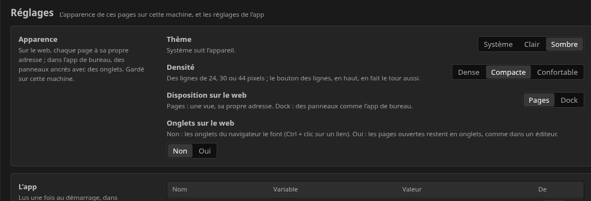

## 3. Votre propre page d'administration : les factures de tous les cabinets

Le support de la plateforme veut les factures impayées de tous les cabinets, leur somme par cabinet, et pouvoir en
marquer une payée quand un client paie par téléphone. Deux endpoints du rôle super sur le serveur, et une page dans
l'entrée des pages d'administration :

```cesia norun
(* src/invoices/endpoints/endpoints.ce *)
AdminRow = check.Record({Id: check.Id(), Tenant: check.Id(), Number: check.Int(1), BillTo: check.Text(), Due: check.Date(),
  Status: check.OneOf(Statuses), Total: check.Money(2, 0, 1e15)})
AdminInvoices = api.Get("/admin/invoices", query = check.Record({Status: check.OneOf(["unpaid", "paid"], optional = true, default = "unpaid")}),
  out = api.Page(AdminRow, 50), role = api.Super, about = "The invoices of every office.")
AdminPay = api.Post("/admin/invoices/:id/pay", role = api.Super, about = "Marks an invoice paid, for the support.")
```

```cesia norun
(* src/invoices/invoices.ce: an invoice of any office paid by the support, as its office would pay it *)
defn adminPaying(r)
  id = app.IdOf(r.Params.id)
  inv = if value.IsMissing(id) missing else cepheus.Get(Invoice, id, r.Db)? end
  if value.IsMissing(inv) or value.IsMissing(inv.Tenant)
    return app.Missing()
  end
  office = r
  office.User = dict.Put("Tenant", inv.Tenant, r.User)
  office.Params = {id: "$id"}
  paying(office)?   (* the payment of chapter 3: once, its partner told in the same group *)
  result.Ok(missing)
end
adminPay(r) = app.Retry(() -> adminPaying(r))
```

```cesia norun
(* admin/page.ce; e is the package of the invoices' contracts, src/invoices/endpoints, and words their catalogue *)
use deps/www-celestial/centauri/src/admin/pages
use deps/www-celestial/ceres/src/web
use std/plot

defn unpaid(p)
  l = pages.Lister(e.AdminInvoices, {Status: "unpaid"}, p)   (* 50 a page, More and All under the table *)
  rows = pages.ListRows(l)
  asking = web.Signal(missing)
  said = web.Signal(missing)
  table = web.Table(rows, [web.Column(pages.Say("Office"), i -> i.Tenant, sort = "Tenant", width = 90), web.Column(pages.Say("Number"), i -> i.Number, sort = "Number", width = 90),
    web.Column(pages.Say("Bill to"), i -> i.BillTo, sort = "BillTo"), web.Column(pages.Say("Due"), i -> pages.Local(i.Due), sort = "Due", width = 120),
    web.Column(pages.Say("Total"), i -> web.Money(i.Total), sort = "Total", width = 140)], height = 340, label = pages.Say("Unpaid invoices"))
  web.Stack([
    web.Title(pages.Say("Unpaid invoices")),
    web.Plot(() -> byOffice(web.Get(rows)), height = 200, width = 640, label = pages.Say("Unpaid by office")),
    table,
    pages.ListState(l, rows),
    () -> paying(pages.Chosen(table, rows), p, l, asking, said),   (* Mark paid, asked first *)
    pages.Question(asking),
  ], gap = 8)
end

pages.Run(title = "Invoices — admin", words = words.Words,
  kinds = [pages.Kind("invoice", title = "Invoices", columns = [pages.Column("Number", width = 80), pages.Column("Client"), pages.Column("Due", width = 110),
    pages.Column("Status", width = 100), pages.Column("Total", show = v -> pages.Money(v, currency = "€"), width = 110)],
    actions = [pages.Action("Mark paid", e.AdminPay)])],
  more = [pages.Page("Unpaid", "/unpaid", unpaid)])
```

Le fichier entier est `examples/invoices/admin/page.ce` (avec `byOffice` et `paying`). Chaque texte passe par
`pages.Say`, pour que la page parle aussi français (étape 4). Ce qu'il donne :

- `pages.Page(title, path, view)` : une page dans le menu, après celles de Centauri. `view(p)` donne ses widgets (les
  éléments de la page : un titre, un tableau, un bouton...) ; il appelle les endpoints de l'app par
  `pages.Call(endpoint, args, p)`, ou en lit un qui rend des pages par `pages.Lister`.
- `pages.Kind(name, title, columns, actions, fields, create)` : comment le navigateur de données montre un kind.
  `pages.Column(field, title, show, width)` : une colonne (ses premiers champs quand il n'y en a aucune), montrée
  comme son type le dit sans `show` (une date à l'heure du lecteur, un montant, le titre que nomme un lien).
  `fields` : les champs que montre le panneau (tous sauf ceux que l'app garde pour elle quand il n'y en a aucun) ;
  `create = false` retire Nouveau. `pages.Action(label, endpoint, args, confirm)` : un bouton sur la chose choisie et
  sur les lignes cochées, avec `{id: its id}` par défaut, confirmé d'abord sauf si `confirm = false`.
- les outils de chaque page : `pages.Lister`, `ListRows`, `ListState`, `More`, `Again`, `Chosen` (la ligne qu'un clic a
  choisie, dans l'ordre que montre le tableau), `Confirm` et `Question`, `Replied` (une réponse montrée, ou son
  problème), `Local` (une heure à l'heure de celui qui regarde), `Cell`.

Une action de l'app est un endpoint du rôle super : la page n'écrit jamais en passant à côté des vérifications du
serveur, et le paiement du support est le paiement du cabinet du chapitre 3 (une seule fois, avec `Expect` ; le
partenaire prévenu dans le même groupe).

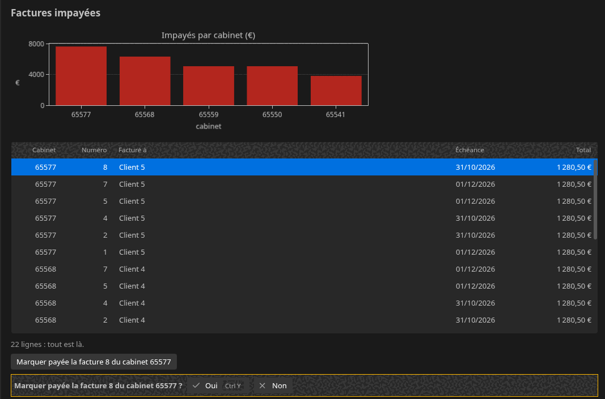

```python
# Django: the same with the admin of the model, made on the server
@admin.register(Invoice)
class InvoiceAdmin(admin.ModelAdmin):
    list_display = ("number", "bill_to", "status", "total")
    list_filter = ("status", "office")
    actions = ["mark_paid"]

    @admin.action(description="Mark paid")
    def mark_paid(self, request, queryset):
        for inv in queryset.select_for_update():   # the webhook of the partner: by hand, after the commit or not?
            inv.pay(by=request.user)
# a page of one's own: a view, a template, its URL in get_urls(), the admin's CSS to look like it, a chart by a JS library
```

Ce que joue le test dans un navigateur (`examples/invoices/tools/admin-shot.sh`, Chrome sans fenêtre piloté depuis
Cesia, et la même chose dans Firefox) : la connexion (le mot de passe dans un champ de points, un champ de mot de passe
pour le gestionnaire du navigateur) ; chaque page ; un utilisateur choisi et désactivé après confirmation, le tableau
relu ; le nom d'une facture changé sur place, et un total qui n'est pas un nombre refusé avec son champ ; Marquer payée
sur la page Impayées ; chaque changement dans l'Audit ; sur Clés, la clé du robot comptable choisie et révoquée après
confirmation (l'étape `revoke`) ; sur Flags, le flag `export.country` et son cabinet, puis activé pour tous (l'étape
`flag`) ; la déconnexion. Chaque page visitée tient dans la fenêtre, aucun bouton n'en recouvre un autre, et du
balisage HTML tapé dans un champ (`<b>`, ``) reste un texte : aucun élément n'en est fait.

## 4. En français

Les pages parlent la langue que le serveur parle au super-admin. Elles demandent d'abord `GET /auth/me`, dont le
`Content-Language` (le header qui dit la langue de la réponse) la donne. Elle est choisie comme pour chaque requête de
l'app (chapitre 15) : la langue de son compte, sinon celle que son navigateur préfère, parmi les langues de l'app
(`APP_LANGS`) ; l'anglais quand l'app ne parle qu'anglais. Les actions de l'écran en direct portent elles aussi la
langue du navigateur : les erreurs du serveur arrivent donc dans cette langue. Les textes de Centauri en français
viennent avec les pages (`pages.Words`, 254 textes, dont la bande des touches de Ceres et les erreurs de l'écran) : les
titres, le menu, les boutons, les colonnes, les lignes d'aide, les listes vides, les questions. Les nombres sont écrits
comme le français les écrit (`12 345,5`, les milliers séparés par une espace fine qu'aucune fin de ligne ne coupe), les
heures le jour d'abord (`26/11/2026 09:22:01`), les pluriels par CLDR (les règles de pluriel d'Unicode pour chaque
langue : `0 ligne`, `1 ligne`, `2 lignes`). Un texte sans français se montre en anglais, jamais vide. Les données restent
telles qu'elles sont écrites : les noms, le détail des événements et les lignes du log, les noms des champs. Les champs
de l'éditeur gardent le point des nombres (une liste y est coupée à ses virgules) ; une heure se tape des deux façons,
`25/11/2026 08:00` ou `2026-11-25 08:00`.

La page propre à une app dit chacun de ses textes par `pages.Say(text, args)`, les valeurs dans `args` (`{Number}`,
`{N}`), jamais écrites dans le texte. Les titres donnés à `pages.Page`, `Kind`, `Column`, `Action` et `Run` sont dits là
où ils s'affichent. Son français est un catalogue d'i18n (une liste de messages et de leurs traductions), donné à
`pages.Run(words = ...)` après celui de Centauri : pour un texte qui est dans les deux, celui de l'app gagne. Les
factures donnent celui que parle leur serveur (`src/invoices/words/words.ce`) :

```cesia norun
(* src/invoices/words/words.ce: what the admin page says, beside the errors of the server *)
Words = i18n.Catalog("fr", [
  (* ... *)
  ["Unpaid invoices", "Factures impayées"],
  ["Mark invoice {Number} of office {Office} paid", "Marquer payée la facture {Number} du cabinet {Office}"],
])

(* tests/l3.test.ce: each text of the page has its French, with the names of its values *)
defn isAdminInFrench()
  wrong = apptest.Untranslated(["admin/page.ce"], i18n.Of([pages.Words, words.Words]), "fr")
  bug.Assert(value.Len(wrong) == 0, text.Join("\n", wrong))
  (* ... *)
end
```

`apptest.Untranslated(paths, words, lang)` lit les fichiers des pages. Chaque texte dit (`Say("…")`, un titre de page,
de kind, de colonne, d'action) doit être dans le catalogue, non vide, avec les noms de ses valeurs dans chaque forme. Un
texte donné directement à un widget de Ceres (`web.Text("…")`, `label = "…"`) s'affiche en anglais dans toutes les
langues : il est nommé, avec sa ligne. Les pages de Centauri passent la même vérification
(`tests/translated.test.ce`).


```python
# Django:  in the templates and gettext in the code, makemessages then compilemessages,
# LocaleMiddleware for the language of the request; the admin's own texts come translated with Django.
MIDDLEWARE = [..., "django.middleware.locale.LocaleMiddleware", ...]
LANGUAGES = [("en", "English"), ("fr", "French")]
```

## 5. Ses tests

`tests/admin.test.ce` : les fichiers servis avec leur type, leur ETag, le 304 et brotli, aucun script à elle dans la
page, aucune source et rien hors du dossier (`isPagesServedWithTheirHeaders`) ; les pages éteintes par leur réglage
(`isTurnedOffBySetting`) ; chaque endpoint de `api.AdminOfApp`, de `api.AdminOfAccounts` et des jobs refusé sans
session (401) et sans le rôle (403) (`isEveryEndpointForSuperOnly`) ;
aucun secret envoyé (`isSecretNeverSent`) ; un champ changé à travers son type, un secret refusé, une valeur unique
vérifiée, l'audit qui ne nomme que les champs (`isEditCheckedByTheKind`) ; un job annulé, pas pendant qu'il tourne, et
relancé (`isJobCancelledAndRetried`) ; les événements par heure et par route (`isEventsFilteredByTimeAndRoute`) ; une
requête d'un autre site refusée (`isCrossSiteRefused`) ; le log lu une fois par ligne (`isLogTailedOnce`) ; les trois
shows pour le rôle super seulement, sur un vrai WebSocket (`isLiveForSuperOnly`). `tests/people.test.ce` : les
endpoints des pages Clés et des facteurs, des sessions et des invitations d'un utilisateur
([l'administration](administration.md)) ; `tests/flags.test.ce` : ceux de Flags ; `isEveryEndpointForSuperOnly` liste
aussi `AdminFlags` et `AdminFlag`.
En français : `tests/translated.test.ce` (chaque texte des pages dit et en français, le catalogue de Centauri complet,
le parcours qui attrape un texte non dit ; `/auth/me` dans la langue du compte, puis dans celle du navigateur ; un
header fait pour injecter ; une traduction avec du balisage ; une action de l'écran dans la langue du navigateur),
`src/admin/pages/pages.test.ce` (les nombres, les heures, les pluriels, un texte sans français en anglais, la connexion
dessinée en français avec la bande de Ceres), et le test dans un navigateur avec `LANG=fr`
(`examples/invoices/tools/admin-shot.ce`), qui joue chaque étape en français.

Suite : [Vitesse](speed.md), où sont mesurés la taille des pages, leur premier affichage et leurs frames (les images
que l'écran dessine l'une après l'autre).
