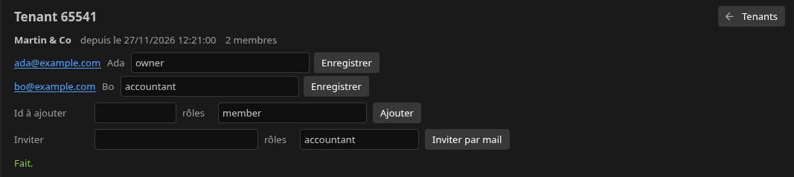

# L'administration

Un super-admin est un utilisateur de toute la plateforme, au-dessus de chaque tenant (un tenant : un client de la
plateforme, comme un cabinet ou une entreprise, avec ses données à lui) ; il a `Super` sur son compte, le rôle
`api.Super`. Le premier est créé par une tâche, `APP_ADMIN_EMAIL=... APP_ADMIN_PASSWORD=... cesia do admin`
(`auth.Admin`), les autres par lui (`PUT /admin/users/:id/super`). Les endpoints ci-dessous (un endpoint : une adresse
de l'API avec sa méthode HTTP, comme `POST /clients`) sont le contrat (ce qu'un endpoint prend, ce qu'il rend et le
rôle qu'il demande, lu par le serveur et par les pages) des pages d'administration, dans le package api
(`src/api/platform.ce`) : [les pages d'administration](admin.md) les appellent, et tout programme le peut. Chaque
changement est un événement de l'historique, et personne ne se désactive lui-même ni ne se retire le rôle : la
plateforme en garde donc toujours un.

| endpoint | ce qu'il donne ou fait |
|---|---|
| `GET /admin/app` | l'app (l'application, le serveur et ses pages) : son nom, sa version, son profil, son démarrage, depuis combien de temps elle tourne, ses modules, le nombre de ses endpoints et de ses kinds (les sortes de choses de la base de données, comme les factures ou les clients) |
| `GET /admin/stats` | les utilisateurs, les tenants, les sessions (une session : le temps où un utilisateur reste connecté), les requêtes, les refus, les connexions échouées de la dernière minute |
| `GET /admin/settings` | chaque réglage : sa variable, sa valeur (`(secret)` pour un secret), d'où il vient (env, code, défaut) |
| `GET /admin/logs?Level=&Search=` | les dernières lignes du log de ce processus (le journal qu'il tient, une ligne par fait), les plus récentes d'abord |
| `GET /admin/metrics` | les métriques de ce processus, une ligne par valeur |
| `GET /admin/endpoints` | chaque endpoint de l'app, par module, avec son rôle et sa limite |
| `GET /admin/events?Kind=&Tenant=&User=` | l'historique : les inscriptions, les connexions et leurs échecs, les blocages, les refus, les invitations, les rôles, les utilisateurs désactivés |
| `GET /admin/kinds`, `GET /admin/data/:kind?Tenant=` | les kinds de la base de données avec leurs champs, et les choses (*things* dans le code) de l'un d'eux, par pages |
| `GET /admin/users?Search=&Tenant=`, `GET /admin/users/:id` | les utilisateurs, les plus récents d'abord ; un utilisateur, avec ses tenants, ses rôles et ses sessions, et ses `Factors` : TOTP (le code à six chiffres d'une app d'authentification, qui change toutes les 30 secondes) activé ou non, les codes de secours restants, un mot de passe ou non, ses passkeys (des clés d'accès gardées par l'appareil, qui remplacent le mot de passe), les fournisseurs (providers, comme Google) avec lesquels il se connecte |
| `DELETE /admin/sessions/:id` | une session prend fin ; les autres de l'utilisateur continuent |
| `POST /admin/users/:id/factors/reset {Totp, Passkeys}` | son TOTP et ses codes de secours, ses passkeys, retirés quand il a perdu son appareil ; ses sessions continuent ([passkeys](passkeys.md#6-quand-un-appareil-est-perdu)) |
| `POST /admin/users/:id/disable`, `/enable`, `/signout` ; `PUT /admin/users/:id/super` | un utilisateur mis dehors (ses sessions prennent fin), réadmis, déconnecté partout ; un super-admin fait ou défait |
| `GET /admin/tenants?Search=`, `GET /admin/tenants/:id` | les tenants ; un tenant, avec ses membres |
| `PUT /admin/tenants/:id/members/:user` | les rôles d'un utilisateur dans un tenant (aucun : il le quitte) |
| `POST /admin/tenants/:id/invites {Email, Roles}` | une invitation dans un tenant par mail : `202`, un job (un travail fait en arrière-plan, hors de la requête) fait son code et envoie son lien par mail (`APP_INVITE_PAGE`) ; le code n'est donc dans aucune réponse et aucune base de données |
| `GET /admin/keys?Tenant=`, `DELETE /admin/keys/:id` | les clés de programme (un secret qu'un programme envoie à la place de la session d'une personne) de tous les tenants ou d'un seul, les plus récentes d'abord, jamais leurs secrets ; une clé révoquée ([API pour un partenaire](partner-api.md)) |
| `GET /admin/flags`, `PUT /admin/flags/:name` | les feature flags (un feature flag : un interrupteur qui ouvre une fonction à tous, à une part des utilisateurs, à un tenant ou à un utilisateur) que le code déclare, avec ce qui a été réglé par-dessus ; un flag réglé pour tout le monde, une part des utilisateurs, un tenant ou un utilisateur, ou effacé (servis par `flags.Module` : [flags](flags.md)) |
| `GET /admin/jobs?State=&Kind=`, `POST /admin/jobs/:id/retry`, `POST /admin/jobs/:id/cancel` | les jobs d'un état et d'un type ; un job mort relancé ; un job en attente rendu mort (un job qui tourne : 409) |
| `PATCH /admin/data/:kind/:id` | des champs d'une chose changés (`Fields`, un objet JSON), chacun à travers la forme de son type (ce qu'une valeur doit être : un texte de 1 à 120 octets, un nombre entier...) ; un champ secret refusé |
| `GET /admin/series?Step=&Count=` | l'historique du tableau de bord en colonnes : les `Count` derniers points d'un `Step` (1, 60 ou 600), les plus anciens d'abord |
| les shows en direct `admin.series`, `admin.events`, `admin.logs` (un show : une liste en direct qu'une page demande par son nom) | les points du tableau de bord, un par seconde sur 15 minutes, un par minute et un toutes les dix minutes sur 7 jours, les événements de la dernière heure à mesure qu'ils arrivent, le log du processus à mesure qu'il s'écrit |

`admin.series` est l'historique du processus, échantillonné une seule fois quel que soit le nombre de pages qui le
regardent : depuis le démarrage de l'app (depuis la première page qui le demande quand `AdminPath` vaut `off`), un point
chaque seconde, les 900 derniers gardés, un point chaque minute, les 10 080 derniers, et un point toutes les dix
minutes, les 1 008 derniers, en mémoire (environ 6,6 Mo une fois plein, après 7 jours). Une page demande les `Seconds`
derniers (de 0 à 900, 300 si elle ne dit rien), les `Minutes` derniers (de 0 à 10 080) et les `Tens` derniers (de 0 à
1 008), aucun de ces deux si elle ne dit rien : `{"Show": "admin.series", "Args": {"Seconds": 900, "Minutes": 60,
"Tens": 1008}}`, 15 minutes à la seconde, la dernière heure à la minute et 7 jours par dix minutes, fait 1 968 points,
environ 410 Ko de JSON (toutes les minutes, 10 980 points, 2,3 Mo). Elle les reçoit tout de suite, 500 points par frame
au plus (un message envoyé d'un coup), les plus récents d'abord, puis chaque nouveau point, et les points qui sortent
de sa fenêtre comme `Removed`. `Step` distingue un point d'une seconde (1), d'une minute (60) et de dix minutes (600) ;
`At` est la fin de sa seconde ou le début de sa minute ou de ses dix minutes. Le point d'une minute fait la somme de ses
secondes (requêtes, 5xx, refus, connexions), celui de dix minutes la somme de leurs minutes ; chacun garde de sa
dernière seconde `Failures`, les jobs et `Screens`, et ses `P50` et `P99` sont ceux de toutes les requêtes de sa durée,
à 1 % près (DDSketch, un sketch, c'est-à-dire un résumé de taille bornée qui donne les quantiles : Masson, Rim et Lee,
*PVLDB* 12(12), 2019 ; les sketches des minutes s'additionnent en celui des dix minutes sans rien perdre). Les autres
champs : `Screens`, les écrans live ouverts sur le processus ; `SignedIn` et `FailedSignIns`, les connexions qui ont
ouvert une session et celles refusées ; ce que le processus utilise, dans le point d'une seconde (ceux d'une minute et
de dix minutes gardent celui de leur dernière seconde) : `Cpu`, sa part d'un cœur sur la seconde en pourcentage (200
pour deux cœurs occupés), `Memory`, ses octets en RAM (de `sys.Usage()`), et `DiskUsed` et `DiskTotal`, les octets du
système de fichiers qui tient le dossier du réglage `AdminDisk` (de `sys.Disk`), comme le dossier des données d'un
Cepheus sur la même machine, quand il est donné : l'app a besoin de `--allow read` sur lui. Un champ que le système ne
dit pas est absent, jamais 0. Les écritures de la base n'ont pas encore de source : le paquet de Cepheus n'en compte
aucune.

`GET /admin/series` donne le même historique en colonnes, ce qu'une page lit une fois à son ouverture et quand sa
période change, avant `admin.series` avec `{"Seconds": 60}` pour les points qui arrivent : `{"Step": 1, "Ats": [...],
"Cols": {"Requests": [...], "P99": [...], "Memory": [...]...}}`, une liste par champ (`Requests`, `Errors`, `Origin`,
`Limit`, `Signin`, `Role`, `Failures`, `SignedIn`, `FailedSignIns`, `P50`, `P99`, `Ready`, `Running`, `Dead`,
`Screens`, et `Cpu`, `Memory`, `DiskUsed`, `DiskTotal` quand chaque point les a), les temps des requêtes au dixième de
milliseconde. `Count` vaut tous les points gardés s'il n'est pas donné. Mesuré sur un historique plein :
`Step=1&Count=900` fait environ 83 Ko de JSON, `Step=60&Count=60` 6 Ko, `Step=600&Count=1008` 96 Ko, là où les lignes
d'`admin.series` faisaient 412 Ko.

`GET /admin/events` prend aussi `Route`, `Since` et `Until` (ISO 8601). `GET /admin/data/:kind` et `GET /admin/kinds`
ne donnent jamais un champ que nomme `app.Kind(..., secret = [...])` : il arrive comme `(secret)`, et `Secret` le marque
parmi les champs de son kind. Ceux de Centauri sont nommés ainsi : les hashs des mots de passe, des sessions, des
invitations et des codes, ceux des clés de programme, les codes de secours, les tickets d'une seconde étape, les
cérémonies des passkeys et les flux des fournisseurs, les secrets scellés de TOTP, le secret d'un webhook. (Un hash est
une empreinte : un nombre calculé à partir d'un texte, d'où on ne peut pas revenir au texte ; un webhook, un appel HTTP
que l'app envoie à un partenaire quand quelque chose arrive.) Chaque changement par `PATCH /admin/data`, `retry` et
`cancel` est un événement (`data-edited`, `job-retried`, `job-cancelled`), comme le sont une session terminée
(`signout`), des facteurs retirés (`factors-reset`), une invitation (`invite`), une clé révoquée (`key-revoked`) et un
flag réglé (`flag`), avec les autres : [les pages d'administration](admin.md) les montrent comme la piste d'audit.

La page d'un utilisateur dans l'administration montre `GET /admin/users/:id`, ses facteurs avec les boutons de
`POST /admin/users/:id/factors/reset`, et ses sessions, l'une terminée par `DELETE /admin/sessions/:id` :


La page d'un tenant montre `GET /admin/tenants/:id` et envoie `POST /admin/tenants/:id/invites` :



```cesia norun hide=code
(* For the check of this page: the packages its code uses, and the names it takes from the invoices of
   examples/invoices, unknown here. *)
use deps/www-celestial/centauri/src/api
use std/json
a = json.Parse("{}")!
made = json.Parse("{}")!
t = json.Parse("{}")!
```

```cesia norun
boss = t.Super()?
users = boss.Call(api.AdminUsers, {Search: "ana"})?
boss.Call(api.AdminDisable, {id: users.Rows[1].Id})?
```

```cesia norun
boss.Call(api.AdminResetFactors, {id: a.User, Totp: true, Passkeys: true})?
boss.Call(api.AdminRevokeKey, {id: made.Id})?
```

Les admins d'un tenant gèrent ses membres et ses clés avec les endpoints des comptes (`/auth/members`, `/auth/invites`,
`/auth/keys`), pas avec ceux-ci. Les tests de ces endpoints sont dans `tests/people.test.ce` : les clés de tous les
tenants vues et révoquées (`isKeysSeenAndRevokedBySuper`), une session terminée et pas les autres
(`isOneSessionEnded`), les facteurs d'un utilisateur vus et retirés (`isFactorsShownAndReset`), des invitations par
mail d'un super-admin et d'un admin de tenant, leur code dans aucune réponse et aucune base de données
(`isInvitedByMail`, `isTenantAdminInvitingByMail`) ; et chacun refuse qui n'a pas de session (401) et qui n'est pas
super-admin (403) (`isEveryEndpointForSuperOnly` dans `tests/admin.test.ce`).
