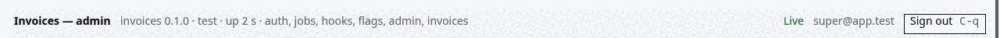
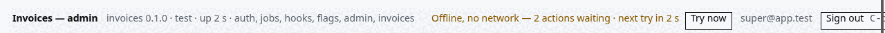
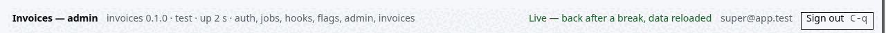

# Quand la connexion tombe

La tâche : une comptable travaille sur les pages d'admin dans un train. Le wifi part une minute, puis revient en 4G
avec une autre adresse ; au bureau, l'app est redéployée à midi ; un *proxy* (une machine posée entre la page et l'app,
qui fait passer les messages) coupe les connexions qui restent muettes. Rien de tout cela ne doit donner une page
cassée : la page dit ce qui se passe en une ligne simple, reste utilisable, garde ce que la comptable fait pendant ce
temps, et reprend quand le réseau revient, **sans recharger la page**. Un paiement demandé pendant la coupure est payé
**une fois**, ni zéro fois ni deux ; la liste en direct ne rate aucun changement et n'en montre aucun deux fois ; un
changement fait sur une valeur que quelqu'un d'autre a changée entre-temps est montré comme un *conflict* (un conflit :
deux personnes ont changé la même chose), jamais écrasé en silence ; un envoi de fichier coupé à 60 % reprend de là.

Ce qu'il faut : rien à écrire. Chaque page de Ceres qui a un *screen* en direct (le côté app de la connexion vivante
d'une page) l'a d'office, les pages d'admin comprises, et `live.js` pour une page en JavaScript ; les *handlers* de
l'app (les fonctions qui répondent aux requêtes) restent tels quels. Une app qui veut d'autres limites ou d'autres
délais les règle, [plus bas](#7-les-réglages). Ce qui est nouveau pour un handler, c'est `app.Unchanged`, pour un
changement qui ne doit pas en écraser un autre ; pour un programme, ce sont `client.Upload` et `client.Download`.

Ce que cela fait, Socket.IO l'appelle *connection state recovery* (reprise de l'état de la connexion), SignalR
*stateful reconnect* (reconnexion qui garde l'état) et MQTT *persistent sessions* (sessions qui durent) : une coupure de
quelques secondes à quelques minutes ne se voit pas. La plupart des *frameworks* (les bases toutes prêtes pour bâtir
une app) n'en donnent rien d'origine : [les géants](#10-à-côté-des-autres).

```cesia norun hide=code
(* For the check of this page: the packages its code uses, and the names it takes from a page and from the admin
   pages, unknown here. *)
use deps/www-celestial/centauri/src/app
use deps/www-celestial/centauri/src/client
use deps/www-celestial/cepheus/cesia/cepheus
use deps/www-celestial/ceres/src/web
use std/json
use std/list
Note = json.Parse("{}")!
p = json.Parse("{}")!
email = json.Parse("{}")!
password = json.Parse("{}")!
said = json.Parse("{}")!
step = json.Parse("{}")!
signingIn = json.Parse("{}")!
bytes = "%PDF-"
key = "k"
```

## 1. La ligne qui le dit

Le bandeau des pages d'admin montre, à sa droite et en mots, l'état de la connexion de la page à son app :



La ligne est `web.Connection(p)`, un *widget* de Ceres (un élément d'écran tout prêt) que toute page peut montrer ;
une page en JavaScript reçoit le même état par `live.onStatus`. Elle dit, par ordre d'importance :

| la ligne | quand |
|---|---|
| `Live` (« en direct ») | connectée, rien n'attend |
| `Live — sending 2 actions…` (« en direct — envoi de 2 actions… ») | revenue, les actions demandées entre-temps sont en route |
| `Live — back after a break, nothing missed` (« en direct — de retour après une coupure, rien de manqué ») | revenue sur le screen que l'app a gardé : chaque changement de la coupure est arrivé, une fois |
| `Live — back after a break, data reloaded` (« en direct — de retour après une coupure, données rechargées ») | revenue sur un nouveau screen (l'app a redémarré, ou la coupure a trop duré) : les listes sont relues, pas la page |
| `Offline — 2 actions waiting · next try in 4 s` (« hors ligne — 2 actions en attente · prochain essai dans 4 s »), bouton **Try now** (« essayer maintenant ») | coupée : les actions attendent, la page réessaie d'elle-même |
| `Offline, no network — …` (« hors ligne, pas de réseau — … ») | pareil, quand le navigateur lui-même dit qu'il n'a pas de réseau |
| `Signed out — sign in again, 2 actions kept` (« déconnectée — reconnectez-vous, 2 actions gardées ») | la session a pris fin pendant que la page était absente : la page demande de se reconnecter, et garde les actions pour après |
| `Screen closed: …` (« screen fermé : … »), bouton **Again** (« recommencer ») | l'app a refusé le screen pour une autre raison |

## 2. Le réseau part

Le wifi part. Le navigateur le dit (son événement `offline`) : la ligne change aussitôt. Quand le réseau part sans que
le navigateur le sache (un routeur tombé, un câble arraché, un proxy qui garde la connexion ouverte mais jette ce qui
passe), la page le voit grâce à son *heartbeat* : elle envoie un petit message à l'app toutes les `PingEvery` secondes
(15), et aucun mot de l'app pendant `DeadAfter` secondes (30) vaut coupure. Un *heartbeat* (un « battement de cœur »)
est un petit message envoyé à intervalle régulier, seulement pour prouver que l'autre côté entend encore.

La comptable continue de travailler : elle change le nom du client sur une facture et enregistre, puis la marque
payée. La page montre ce qu'elle montrait avant (une liste demandée à nouveau garde ses lignes jusqu'à l'arrivée des
nouvelles), et les deux changements attendent :



Chaque action attend **dans l'ordre**, avec une **Idempotency-Key** créée au moment où elle a été demandée : un nom
tiré au hasard, de 128 bits, que l'app garde avec la réponse de l'action, pour que la même action envoyée à nouveau
reçoive la première réponse au lieu de tourner une seconde fois ([le projet de norme de l'IETF](https://datatracker.ietf.org/doc/draft-ietf-httpapi-idempotency-key-header/)).
Une action envoyée juste au moment où la connexion a cassé, et dont la réponse n'est jamais venue, attend aussi, avec sa clé : elle a peut-être
tourné, et sa clé garantit qu'elle tourne au plus une fois.

La page réessaie après une attente tirée au hasard entre 0 et une borne qui double à chaque échec, de
`ReconnectFirst` (500 ms) à `ReconnectMax` (30 s). C'est l'*exponential backoff with full jitter* (Marc Brooker,
« Exponential Backoff And Jitter », AWS Architecture Blog, 2015) : le *backoff* est l'attente qui double à chaque
échec, le *full jitter* le tirage au hasard de toute cette attente. Ainsi, quand une app redémarre, ses mille pages ne
reviennent pas toutes au même instant, ce qui la ferait tomber à nouveau ([mesuré](#9-ce-que-cela-coûte)). La page
réessaie aussitôt quand le navigateur dit qu'il est de nouveau en ligne, quand son onglet est de nouveau affiché, ou
sur **Try now**.

## 3. Le réseau revient

La page revient sur le screen que l'app lui a gardé. Un *screen* est le côté app de la connexion en direct d'une
page : ses *shows* (les listes qui suivent la base de données) et ses actions. L'app garde pendant `ResumeTime`
secondes (120) un screen dont la connexion a cassé : ses shows continuent de suivre la base de données, et les
*frames* (les messages numérotés que l'app envoie à la page) qu'elle aurait envoyées attendent, au plus `ResumeBytes`
(1 MiB). La page revient avec le *token* du screen (le jeton : une suite de caractères qui le désigne) et le numéro de
la dernière frame qu'elle a ; l'app lui envoie chaque frame qui suit celle-là, une fois. *Rien de manqué, rien en
double* : la liste des factures impayées montre chaque facture payée entre-temps, et aucune deux fois.

Puis les deux changements partent, dans l'ordre. Le paiement est fait une fois. Le changement du nom est refusé :
Bruno, dans un autre bureau, a renommé le client entre-temps. La page le montre, avec la valeur vue, la valeur
actuelle et la sienne, et les deux choix :


**Keep mine** (« garder le mien ») renvoie le changement par-dessus la valeur actuelle ; **Take theirs** (« prendre le
leur ») l'abandonne. Rien n'est écrasé en silence.

Quand l'app n'a pas pu garder le screen (elle a redémarré, elle a été redéployée, la page est arrivée sur un autre
serveur derrière le répartiteur de charge, la coupure a duré plus que `ResumeTime`, ou plus de `ResumeBytes` de
frames attendaient), la page reçoit un nouveau screen : ses listes sont relues, la page non, et la ligne le dit. Les
actions en attente y sont envoyées, chacune avec sa clé, qui la fait tourner une fois quoi qu'il se soit passé avant :



## 4. Le même compte, depuis n'importe quelle adresse

Un téléphone qui passe du wifi à la 4G revient depuis une autre adresse : le screen reste quand même celui de la page,
car l'app vérifie le compte et les shows, pas l'adresse (`isResumedFromANewAddress`). Dans l'autre sens, un token
n'ouvre rien à lui seul : le token du screen d'un autre compte, ou d'une autre liste de shows, reçoit un screen à lui,
et le screen de ce token continue (`isScreenOfAnotherAccountNotResumed`).

La clé d'une action est celle du **compte**, pas celle de la session (`APP_IDEMPOTENCY_SCOPE=account`) : quand la
session a pris fin pendant la coupure et que la comptable se reconnecte, un paiement dont la coupure a perdu la
réponse reçoit sa première réponse, pas un second paiement (`isKeyOfTheAccountAfterASignInAgain`). La reconnexion se
fait dans la page, et les actions restent gardées :

```cesia norun
(* in the admin pages: the screen ended with a 401, a sign-in in the page, then the screen comes back *)
done = () -> web.Again(p.Screen)
go = () -> signingIn(email, password, said, step, done = done)
```

Et la personne suivante sur le même navigateur n'envoie jamais les actions de la première : chaque screen donne à sa
page une étiquette de son compte (`Who`, une empreinte BLAKE2b du compte sous les clés de l'app, c'est-à-dire un
résumé dont on ne peut pas retrouver le compte, qui ne nomme personne) ; la page marque chaque action avec elle, jette
celles d'un autre compte quand elle revient connectée sous le nom de quelqu'un d'autre, et l'app refuse, par une
erreur 403 (accès refusé), une action dont l'étiquette n'est pas celle de son screen
(`isScreenOfAnotherAccountNotResumed`).

## 5. Un changement par-dessus un changement

L'app doit refuser un changement demandé sur des valeurs qui ont changé depuis, sinon le dernier arrivé gagne et
l'autre est perdu. La page envoie ce qu'elle a vu, la *base* (les valeurs de départ) ; le handler la vérifie avec
`app.Unchanged` :

```cesia norun
defn edit(r, x)
  (** PUT /notes/:id: a new text, refused when the page saw another one than the note has now. *)
  n = app.Own(Note, r.Params.id, r)?
  seen = app.Unchanged(Note, n.Id, n, r)?
  cepheus.Write(list.Append(cepheus.Add(n.Id, Note.Text, x.Text), seen), r.Db, by = r.User.Id, why = r.Why)?
  {Id: n.Id, Text: x.Text}
end
```

- `app.Unchanged(kind, id, current, r)` lit la base de la requête (l'en-tête `Centauri-Base`, un objet JSON des champs
  vus ; une action en direct le remplit à partir du `base` de `web.Act`). Un champ dont la valeur actuelle n'est pas
  celle qui a été vue est un conflict : une réponse 409 (le code HTTP du conflit) dont le `conflict` liste chaque
  champ, `{Field, Base, Now}`, que la page montre.
- Sinon, il donne l'`Expect` de chaque champ vu (la condition « ce champ a encore cette valeur »), écrit **dans le
  même groupe** que le changement, c'est-à-dire avec lui ou pas du tout : un changement qui arrive entre la lecture et
  l'écriture est refusé aussi par Cepheus.
- Sans base, il ne donne rien et le changement se fait comme avant : une ancienne page, ou un programme qui n'en
  envoie pas, ne voit aucune différence.

Sur la page :

```cesia norun
web.Act("PUT /notes/:id", {id: 7, Text: "oat milk"}, p, base = {Text: "milk"})
```

L'explorateur de données des pages d'admin envoie les valeurs qu'il a montrées pour chaque champ changé, et
`PATCH /admin/data/:kind/:id` les vérifie : c'est ce que montre la capture plus haut.

## 6. Des envois et des téléchargements qui reprennent

Un envoi coupé à 60 % reprend à partir des octets que l'app a déjà, avec les en-têtes du
[protocole tus 1.0](https://tus.io/protocols/resumable-upload) sur l'adresse de l'app elle-même (`api.Upload`), sans
rien y changer :

```sh
# the first try, cut: the app keeps the whole parts it stored (UploadPart, 1 MiB each), under the key
curl -X POST 'https://app.example/invoices/7/scan?name=scan.pdf' -H 'Idempotency-Key: 4f1c...' \
  -H 'Upload-Length: 3000000' -H 'Content-Type: application/pdf' --data-binary @scan.pdf
# how much the app holds
curl -I 'https://app.example/invoices/7/scan' -H 'Idempotency-Key: 4f1c...'     # 204, Upload-Offset: 2097152
# the rest, from there; a wrong offset gets a 409 that says the right one
tail -c +2097153 scan.pdf | curl -X POST 'https://app.example/invoices/7/scan' -H 'Idempotency-Key: 4f1c...' \
  -H 'Upload-Offset: 2097152' -H 'Upload-Length: 3000000' -H 'Content-Type: application/pdf' --data-binary @-
```

Les premiers octets sont vérifiés contre le type annoncé dès leur arrivée (à l'*offset* 0 ; l'offset est la position
dans le fichier, en octets) ; le fichier est créé une fois, quelles que soient les coupures, et sa réponse est gardée
avec sa clé : un nouvel essai après une réponse perdue reçoit le même fichier, pas un second. Dans un programme ou une
page, `client.Upload` fait la demande et la reprise :

```cesia norun
use deps/www-celestial/centauri/src/client
got = client.Upload("https://app.example/invoices/7/scan?name=scan.pdf", bytes, "application/pdf", headers = [{Name: "authorization", Value: "Bearer $key"}])?
```

Un téléchargement a un `ETag` fort (une étiquette du fichier, qui change au moindre octet changé) et respecte
`If-Range` (« seulement si c'est encore la même version », RFC 9110 §13.1.5) : un téléchargement coupé reprend où il
s'était arrêté avec `Range` (l'en-tête qui demande la suite à partir d'un octet donné), et si le fichier a changé
entre-temps, l'app l'envoie en entier, jamais un mélange de deux versions. Les téléchargements de Chrome reprennent de
cette façon ; `client.Download` lit par morceaux et vérifie chacun contre l'étiquette du premier.

## 7. Les réglages

Chaque choix est un réglage ; les valeurs par défaut sont celles données plus haut.

| réglage | par défaut | ce que c'est |
|---|---|---|
| `APP_OUTBOX` | `on` | `on` : les actions demandées hors ligne attendent dans l'*outbox* (la file d'attente des actions de la page) et partent quand la page revient ; `off` : refusées aussitôt, comme avant |
| `APP_OUTBOX_COUNT`, `APP_OUTBOX_BYTES` | 100, 1 MiB | le plus grand nombre d'actions, et d'octets, qui peuvent attendre dans une page ; au-delà, la suivante est refusée aussitôt |
| `APP_OUTBOX_WAIT` | 3600 | les secondes qu'une action peut attendre ; au-delà, elle échoue, en disant si elle a été envoyée au moins une fois |
| `APP_RECONNECT_FIRST`, `APP_RECONNECT_MAX` | 500, 30000 | les bornes, en millisecondes, de l'attente avant un nouvel essai (full jitter) |
| `APP_PING_EVERY`, `APP_DEAD_AFTER` | 15, 30 | le heartbeat, en secondes, et le silence qui vaut coupure |
| `APP_RESUME_TIME`, `APP_RESUME_BYTES` | 120, 1 MiB | combien de temps l'app garde un screen dont la connexion a cassé, et ses frames (0 : jamais) |
| `APP_IDEMPOTENCY_SCOPE` | `account` | à qui appartient une clé : au compte, ou à la session (`session`, comme avant) |
| `APP_IDEMPOTENCY_LEASE` | 0 | au bout de combien de secondes une clé laissée « en cours » par un serveur arrêté est libérée pour un nouvel essai ; 0 : jamais (une 409 jusqu'à `APP_IDEMPOTENCY_TIME`) |

La page reçoit ses réglages avec son screen. `APP_IDEMPOTENCY_LEASE` : un serveur qui s'arrête au milieu d'un handler
laisse sa clé « en cours », et Centauri ne peut pas savoir si les écritures du handler ont été faites. Avec 0, le
réglage sûr par défaut, un nouvel essai reçoit une 409 jusqu'à ce que la clé soit oubliée ; un *lease* (un bail : un
délai au bout duquel la clé est libérée) laisse un nouvel essai tourner à nouveau après ce délai. C'est sûr pour un
handler qui écrit avec un `Expect` de ce qu'il a lu, comme le fait `invoices.pay` (la seconde fois, il trouve la
facture déjà payée).

Gardé pour une version suivante : les actions gardées dans le stockage du navigateur, pour qu'elles survivent à un
onglet fermé (des heures de travail hors ligne), scellées sous une clé du compte ; aujourd'hui, elles vivent dans la
mémoire de la page.

## 8. Les tests

Les tests coupent vraiment le réseau, de trois façons :

- `tests/drop.test.ce` : l'app sur un port libre, et entre la page et l'app un proxy de `std/net` que le test coupe.
  Une action envoyée à nouveau après une coupure tourne une fois, sur le screen que l'app a gardé (`Heard`) et sur un
  nouveau (grâce à sa clé) ; une clé après une reconnexion ; une clé reprise pour un autre contenu (422) ; le token et
  les actions d'un autre compte ; une nouvelle adresse ; un changement par-dessus un changement, en direct et en HTTP ;
  un envoi coupé à 60 % qui n'envoie que le reste (le proxy compte les octets : 1,0 Mo en tout, pas 1,6) ; un
  téléchargement qui ne mélange jamais deux versions ; une clé laissée en cours.
- Le `tests/drop.test.ce` de Ceres : la page elle-même, sans fenêtre : hors ligne, une action gardée et jouée une
  fois, rien de manqué ; une app qui a oublié (un nouveau screen, données rechargées) ; un réseau muet repéré en 2 à
  6 s ; l'outbox bornée ; une action demandée pendant que la page se construit, demandée une seule fois ; un conflict
  et ses choix.
- `examples/invoices/tools/drop-shot.ce` (`cesia do drop-shot`) : les pages d'admin dans Chrome sans fenêtre, le
  réseau coupé par le mode hors ligne de Chrome, par un proxy qui coupe chaque connexion TCP au passage d'un
  changement, et par un redémarrage de l'app sur la même base de données. Les images de ce chapitre viennent de lui.

## 9. Ce que cela coûte

Rien sur une requête : une requête sans `Idempotency-Key` suit le même chemin qu'avant. Sur un screen en direct, une
frame de la version 2 est numérotée et gardée jusqu'à ce que la page dise qu'elle l'a, dans une file dont le coût ne
grandit pas avec sa longueur. Mesuré par `bench/drop.ce` et `bench/storm.ce`, 21 tours alternés :

| quoi | avant | maintenant |
|---|---|---|
| une requête, Centauri public (`bench/micro.ce`, A/B en alternance) | 27,9 µs [22,4, 108,2] | 29,9 µs [23,3, 140,1] |
| une requête connectée, une chose par son id | 54,0 µs [40,1, 131,5] | 49,5 µs [41,9, 231,6] |
| une requête connectée, une page de 20 choses | 176,1 µs [145,3, 992,3] | 179,2 µs [147,5, 360,4] |
| un changement d'un écran live, vers une page qui les lit aussi vite qu'ils viennent (`bench/drop.ce`, 20 000 par tour) | 13,1 µs [8,0, 47,5] (version 1) | 14,9 µs [9,8, 89,2] (version 2) |

Médianes de 21 tours [min, max], sur une machine partagée avec d'autres travaux (une charge de 6 à 8 sur 8 cœurs) : la
même route `std/http` dans les deux colonnes a bougé de -12 % à +52 % entre elles, donc les écarts des requêtes sont du
bruit : une requête ne paie rien. Un changement d'un écran live paie environ 2 µs pour son numéro et sa place dans la
file des trames gardées.

- **Du retour du réseau aux actions envoyées** : 100 actions en attente, le réseau revenu (le `online` du navigateur),
  toutes les réponses en 10,6 ms [8,9, 63,4] (21 tours, une page de Ceres dans un programme) ; dans Chrome, les pages
  d'admin de nouveau *Live* 0,1 à 0,2 s après le réseau (le test lui-même regarde toutes les 0,1 s).
- **Une action en attente** prend environ 2,1 Ko de la mémoire de la page (ses arguments, sa clé, sa réponse) : 500
  puis 4 500 actions dans un processus neuf, 5 fois chacun, 14,0 puis 22,5 Mo de médianes.
- **Une tempête après un redémarrage** (`bench/storm.ce`) : 1 000 pages live sur une application, l'application partie
  3 s, chaque connexion coupée. Mesuré : 4 298 essais en tout, au plus 302 dans les mêmes 100 ms, 99 % des pages de
  retour 10,5 s après la coupure, toutes après 16,2 s. Un modèle des mêmes pages : sans hasard, les 1 000 reviennent
  dans les mêmes 100 ms (3 000 essais, de retour après 3,5 s) ; avec les attentes de Centauri d'avant (0,25 à 8 s, fois
  0,5 à 1,5), au plus 396 en 100 ms (99 % de retour après 8,5 s). Le *full jitter* baisse d'un quart, face à avant, le
  plus qu'un serveur doit traiter à la fois, et de plus de trois fois face à aucun hasard, pour quelques secondes de
  plus avant que la dernière page soit revenue : le compromis de Brooker, moins de travail pour le serveur quand il
  vient de redémarrer. Une page dont le réseau à elle est revenu ne l'attend pas : elle réessaie tout de suite sur
  `online`.

## 10. À côté des autres

| | une coupure de quelques secondes | les actions d'une page pendant ce temps | vues en direct | envois de fichiers |
|---|---|---|---|---|
| Centauri | le screen gardé, les frames rejouées depuis la dernière que la page a | gardées dans l'ordre, chacune avec sa clé : jouées une fois | rien de manqué, rien en double ; sinon rechargées, et c'est dit | reprennent depuis les octets déjà reçus |
| Socket.IO 4.6+ | *connection state recovery*, éteint par défaut, 2 min : les paquets rejoués depuis un offset | ses *emits* (les messages envoyés) gardés pendant la déconnexion, renvoyés, sans clé : peuvent tourner deux fois | comme ses paquets | rien d'intégré |
| SignalR (.NET 8+) | *stateful reconnect*, à activer, jusqu'à 100 000 octets gardés de chaque côté, accusés par numéro d'ordre | gardées comme ses messages, sans clé : un redémarrage du serveur les perd | comme ses messages | rien d'intégré |
| MQTT | *persistent sessions* (clean start 0), QoS 1 et 2 (le niveau de garantie de livraison) par numéros de paquet | QoS 1 : au moins une fois ; QoS 2 : exactement une fois, par *broker* (le serveur relais) | comme ses messages | pas son rôle |
| Firestore | persistance hors ligne | écritures mises en file, appliquées plus tard, la dernière écriture gagne : aucun conflict montré | depuis son cache | envois reprenables de Cloud Storage |
| Workbox | Background Sync | les POST échoués mis en file dans IndexedDB (la base de données du navigateur), rejoués quand le Background Sync du navigateur se déclenche (Chromium), sinon quand le *service worker* (le programme de fond de la page) redémarre ; sans clé | pas son rôle | pas son rôle |
| Phoenix LiveView | se reconnecte, reconstruit la vue, récupère ses formulaires | rien en file : perdues pendant l'absence | la vue reconstruite, sans rejeu | `allow_upload`, sans reprise |
| Spring Boot, Django, Rails | rien d'intégré | rien d'intégré | rien d'intégré | rien d'intégré |

Avec Spring Boot, chaque morceau s'écrit à la main : un filtre qui garde les `Idempotency-Key` (dans une table, dans
un Redis), un client qui réessaie avec la même clé, un *STOMP broker relay* (un relais vers un serveur de messages)
pour garder les messages, un ETag sur chaque ressource :

```java
@Component class IdempotencyFilter extends OncePerRequestFilter {
  @Autowired StringRedisTemplate redis;
  protected void doFilterInternal(HttpServletRequest req, HttpServletResponse res, FilterChain chain) throws IOException, ServletException {
    var key = req.getHeader("Idempotency-Key");
    if (key == null || req.getMethod().equals("GET")) { chain.doFilter(req, res); return; }
    var scoped = "once:" + SecurityContextHolder.getContext().getAuthentication().getName() + ":" + key;
    if (!redis.opsForValue().setIfAbsent(scoped, "running", Duration.ofDays(1))) { res.sendError(409); return; }
    // ... keep the answer, give it again, let the key go on a 5xx, compare the body's hash (422) ...
  }
}
```

et rien côté page : la reconnexion, la file des actions, la ligne qui le dit, la reprise d'une vue en direct.

Suite : [Prévenir un partenaire, et prendre ses réponses](partner.md).
