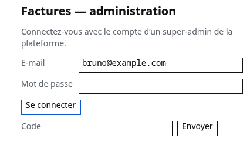

# Passkeys et double authentification

La tâche : les propriétaires (owners) d'un cabinet doivent avoir un second facteur. À sa première connexion, Ada
installe une app de codes sur son téléphone et garde dix codes de secours ; dès lors, son mot de passe seul n'ouvre plus
rien. Puis elle ajoute une passkey (une clé d'accès gardée par l'appareil, qui remplace le mot de passe) et se connecte
avec elle seule, son téléphone vérifiant son visage. Un site de phishing (un faux site qui imite le vrai pour voler ce
qu'on y tape) qui copie la page n'obtient rien dont il puisse se servir ; un code vu par-dessus son épaule ne sert
qu'une fois ; un téléphone perdu est retiré par un admin. Le code est `src/auth/passkeys.ce` et `src/auth/second.ce`,
les contrats `src/api/passkeys.ce` et `src/api/factors.ce` (un contrat : ce qu'un endpoint prend, ce qu'il rend et le
rôle qu'il demande, lu par le serveur et par les pages ; un endpoint est une adresse de l'API avec sa méthode HTTP,
comme `POST /clients`), les tests `tests/passkeys.test.ce` et `tests/second.test.ce` ; l'app des factures (une app :
l'application, le serveur et ses pages) le fait dans `examples/invoices/tests/l3.test.ce` (`isPasskeyAndTwoFactor`).

Ce qui est utilisé : les passkeys (WebAuthn, la *Web Authentication Level 3* du W3C) et leurs deux cérémonies (une
cérémonie : un échange entre le serveur et l'appareil, dans les mots de WebAuthn) ; TOTP (le code à six chiffres d'une
app d'authentification, qui change toutes les 30 secondes ; RFC 6238) et les codes de secours ; la seconde étape d'une
connexion et son ticket ; les réglages `Passkeys`, `PasskeyCheck`, `PasskeyTime`, `PasskeyCounter`, `PasskeyOrigins`,
`RpId`, `RpName`, `Passwords`, `TwoFactor`, `TwoFactorRoles`, `Totp*` et `Step*` ; dans les tests, `apptest.Device` et
`t.SetUp`.

## 1. Les réglages

```sh
export APP_TWO_FACTOR_ROLES=owner      # the owners must have a second factor; super for the super-admins
```

| réglage | valeurs | ce qu'il fait |
|---|---|---|
| `APP_TWO_FACTOR` | `off`, `optional` (le défaut), `required` | `optional` : un utilisateur active TOTP s'il le veut ; `required` : tout le monde le doit ; `off` : pas de TOTP du tout |
| `APP_TWO_FACTOR_ROLES` | des rôles, séparés par des virgules (aucun) | les rôles qui doivent avoir un second facteur, `super` pour les super-admins (les administrateurs de toute la plateforme, au-dessus des tenants, ses clients) |
| `APP_TOTP_ALGORITHM`, `APP_TOTP_DIGITS`, `APP_TOTP_PERIOD`, `APP_TOTP_SKEW` | `SHA1`, 6, 30, 1 | les codes : `SHA1` ou `SHA256`, de 6 à 8 chiffres, de 15 à 120 secondes par code, de 0 à 3 codes acceptés avant et après maintenant ; les défauts sont ce que lit toute app de codes |
| `APP_TOTP_ISSUER` | le nom de l'app | le nom que l'app de codes montre à côté du compte |
| `APP_STEP_TIME`, `APP_STEP_TRIES` | 300, 5 | combien de temps attend la seconde étape d'une connexion, et combien de codes elle accepte |
| `APP_PASSKEYS` | `on` (le défaut), `off` | les endpoints des passkeys, ou un 403 |
| `APP_PASSKEY_CHECK` | `required` (le défaut), `preferred`, `discouraged` | si l'appareil doit vérifier son utilisateur (un visage, un doigt, un code PIN) : le `userVerification` de WebAuthn |
| `APP_PASSKEY_TIME` | 300 | combien de temps attend une cérémonie, en secondes |
| `APP_PASSKEY_COUNTER` | `refuse` (le défaut), `allow` | une passkey dont le compteur recule : refusée, ou seulement un événement |
| `APP_PASSKEY_ORIGINS` | aucune | d'autres origines (une origine : le début d'une adresse, son schéma, son hôte et son port) d'où une cérémonie peut venir, séparées par des virgules (une app Android, un site de la même relying party, la partie qui se fie à l'appareil) |
| `APP_RP_ID`, `APP_RP_NAME` | l'hôte de `APP_ORIGIN`, le nom de l'app | la *relying party*, telle que l'appareil connaît le site : son id, auquel ses passkeys sont liées, et son nom |
| `APP_PASSWORDS` | `on` (le défaut), `off` | `off` : ni inscription ni connexion par mot de passe, seulement les passkeys et les fournisseurs (providers), comme Google |

Les codes en SHA-1 et les signatures ES256, RS256 et PS256 sont ceux d'OpenSSL : les tâches de l'app autorisent
`ffi=crypto`, comme celles de l'app des factures. OpenSSL est chargé une fois par processus, à sa première utilisation ;
une app qui ne se sert d'aucun d'eux n'a pas besoin de cette permission.

```java
// Spring Boot: Spring Security's passkeys (6.4 and after, with com.webauthn4j:webauthn4j-core), from Spring's docs
http.webAuthn(w -> w.rpName("Invoices").rpId("invoices.example").allowedOrigins("https://invoices.example"));
// Spring Security 7 asks several factors as authorities (@EnableMultiFactorAuthentication, FactorGrantedAuthority);
// among them a password, a one-time token by mail (oneTimeTokenLogin) and a passkey; TOTP is a library's
```

## 2. Une passkey : deux appels par cérémonie

Une *passkey* est une paire de clés que garde l'appareil de l'utilisateur (iCloud Keychain, Google Password Manager,
Windows Hello, une clé de sécurité). Le serveur ne garde que la clé publique : il n'y a rien à voler dans la base de
données, et rien à taper, donc rien à donner à un site de phishing. Chaque *cérémonie* de WebAuthn se fait en deux
appels. Le serveur donne ses options et un ticket ; la page passe les options au navigateur, qui interroge l'appareil ;
la page renvoie ce que l'appareil a produit, avec le ticket.

```js
// the page, a sketch in JavaScript: a new passkey of the signed-in user
const c = await post('/auth/passkeys/options')
const made = await navigator.credentials.create({publicKey: PublicKeyCredential.parseCreationOptionsFromJSON(JSON.parse(c.Options))})
await post('/auth/passkeys', {Ticket: c.Ticket, Credential: JSON.stringify(made.toJSON()), Name: "Ada's phone"})

// a sign-in: no e-mail asked, the device offers the passkeys it holds for this site
const s = await post('/auth/passkey/options')
const got = await navigator.credentials.get({publicKey: PublicKeyCredential.parseRequestOptionsFromJSON(JSON.parse(s.Options))})
const account = await post('/auth/passkey', {Ticket: s.Ticket, Credential: JSON.stringify(got.toJSON())})
```

Les options d'une nouvelle passkey nomment la relying party (`RpId`, `RpName`) ; l'utilisateur (son *handle* : 16 octets
aléatoires créés à sa première passkey, sans e-mail ni nom dedans ; son e-mail et son nom tels que l'appareil les
montre) ; les algorithmes que l'app accepte (ES256, EdDSA, RS256, PS256, dans cet ordre) ; les passkeys qu'il a déjà
(pour qu'un appareil n'en crée pas une seconde) ; une clé que l'appareil garde pour le site (`residentKey: required`) ;
`userVerification` comme le dit `PasskeyCheck` ; et `attestation: none` : la marque de l'appareil n'est pas vérifiée, sa
clé l'est. Le *challenge* (le défi que l'appareil doit signer) fait 32 octets aléatoires. Le ticket est `id.challenge`,
la base de données ne garde que le hash du challenge (une empreinte : un nombre calculé à partir d'un texte, d'où on ne
peut pas revenir au texte), et le ticket ne sert qu'une fois, pendant `PasskeyTime` secondes.

Ce que l'appareil a envoyé est vérifié comme le disent les sections 7.1 et 7.2 de WebAuthn, chaque refus un `400` « This
passkey's answer is not valid: ... » qui nomme la vérification :

- les données du client, telles que le navigateur les a écrites : leur type (`webauthn.create`, ou `webauthn.get`), leur
  challenge (celui de cette cérémonie), leur origine (`APP_ORIGIN`, ou une de `PasskeyOrigins`), et aucun cadre d'un
  autre site (un cadre, ou frame : une page d'un autre site incluse dans la page ; `crossOrigin`, `topOrigin`). La page
  d'un site de phishing a sa propre origine, que le navigateur écrit : la réponse est refusée (`isPhishingRefused`,
  `isMadeOnlyHere`).
- les données de l'appareil : le SHA-256 de `RpId` (une passkey d'un autre site est liée à un autre), l'utilisateur
  présent, l'utilisateur vérifié quand `PasskeyCheck = required` (`isVerificationAsked`).
- pour une nouvelle passkey, sa clé publique (une clé COSE en CBOR, un format binaire proche de JSON : ES256 sur P-256,
  EdDSA sur Ed25519, RS256 ou PS256 d'au moins 2 048 bits) et son id, jamais gardé avant ; sinon, un `409` « This
  passkey is kept already. »
- pour une connexion, la passkey de son id (sinon, un `401` « This passkey is not known here. »), son user handle (celui
  d'un autre utilisateur est refusé), son drapeau de sauvegarde (backup) inchangé, sa signature sur les données de
  l'appareil et le hash des données du client, par son propre algorithme (`isMadeThenSignedInEs256`, `isEdDsaToo` ; une
  signature modifiée est un `401`), et son compteur.

Le *compteur* : un appareil qui compte ajoute un à chaque signature. Quand la passkey ou l'appareil a compté, le nouveau
compte doit être plus haut que celui qui est gardé. Un compte qui recule est une copie de la clé (une clé de sécurité
clonée) : un événement `passkey-cloned`, et avec `PasskeyCounter = refuse` un `401` « This passkey's counter went back:
it may be a copy. Use another way to sign in. » (`isClonedKeyRefused`). Les passkeys synchronisées entre appareils
(celles d'Apple, de Google) comptent 0 à chaque fois, et c'est accepté (`isCounterOfZeroTaken`). Le compte est écrit par
une écriture qui exige que l'ancien soit encore là : de deux connexions avec une même passkey au même moment, l'une est
un `401` « This passkey was used at the same moment: sign in again. »

Une passkey dont l'appareil a vérifié son utilisateur vaut deux facteurs à la fois (l'appareil qu'on tient, et un
visage, un doigt ou un code PIN) : elle connecte sans l'étape de TOTP. Une passkey dont l'appareil ne l'a pas fait (avec
`PasskeyCheck` à `preferred` ou `discouraged`) vaut un facteur : la seconde étape vient comme après un mot de passe,
quand il en faut une (`isVerificationAsked`).

`GET /auth/passkeys` liste les passkeys de l'utilisateur (`Name`, `Created`, `Last`, `Verified`) ;
`DELETE /auth/passkeys/:id` en retire une, sauf si c'est sa dernière façon de se connecter (`409`, `isLastWayKept`).
Avec `Passkeys = off`, chacun des endpoints qui créent une passkey, ou qui connectent ou inscrivent avec une passkey,
est un `403` (`isOffMeansOff`) ; la liste et le retrait restent, pour qu'un utilisateur puisse encore voir et retirer ce
qu'il a créé.

```java
// Spring Boot: webAuthn() serves POST /webauthn/register/options, /webauthn/register, /webauthn/authenticate/options
// and /login/webauthn, and keeps the credentials in memory unless given a JdbcUserCredentialRepository and a
// JdbcPublicKeyCredentialUserEntityRepository (6.5); a passkey is made for a user already signed in
```

## 3. S'inscrire sans mot de passe

```text
POST /auth/signup/passkey/options {Email, Name, Tenant?, Invite?, Proof?}   -> {Ticket, Options}
POST /auth/signup/passkey         {Ticket, Credential}                      -> the Account, and a session
```

Le premier appel vérifie ce que vérifie une inscription (fermée, sur invitation, le champ piège, les limites de
l'adresse, la preuve de travail : un petit calcul que le navigateur doit faire avant d'envoyer, qui coûte cher à un bot,
un programme qui se fait passer pour un visiteur), puis commence une cérémonie qui garde les champs. Le second crée le
compte avec sa passkey en un seul groupe (une écriture de Cepheus, appliquée tout entière ou pas du tout), sans mot de
passe : une connexion par mot de passe avec cet e-mail est un `401`, comme pour un mauvais mot de passe
(`isSignedUpWithoutPassword`). Une adresse à vérifier par mail attend son lien, comme le fait `SignUp`. Avec
`Passwords = off`, l'inscription et la connexion par mot de passe sont un `403` (« Signing up with a password is off:
use a passkey or a provider. », « Signing in with a password is off: ... ») (`isPasswordOff`).

```java
// Spring Boot: Spring's passkeys are made for a user signed in already; an account made by its passkey is by hand
```

## 4. TOTP et codes de secours

TOTP (*Time-based One-Time Password*, RFC 6238, bâti sur HOTP, RFC 4226) : le serveur et l'app de codes de l'utilisateur
(Google Authenticator, 1Password, Aegis) partagent un secret de 20 octets aléatoires ; toutes les 30 secondes, les deux
en calculent un code de 6 chiffres, à partir de lui et de l'heure. Rien ne passe par le réseau que le code.

```text
POST /auth/totp                   -> {Secret, Uri, Codes}     a new secret, not on yet
POST /auth/totp/confirm {Code}    -> the factors               a code of the app turns it on
POST /auth/recovery {Code}        -> {Codes}                   10 new recovery codes, with a code of the app
POST /auth/totp/off {Code}        -> the factors               with a code of the app or a recovery code
GET  /auth/factors                -> {Totp, Recovery, Password, Passkeys, Identities}
```

`Secret` est en base32, à taper dans l'app de codes ; `Uri` est son adresse
`otpauth://totp/invoices%3Aada%40example.com?secret=...` (le *Key Uri Format* de Google), que la page montre en QR
code ; `Codes` sont les dix codes de secours, chacun `xxxxx-xxxxx` (50 bits aléatoires), chacun bon pour une connexion
sans l'app de codes, montrés cette fois seulement. Rien n'est activé avant qu'un code de l'app de codes confirme le
secret : un utilisateur qui n'a rien scanné ne perd l'accès à rien.

- Un code est accepté de `TotpSkew` pas avant maintenant à autant de pas après (un pas : la période d'un code ;
  l'horloge d'un téléphone peut être un peu décalée), et **une fois** : le pas du dernier code accepté est gardé, et un
  code de ce pas ou d'un pas plus ancien est refusé. Un code vu par-dessus une épaule et retapé est un `401`
  (`isCodeTakenOnce`) ; de deux requêtes avec un même code au même moment, l'une échoue (l'écriture du pas exige que
  l'ancien soit encore là).
- Un code de secours est lu en majuscules comme en minuscules, ses `-` et ses espaces ignorés, et il prend fin quand il
  sert (`isRecoveryCodeOnce`).
- TOTP ne se désactive qu'avec un code : une session (le temps où un utilisateur reste connecté) seule, tenue par un
  voleur, ne désactive rien (`isTurnedOffOnlyWithACode`). Quand les réglages le demandent à l'utilisateur, sa connexion
  suivante le lui fait installer de nouveau : c'est ainsi qu'il passe lui-même ses codes sur un nouveau téléphone
  (`isTurnedOffThenSetUpAgainWhenAsked`).
- Au repos, le secret est scellé (XSalsa20-Poly1305) sous une clé tirée d'`APP_SECRET`, et chaque code de secours est
  gardé comme un BLAKE2b avec cette clé : une copie de la base de données ne donne ni l'un ni l'autre
  (`isSecretSealed`). `APP_SECRET` doit donc rester le même, dans chaque worker (un des processus de l'app) et à chaque
  démarrage (il est requis dans le profil prod). Avec un autre, aucun secret de TOTP et aucun code de secours ne peut
  être lu, et leurs utilisateurs ont besoin d'un admin (section 6). Sans `APP_SECRET` (dans le profil dev), la clé est
  nouvelle à chaque démarrage.
- L'algorithme, les chiffres et la période sont ceux des réglages ; les codes sont exactement ceux des vecteurs de test
  de la RFC 6238 elle-même (`isRfc6238Exact`), et `SHA256` avec 8 chiffres marche de même
  (`isAskedOfEveryoneWithSha256`).

## 5. La seconde étape d'une connexion

Quand l'utilisateur a activé TOTP, ou que les réglages le lui demandent (`TwoFactor = required`, ou un de ses rôles dans
`TwoFactorRoles`), une connexion qui a vérifié son mot de passe ne donne pas encore de session. Elle répond un `401`
dont les Problem Details (le format standard des erreurs d'une API HTTP, RFC 9457) contiennent un ticket de la seconde
étape :

```json
{"type": "about:blank", "title": "Unauthorized", "status": 401, "detail": "A second factor is needed: send the code of your app.",
 "instance": "urn:request:4f2a1c-1794528000", "second": {"Ticket": "65601.3c1f...", "Methods": ["totp", "recovery"], "Setup": false}}
```

La page demande le code et envoie `POST /auth/second {Ticket, Code}` : un code de l'app de codes, ou un code de secours.
La session arrive comme après un mot de passe (`isPasswordAloneNotEnough`).

- Le ticket a la forme du cookie d'une session (un cookie : un petit texte que le navigateur garde et renvoie à chaque
  requête), `id.secret` ; la base de données garde le hash de son secret ; il dure `StepTime` (300 secondes). Un ticket
  fait à la main, d'une autre étape, ou en retard est un `403` (`isTicketForgedRefused`).
- Chaque ticket accepte `StepTries` codes (5), puis prend fin : un `403` « This sign-in has ended: sign in again. » Les
  mauvais codes comptent contre l'utilisateur, dans Cepheus, comme les échecs d'un mot de passe (chaque worker les
  voit), avec le délai qui double après `LockAfter` d'entre eux (un `429`). La limite de l'adresse, `SignInPerIp` par
  minute, tient aussi : 6 chiffres ne se devinent pas (`isGuessingStopped`).
- Quand les réglages demandent un second facteur à un utilisateur qui n'en a pas, `Setup` est vrai et `Methods` est
  `["totp"]`. La page appelle `POST /auth/second/setup {Ticket}`, qui donne le secret, son adresse et les codes de
  secours, et le premier code envoyé à `POST /auth/second` active TOTP et ouvre la session. L'inscription d'un rôle qui
  doit en avoir un crée le compte, puis donne ce `401` et pas de session (`isAskedOfARole`).

L'étape est demandée sur chaque voie d'entrée, pas seulement après un mot de passe : une passkey dont l'appareil n'a pas
vérifié son utilisateur (`isVerificationAsked`), une connexion avec un fournisseur (`isSecondFactorAfterTheProvider`),
le lien d'un mail qui vérifie une adresse (`isPasskeyAndTwoFactor`), un nouveau mot de passe par le lien d'un mail
(`isAskedOnEveryWayIn`), l'entrée dans un tenant (`POST /auth/tenant`), une invitation acceptée (`POST /auth/join`).
Seule une passkey vérifiée par son appareil la saute. Les pages d'administration la demandent aussi, à leur connexion
([les pages d'administration](admin.md)).



```java
// Spring Boot: TOTP by a library (java-totp, googleauth), its secret on the user by hand, and the state between
// the two steps in the HTTP session; Spring Security 7's multi-factor authentication asks each factor as an authority
```

## 6. Quand un appareil est perdu

- Un téléphone perdu, avec les codes de secours : l'utilisateur se connecte avec l'un d'eux (un événement `recovery`),
  désactive TOTP avec un autre, et l'installe de nouveau sur son nouveau téléphone. Sauf si les réglages le lui
  demandent : alors il ne peut pas le désactiver, et un admin le retire.
- Une passkey perdue : l'utilisateur la retire depuis un autre appareil, par `DELETE /auth/passkeys/:id`.
- Les deux perdus : un super-admin retire les facteurs,
  `POST /admin/users/:id/factors/reset {Totp: true, Passkeys: true}`, depuis la page de l'utilisateur dans [les pages
  d'administration](admin.md) (« Retirer le TOTP et les codes de secours de ... », chaque retrait confirmé d'abord).
  Ses sessions continuent ; sa connexion suivante se fait par mot de passe, ou par un fournisseur, seul. Quand les
  réglages lui demandent un second facteur, il en installe un nouveau à cette connexion. Un événement `factors-reset` le
  nomme (`isFactorsShownAndReset`). Comment le super-admin s'assure de qui demande, c'est à la plateforme d'en décider :
  Centauri fait confiance au rôle super.


## 7. Son test

`apptest.Device(t, alg, uv)` est un appareil de passkeys logiciel (ES256 par OpenSSL, ou EdDSA par libsodium, qui
vérifie son utilisateur quand `uv` est vrai). `apptest.Made(d, options, t)` donne le credential (la réponse de
l'appareil : la nouvelle clé et ses données) qu'une page envoie pour une nouvelle passkey (et l'appareil, qui connaît
maintenant le handle de l'utilisateur) ; `apptest.Signed(d, options, t, count)` donne l'assertion d'une connexion (ce
que l'appareil signe pour se connecter). Leurs autres arguments faussent la réponse exprès, comme le ferait un attaquant
ou une clé clonée : `origin`, `rpId`, `kind`, `uv`, `cross` (un cadre), `handle`, `tamper` (un octet de la signature
changé), `count`. `t.SetUp(err)` finit une inscription ou une connexion que les réglages ont arrêtée sur un second
facteur pas encore installé : il installe TOTP comme le ferait son propriétaire et donne `{Client, Secret, Codes}` ;
`auth.TotpCode(secret, at, t.Env)` est le code que son app de codes montrerait.

```cesia norun hide=code
(* For the check of this page: the packages its code uses, and the names it takes from the invoices of
   examples/invoices, unknown here. *)
use deps/www-celestial/centauri/src/api
use deps/www-celestial/centauri/src/apptest
use std/bug
use std/result
use std/value
use std/json
ada = json.Parse("{}")!
invoices = json.Parse("{}")!
```

```cesia norun
defn isPasskeyAndTwoFactor()
  t = apptest.Start(invoices.App, settings = {TwoFactorRoles: "owner"})?
  stopped = t.SignUp(ada)
  bug.Assert(result.IsErr(stopped) and stopped.Error.Status == 401 and stopped.Error.Problem.second.Setup, "asked at the check of her address: $stopped")
  s = t.SetUp(stopped)?
  a = s.Client
  bug.Assert(value.Len(s.Codes) == 10 and a.Call(api.MyFactors)?.Totp, "TOTP on")
  d = apptest.Device(t)?
  c = a.Call(api.PasskeyNew)?
  a.Call(api.PasskeyAdd, {Ticket: c.Ticket, Credential: apptest.Made(d, c.Options, t).Credential, Name: "Ada's phone"})?
  password = t.SignIn(ada.Email, ada.Password)
  bug.Assert(password.Error.Status == 401, "the password alone: a second step")
  start = t.Anyone().Call(api.PasskeyStart)?
  key = t.Anyone().Call(api.PasskeySignIn, {Ticket: start.Ticket, Credential: apptest.Signed(apptest.Made(d, c.Options, t).Device, start.Options, t)})
  result.IsOk(key) and key.Value.Email == ada.Email
end
```

L'app des factures vérifie les adresses par mail : `t.SignUp` suit le lien, et c'est à la vérification de son adresse
que l'étape est demandée.

## 8. Contre quoi il protège

| menace | défense | test |
|---|---|---|
| un mot de passe volé | TOTP ou une passkey, demandé après lui | second `isPasswordAloneNotEnough` ; invoices `isPasskeyAndTwoFactor` |
| des codes de TOTP devinés (force brute) | `StepTries` par ticket ; les échecs de l'utilisateur et leur délai qui double ; `SignInPerIp` | second `isGuessingStopped` |
| un code vu et retapé (replay, le rejeu) | le code de chaque pas, une seule fois : le dernier pas gardé, écrit avec `Expect` | second `isCodeTakenOnce` |
| un code de secours utilisé deux fois | il prend fin quand il sert, par une écriture qui exige qu'il soit encore là | second `isRecoveryCodeOnce` |
| un ticket de la seconde étape forgé, d'un autre, en retard | son hash gardé ; `StepTime` | second `isTicketForgedRefused` |
| TOTP désactivé par qui ne tient qu'une session | un code demandé ; jamais quand les réglages le demandent | second `isTurnedOffOnlyWithACode` |
| les secrets de TOTP lus dans une copie de la base de données | scellés sous une clé tirée d'`APP_SECRET` ; les codes de secours hachés avec une clé | second `isSecretSealed` |
| un second facteur sauté par une autre voie d'entrée | l'étape sur chaque voie d'entrée, sauf une passkey vérifiée | second `isAskedOnEveryWayIn` ; oidc `isSecondFactorAfterTheProvider` ; passkeys `isVerificationAsked` ; invoices `isPasskeyAndTwoFactor` |
| la réponse d'une passkey venue d'un site de phishing, d'une autre relying party, d'une autre cérémonie, d'un cadre | l'origine, le hash de `RpId`, le type et le challenge, `crossOrigin` et `topOrigin` vérifiés | passkeys `isPhishingRefused`, `isMadeOnlyHere` |
| un ticket ou une assertion utilisés deux fois | le ticket prend fin à sa première utilisation ; une réponse signe un seul challenge | passkeys `isTicketAndAssertionOnce` |
| une passkey clonée | son compteur doit croître ; `passkey-cloned` ; refusée par `PasskeyCounter` | passkeys `isClonedKeyRefused`, `isCounterOfZeroTaken` |
| la vérification de l'utilisateur sautée | `PasskeyCheck = required` ; sans lui, la seconde étape | passkeys `isVerificationAsked` |
| un utilisateur bloqué dehors en retirant sa dernière voie d'entrée | un `409` | passkeys `isLastWayKept` |

Suite : [Une API pour un partenaire](partner-api.md).
