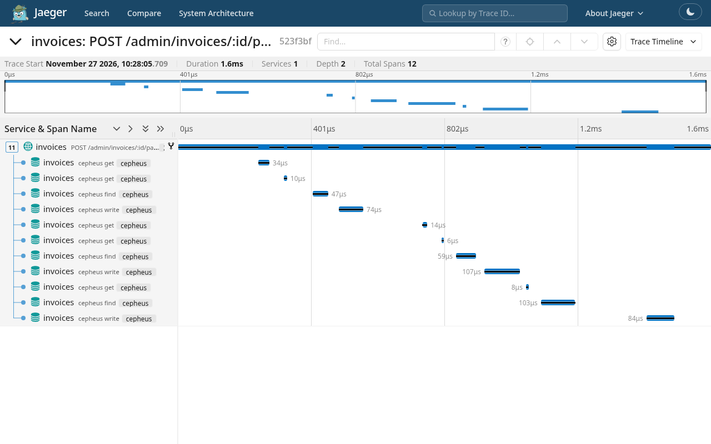

# Télémétrie : ce que disent l'app et ses pages

La tâche : la comptable dit que marquer une facture payée est lent, de temps en temps. Trouver ce clic, et le suivre à
travers l'app jusqu'aux lectures de Cepheus qu'il a faites, dans un visualiseur de traces ; puis voir ce que les pages
de l'app apprennent de chaque visite : leur vitesse, leurs erreurs, les appareils, ce que la loi laisse l'app garder
sans demander, et ce que cela coûte.

Ce qu'il faut : deux réglages. `APP_OTEL=on` envoie les **traces** de l'app (l'histoire de chaque requête), ses
**métriques** (ses compteurs et ses mesures) et ses **logs** (les lignes de son journal) à un *collector*
d'[OpenTelemetry](https://opentelemetry.io/) (le programme qui reçoit ces données, puis les garde ou les fait suivre ;
OpenTelemetry est le standard ouvert de ces trois sortes de données), dans son propre protocole, OTLP sur HTTP ;
`APP_TELEMETRY_CLIENT`, allumé par défaut, laisse les pages de Ceres dire à leur app ce qu'elles voient. Rien à écrire
dans un *handler* (la fonction qui répond à une requête). En Cesia, c'est
[std/otel](https://github.com/www-celestial/cesia/blob/main/docs/book/http.md#opentelemetry), que tout programme
peut utiliser.

Quelques mots d'abord. Une **trace** est l'histoire d'une requête : un **span** pour son tout, et un span pour chaque
chose qu'elle a faite à l'intérieur, une lecture de la base de données, un appel à un autre service, chacun l'*enfant*
du span dans lequel il a été fait, avec son début, sa durée et ce qu'il concernait (ses *attributes*, ses attributs).
Le header `traceparent` du W3C (un header est une ligne d'information en tête d'une requête ; celui-ci porte les
numéros de la trace) fait passer une trace d'un navigateur à un serveur, et de ce serveur au suivant, pour que les
spans de chaque programme forment une seule histoire. Un **collector** reçoit les spans, et les garde ou les fait
suivre ; un **visualiseur** (viewer) les montre sur une ligne de temps. **OTLP** est le protocole d'OpenTelemetry pour
cela, en protobuf (une forme binaire compacte) ou en JSON (une forme en texte).

## 1. Une trace, du clic à la base de données

Jaeger est un visualiseur de traces avec un collector à l'intérieur, un seul fichier à télécharger : ni Docker, ni base
de données.

```sh
# Jaeger 2.23 for Linux on x86-64, from its releases on GitHub, checked against its sha256 sum
mkdir -p ~/.cache/otel/jaeger && cd ~/.cache/otel/jaeger
curl -LO https://github.com/jaegertracing/jaeger/releases/download/v2.23.0/jaeger-2.23.0-linux-amd64.tar.gz
tar xzf jaeger-2.23.0-linux-amd64.tar.gz && mv jaeger-2.23.0-linux-amd64/jaeger .
./jaeger --config file:config.yaml      # OTLP on 127.0.0.1:4318, its pages on http://127.0.0.1:16686
```

`config.yaml` garde tout sur cette machine (le défaut de Jaeger lui-même écoute sur toutes les adresses) :

```yaml
service:
  extensions: [jaeger_storage, jaeger_query]
  pipelines:
    traces: {receivers: [otlp], processors: [batch], exporters: [jaeger_storage_exporter]}
extensions:
  jaeger_query: {storage: {traces: mem}, http: {endpoint: 127.0.0.1:16686}, grpc: {endpoint: 127.0.0.1:16685}}
  jaeger_storage: {backends: {mem: {memory: {max_traces: 100000}}}}
receivers:
  otlp: {protocols: {http: {endpoint: 127.0.0.1:4318}}}
processors:
  batch:
exporters:
  jaeger_storage_exporter: {trace_storage: mem}
```

Puis les factures, avec un mois de données, leurs pages d'admin et OpenTelemetry allumé :

```sh
cd examples/invoices
cesia build --target wasm admin/page.ce
cesia do trace-serve
# http://127.0.0.1:8090/admin, super@app.test, "correct horse super"
```

`tools/trace-serve.ce` est l'app de `tools/admin-serve.ce` avec quatre réglages de plus :
`APP_OTEL=on`, `APP_OTEL_ENDPOINT=http://127.0.0.1:4318`, `APP_OTEL_EVERY=1` (envoyer chaque seconde, pour le
tutoriel) et `APP_TELEMETRY_EVERY=5`. Une vraie app les met dans son environnement :

```sh
export APP_OTEL=on APP_OTEL_ENDPOINT=http://127.0.0.1:4318
```

Ouvrez les factures impayées et marquez-en une payée. Dans Jaeger, le service `invoices-browser` tient ce que la page a
dit : le clic sur **Mark paid**, de l'appui à la réponse, 62 ms ici. Son span a un lien vers la trace du serveur qui a
fait l'action ; le service `invoices` tient celle-ci : `POST /admin/invoices/:id/pay`, et sous elle chaque lecture et
chaque écriture de Cepheus qu'elle a faite, `cepheus get`, `cepheus find`, `cepheus write`, avec leurs temps :



Les plus lents se trouvent de la même façon : dans Jaeger, par la recherche par service et par *Min Duration* (la durée
minimale) ; dans les pages d'admin, par les données de `centauri_client_action`
([section 4](#4-ce-que-disent-les-pages)), chaque action avec son temps et ses deux traces.

Pourquoi deux traces liées, et pas une seule : un `traceparent` qui vient d'Internet est celui de n'importe qui, même
celui de la page (n'importe qui peut en envoyer un). Par défaut (`APP_OTEL_TRUST=restart`), l'app commence une trace à
elle à sa porte (le code par où entre chaque requête), avec un *link* (un lien) vers celle de la page ; personne au
dehors ne peut choisir sa trace, ni la rendre *sampled* (gardée par le *sampling*, le tri qui ne garde qu'une part des
traces). Un service placé derrière un autre service à vous met `APP_OTEL_TRUST=trust`, et les traces se joignent en
une seule.

## 2. Ce que l'app envoie

| | quoi | d'où cela vient |
|---|---|---|
| un span pour chaque requête | `GET /notes/:id` : sa route, jamais son chemin (des ids et des mots dans un chemin donneraient un nom par requête, et peuvent être des données), la méthode, le statut, le schéma, l'hôte ; `client.address` et `enduser.id` seulement comme le disent [les réglages](#5-les-réglages) ; un statut de 500 ou plus est une erreur | la porte (`src/app/serve.ce`) |
| un span pour chaque appel de Cepheus | `cepheus get`, `cepheus find`, `cepheus write`... : `db.system.name` `cepheus`, `db.operation.name`, et le code d'une erreur | Cesia : chaque appel d'un moteur natif fait dans une trace gardée |
| un span pour chaque appel à un autre service | `app.Call` : la méthode, l'hôte et le port (`url.full` sans son chemin ni sa query, la partie après `?`, qui peuvent contenir un secret : l'adresse d'un webhook, où un partenaire attend les messages de l'app, ou un lien signé), le statut ; l'appel fait suivre `traceparent` | `src/app/call.ce` |
| une trace pour chaque job (un travail fait en arrière-plan, hors de la requête) | `process report`, de la sorte *consumer* (OpenTelemetry nomme ainsi le span d'un travail qui traite un message reçu), liée à la trace de la requête qui l'a demandé (gardée avec le job), gardée quand celle-ci l'était | `src/jobs/jobs.ce` |
| un span pour chaque mail envoyé | `mail send` : son transport et son serveur, jamais une adresse | `src/mail/mail.ce` |
| une action en direct | le span de sa requête, enfant ou lien du clic de la page (la page envoie son `traceparent` avec l'action), et la page apprend la trace du serveur dans la réponse | `src/app/live.ce`, std/live |
| les métriques | celles de std/metrics telles quelles, `http_*`, `centauri_requests_total`, `centauri_refused_total`, `job_seconds`, `mails_total`, `otel_dropped_total`... : **une seule source** de nombres, lue toutes les `APP_OTEL_METRICS_EVERY` secondes et envoyée en OTLP (un compteur y perd son `_total`), la même que celle que `/metrics` donne à Prometheus | le std/metrics de Cesia |
| les logs | chaque ligne de std/log, avec son `trace_id` et son `span_id` quand elle a été écrite dans une trace (sur la sortie standard aussi) ; les lignes `info` d'une requête non gardée restent dehors, ses avertissements et ses erreurs partent | le std/log de Cesia |

Une requête à laquelle l'app répond avec une trace gardée donne sa trace à la page dans un header,
`Server-Timing: traceparent;desc="00-…"`, qu'une page lit dans les données de sa navigation (le code d'OpenTelemetry pour
les navigateurs lit le même).

**Le sampling.** `APP_OTEL_SAMPLE` est la part des nouvelles traces gardées, 1 par défaut (toutes), comme le font les
SDK d'OpenTelemetry (ses bibliothèques officielles) : la décision se prend sur l'id de la trace, pour que chaque service
qui échantillonne à la même part garde les mêmes traces. Une trace non gardée fait suivre ses ids (flags `00`) et ne
crée aucun span : ses enfants ne sont jamais créés. `APP_OTEL_ALWAYS` (`errors,slow`) garde quand même le span d'une
requête non gardée qui a échoué, ou qui a pris plus de `APP_OTEL_SLOW` millisecondes (1 000) : son span à elle seul,
puisque aucun de ses enfants n'a été créé, ce qui ne coûte rien de plus.

**La file.** Les spans et les lignes attendent dans une file de `APP_OTEL_QUEUE` (2 048) qui ne fait jamais attendre
une requête : au-delà, ils sont jetés et comptés dans `otel_dropped_total`. Une *fiber* (un fil d'exécution léger, à
l'intérieur du processus) les envoie par *batches* (des lots) de 512, toutes les `APP_OTEL_EVERY` secondes (5) ; un
collector occupé ou parti (429, 502, 503, 504, ou aucune réponse) est réessayé après une pause tirée au hasard sous une
borne qui double à partir d'une seconde, ou après le `Retry-After` qu'il demande, cinq essais, puis le batch est jeté,
et compté. Chacun attend déjà encodé, tel qu'il partira : une file pleine de 2 048 spans prend 1,2 Mo de mémoire en
protobuf, 2,3 en JSON (à côté d'une file de 16, face à un collector qui ne répond rien).

## 3. Protobuf ou JSON

Mesuré par `bench/otel.ce` : les mêmes requêtes à une app avec OpenTelemetry éteint, allumé sans aucune trace gardée,
et allumé avec chacune gardée et envoyée, le temps de les envoyer compté dans celui de la requête (21 tours de 2 000
requêtes, l'ordre alterné ; le programme fixé sur un cœur physique, le collector, `bench/otel-sink.ce`, sur un autre ;
une charge de 3 à 4 sur 8 cœurs, venue d'autres travaux) :

| une requête de Centauri, dans le programme | éteint | allumé, aucune gardée | allumé, gardées, protobuf | allumé, gardées, JSON |
|---|---|---|---|---|
| publique, un JSON d'un champ (1 span) | 23,1 µs [20,5 ; 38,3] | 31,3 µs [28,9 ; 40,2] | 58,7 µs [53,9 ; 203,2] | 57,1 µs [51,6 ; 247,4] |
| connectée, une chose par son id (2 spans) | 39,0 µs [36,1 ; 59,3] | 46,7 µs [44,1 ; 66,1] | 96,8 µs [90,1 ; 261,7] | 88,7 µs [82,6 ; 472,9] |
| connectée, une page de 20 choses (2 spans) | 135,3 µs [125,1 ; 192,0] | 141,8 µs [133,5 ; 266,5] | 196,2 µs [181,8 ; 1 254,6] | 183,5 µs [174,3 ; 687,1] |
| octets sur le réseau, par requête | | 0 | 210 à 349 | 498 à 860 |

Médianes [min ; max] ; chaque colonne diffère de la colonne « éteint » (test de Mann-Whitney, qui dit si deux séries
de mesures diffèrent vraiment : p < 0,02). Protobuf est le défaut (`APP_OTEL_PROTOCOL`) : 2,4 fois moins d'octets que
JSON, pour 5 à 10 % de temps en plus, que Cesia passe à écrire le protobuf, là où il écrit le JSON avec du code natif ;
JSON est là pour un collector qui ne prend que lui, ou sur la même machine, où les octets ne coûtent rien, pour
épargner ces microsecondes.
`APP_OTEL_COMPRESSION=gzip` (zlib, avec la permission `ffi=z`) réduit encore les octets, pour un collector de l'autre
côté d'un réseau : 6 spans et 3 lignes ont pris 1 163 octets avec gzip, 1 853 sans.

Une trace gardée coûte donc à une requête de Centauri de 35 à 60 µs, environ 20 à 25 µs par span, de son début au
collector, tout cela en Cesia ; une requête non gardée, de 7 à 8 µs (ses ids, son contexte, les vérifications de sa
porte). Sur un vrai Cepheus à travers le réseau, dont une lecture prend de 100 µs à 1 ms, c'est quelques pour cent ; en
mémoire, comme ici, cela double le prix des requêtes les moins chères : une app chargée baisse `APP_OTEL_SAMPLE` et
garde celles qui échouent ou qui sont lentes avec `APP_OTEL_ALWAYS`. Avec OpenTelemetry éteint, une requête coûte ce
qu'elle coûtait : `bench/micro.ce`, les binaires d'avant et de maintenant en alternance (21 tours), a donné 20,4 µs et
22,4 µs pour la requête publique (p < 0,01), 36,4 et 37,2 pour une chose par son id (p de 0,07) : les deux tests
d'`APP_OTEL` de la porte et une route de plus coûtent 2 µs à la requête la moins chère ; une route de std/http seul qui
lit Cepheus a bougé d'autant (5,4 et 6,0 µs), alors que rien d'elle n'a changé, sauf la vérification d'un hook (un point
d'accroche, où le tracing se branche) à chaque appel d'un moteur.

Le démarrage, lui, le paie : `bench/serve.ce` jusqu'à sa première réponse, 21 démarrages alternés, a pris 72,1 ms
[66,6 ; 230,4] avant et 78,2 ms [72,3 ; 277,9] maintenant (p de 0,02), 77,0 ms avec OpenTelemetry allumé ; et 39,0 Mio
de mémoire maintenant, contre 34,9 avant : 2,3 Mio en sont les trois kinds de la télémétrie des pages, que Cepheus
déclare au démarrage (environ 29 Ko par champ, 79 champs), le reste le code venu avec eux.

## 4. Ce que disent les pages

Une page de Ceres apprend ce que seul le navigateur peut dire, et son app le garde comme des choses de trois kinds (un
kind : une sorte de chose dans la base de données, comme les factures), que les pages de données de l'admin listent et
filtrent comme toutes les autres : **`centauri_client_view`**, une par chargement d'une page, avec sa vitesse, son
appareil, son parcours ; **`centauri_client_action`**, chaque action, du clic à sa réponse, avec la trace du clic et
celle du serveur ; **`centauri_client_error`**, chaque erreur. Tout cela est la parole de la page : marqué `Untrusted`
(pas digne de confiance), jamais utilisé pour une décision de l'app.


| quoi | quand | pourquoi | la loi |
|---|---|---|---|
| **la vitesse** : les Web Vitals (les mesures de la vitesse d'une page que définit Google), LCP (*Largest Contentful Paint* : le temps jusqu'à l'affichage du plus grand élément), INP (*Interaction to Next Paint* : le temps entre une action et l'image suivante), CLS (*Cumulative Layout Shift* : combien la page bouge pendant qu'elle se charge), FCP (*First Contentful Paint* : le temps jusqu'au premier contenu affiché), TTFB (*Time To First Byte* : le temps jusqu'au premier octet de la réponse), en ms (CLS est un score), comptés comme les compte la bibliothèque `web-vitals` de Google | par défaut | ce qu'un visiteur attend, page par page ; les seuils de Google : LCP bon sous 2,5 s, INP sous 200 ms, CLS sous 0,1 | la mesure d'audience (compter les visites d'un site), « mesure des performances » (CNIL 2020-091 §50) |
| la navigation (son type, son protocole, ses octets), les ressources (combien, leurs octets, celles qui ont échoué, la plus lente par son chemin), les long tasks (les tâches de plus de 50 ms qui bloquent la page), les frames de Ceres (les images qu'elle dessine : la première, la médiane, le p95, c'est-à-dire la durée sous laquelle tombent 95 % d'entre elles, la plus longue), le WebAssembly (le code compilé que le navigateur exécute : son téléchargement, ses octets, son démarrage), l'écran en direct (sa première connexion, ses coupures) | par défaut | où une page lente passe son temps ; une page de Ceres dessine dans un canvas (une surface où la page dessine elle-même), que le navigateur ne compte jamais pour le LCP : sa première image (first paint) est son LCP | de même |
| **les erreurs** : une erreur de Cesia avec sa place dans le `.ce` et ses appels, un trap de WebAssembly (un arrêt du code sur une faute), une exception, une promise rejetée (une promise : une valeur que JavaScript attend), un refus de la CSP (la Content-Security-Policy, qui dit ce qu'une page a le droit de charger), un fichier qui ne s'est pas chargé ; masquées | par défaut | ce qui a cassé, et où | « détection de problèmes de navigation » (§50) ; aucun texte n'exempte à lui seul le suivi des erreurs : il reste dans la mesure, anonyme, pour le site seul |
| **l'appareil** : le navigateur et sa version majeure, le système, mobile ou non (seulement les client hints de basse entropie, les informations courtes que le navigateur donne de lui-même, ou le nom et la version du user agent, le texte par lequel le navigateur se nomme), l'écran et la fenêtre en pixels, la densité, le thème sombre, le mouvement réduit, la langue, le décalage de l'horloge par rapport à UTC, les cœurs, la mémoire, le type de réseau, l'aller-retour, le débit, l'économie de données, en ligne ou non | par défaut | pour quels appareils adapter les pages | de même ; jamais plus : aucune lecture du canvas, des polices ou de l'audio, aucun hint de haute entropie (l'EDPB, le comité européen de la protection des données, 2/2023 §43 : de telles lectures peuvent faire une fingerprint, une empreinte qui reconnaît un appareil sans cookie) |
| **le parcours** : les vues par leur route, `/invoices/:id`, jamais leur chemin ; la page d'où vient la visite, son origine seulement (son schéma, son hôte et son port) ; les `utm_*` de l'adresse (les marques qu'ajoute une campagne) ; les actions par leur nom (un endpoint de l'app, c'est-à-dire une adresse de son API avec sa méthode HTTP, sinon « (other) »), jamais leurs valeurs ; le temps passé sur la page | par défaut | quelles pages, d'où, ce qui y est fait | de même ; aucun suivi d'un site à l'autre, seulement une session d'un onglet |
| une session : un id aléatoire de l'onglet, dans son `sessionStorage` (le stockage d'un onglet, effacé quand il se ferme) | par défaut | les vues d'une même visite ensemble | permis pour la mesure ; vit aussi longtemps que l'onglet |
| **le pays et la ville** de l'adresse, d'après une base de DB-IP | par défaut avec `APP_TELEMETRY_GEO_FILE` (`APP_TELEMETRY_GEO` : `city`, `country` ou `off`) | où sont les visiteurs | l'adresse utilisée pour la ville, pas plus fin, puis pas gardée (CNIL, outil d'auto-évaluation de juillet 2025) |
| l'adresse | `APP_TELEMETRY_IP` : `none` (par défaut), `truncated` (le dernier octet d'une IPv4 retiré, une IPv6 coupée à son réseau /48), `full` | les abus, le support | hors de l'exemption : avec `APP_TELEMETRY_CONSENT=ask` (par défaut), seulement d'un visiteur qui a dit oui |
| le compte et son tenant (un client de la plateforme, avec ses données à lui) | `APP_TELEMETRY_USER=on` | pour voir les visites d'un utilisateur, pour le support | de même |

**La loi.** Dans l'UE, lire ou stocker quoi que ce soit dans l'appareil d'un visiteur demande son consentement (la
directive ePrivacy, art. 5(3) ; en France, l'art. 82 de la loi Informatique et Libertés), sauf si c'est strictement
nécessaire au service qu'il a demandé. L'EDPB dit que du JavaScript qui envoie ce qu'il lit de l'appareil est une
telle lecture (lignes directrices 2/2023, v2 du 7 octobre 2024, §33). La CNIL exempte de consentement la **mesure
d'audience**, à ses conditions (délibération 2020-091 §51) : pour le site seul (« pour le compte exclusif de
l'éditeur »), aucun suivi d'un site ou d'une app à l'autre, des statistiques anonymes seulement, aucun croisement avec
d'autres données, rien de donné à d'autres ; l'adresse utilisée pour la ville au plus, puis coupée (son outil
d'auto-évaluation, juillet 2025). Les défauts ci-dessus sont bâtis sur ces conditions : first party (le site lui-même,
sans tiers), l'adresse de l'app elle-même, ni adresse ni compte gardés, une session d'un onglet, `APP_TELEMETRY_KEEP`
jours (30, sous les 25 mois que permet la CNIL). Les visiteurs doivent quand même être prévenus, dans la notice de l'app
(la page qui dit ce qu'elle fait des données), et pouvoir s'y opposer : la page envoie alors l'événement
`ceres-consent` avec `"off"` (gardé dans le `localStorage` du site, son stockage qui dure), et le Global Privacy Control
du navigateur (un signal qui dit « ne me suivez pas ») est respecté de la même façon : rien n'est mesuré ni envoyé. Ce
qui est hors de l'exemption, l'adresse et le compte, attend un oui : le bandeau de l'app envoie `ceres-consent` avec
`true`, et chaque batch le dit. `APP_TELEMETRY_CONSENT=none` le tient pour acquis, pour une app dont les visiteurs ont
accepté ailleurs (un contrat, un intranet) : l'app en répond.

```js
// the app's banner, in the page: yes, no, or no measure at all
dispatchEvent(new CustomEvent('ceres-consent', { detail: true }))     // or false, or 'off'
```

**Ce qu'envoie une page.** Un batch toutes les `APP_TELEMETRY_EVERY` secondes (30) tant qu'il s'est passé quelque
chose, et le dernier par le beacon du navigateur (un envoi qui part même quand la page se ferme) quand l'onglet est
caché ou se ferme, vers le `POST /telemetry` de sa propre app (une app qui servait déjà cette route la garde, et ses
pages ne disent alors rien) : aucun autre site, donc aucun tiers, pas de CORS (les
règles qui laissent une page appeler un autre site), et les limites de l'app s'appliquent. La page masque ses textes
(les adresses de mail, les suites de 6 chiffres ou plus, les tokens, des jetons secrets qui prouvent un droit, la query
et le fragment des adresses, la partie après `#`) et l'app les masque à nouveau ; ses routes, ses noms d'actions et ses
sortes d'erreurs sont vérifiés contre ceux que l'app connaît. Avec `APP_OTEL` allumé, les actions sont des spans et les
erreurs des lignes de log, d'un service à elles, `<app>-browser`.

## 5. Les réglages

| réglage | par défaut | ce que c'est |
|---|---|---|
| `APP_OTEL` | `off` | `on` : traces, métriques et logs vers un collector d'OTLP |
| `APP_OTEL_ENDPOINT` | `http://127.0.0.1:4318` | le collector, son `/v1/traces`, `/v1/metrics`, `/v1/logs` |
| `APP_OTEL_PROTOCOL` | `protobuf` | ou `json` |
| `APP_OTEL_COMPRESSION` | `none` | ou `gzip` (zlib : la permission `ffi=z`) |
| `APP_OTEL_HEADERS` | aucun, un secret | les headers de chaque export, `name=value` séparés par des virgules, les valeurs encodées en pourcent (`%2C` pour une virgule), comme la clé d'un fournisseur (vendor) |
| `APP_OTEL_SAMPLE` | 1 | la part des nouvelles traces gardées, de 0 à 1 |
| `APP_OTEL_ALWAYS`, `APP_OTEL_SLOW` | `errors,slow`, 1000 | garder le span d'une requête non gardée qui a échoué, ou qui a pris plus que ces millisecondes |
| `APP_OTEL_TRUST` | `restart` | un `traceparent` venu du dehors commence une nouvelle trace, liée à lui ; `trust` continue avec lui |
| `APP_OTEL_SIGNALS` | `traces,metrics,logs` | ce qui est envoyé |
| `APP_OTEL_SERVICE` | le nom de l'app | `service.name` ; sa version est celle de l'app, `deployment.environment.name` son profil, `service.instance.id` un id aléatoire par processus |
| `APP_OTEL_QUEUE`, `APP_OTEL_EVERY`, `APP_OTEL_METRICS_EVERY` | 2048, 5, 60 | le plus de spans et de lignes qui attendent ; les secondes entre deux exports, des spans et des métriques |
| `APP_TELEMETRY_CLIENT` | `on` | les pages disent à leur app ce qu'elles voient ; `off` : elles n'envoient rien, et l'app ne garde rien |
| `APP_TELEMETRY_SAMPLE` | 1 | la part des chargements de pages qui le disent |
| `APP_TELEMETRY_EVERY` | 30 | les secondes entre deux batches d'une page |
| `APP_TELEMETRY_CONSENT` | `ask` | l'adresse et le compte seulement d'un visiteur qui a dit oui ; `none` : toujours |
| `APP_TELEMETRY_IP` | `none` | `truncated` ou `full`, dans les vues et dans le `client.address` des spans |
| `APP_TELEMETRY_USER` | `off` | `on` : le compte et son tenant, dans les vues et dans l'`enduser.id` des spans |
| `APP_TELEMETRY_GEO`, `APP_TELEMETRY_GEO_FILE` | `city`, aucun | le pays et la ville, d'après une base MMDB (le format de MaxMind pour les bases d'adresses), comme « IP to City Lite » de DB-IP (CC BY 4.0 : l'app nomme DB-IP.com là où elle les montre) ou « IP to Country Lite » |
| `APP_TELEMETRY_KEEP` | 30 | les jours où une vue, une action ou une erreur est gardée (de 1 à 760) |
| `APP_TELEMETRY_MOST` | 6000 | les batches par minute qu'un processus prend en tout ; au-delà, jetés et comptés dans `centauri_telemetry_dropped_total` |

La base de DB-IP est lue en entier au démarrage : ses pays prennent 8 Mo, ses villes 127 Mo, dans chaque processus.

## 6. Ce que paient les pages

La télémétrie d'une page de Ceres lui ajoute 6 672 octets avec Brotli (une compression des fichiers du web) :
`telemetry.js`, la glue (le code JavaScript qui relie la page à son WebAssembly), 3 676 (10 263 sans compression), et
le code WebAssembly qui tient le batch, 2 988 (le `page.wasm` de l'admin, 171 859 octets avec Brotli avant, 174 847
maintenant). Les bibliothèques des autres, montées comme le dit leur guide de démarrage rapide (quick start) :
regroupées par esbuild, minifiées (réduites à leur plus petite écriture), Brotli au niveau 11 :


| | Brotli | ce qu'elle recueille par défaut |
|---|---:|---|
| la télémétrie de Centauri | 6 672 | le tableau de la [section 4](#4-ce-que-disent-les-pages) |
| web-vitals 6.2.3 seul | 3 009 | les cinq Web Vitals, rien d'autre |
| Elastic APM RUM 5.17.5 | 20 933 | le chargement de la page, les changements de route, les interactions de l'utilisateur, les erreurs, les spans de fetch et de XHR (les requêtes qu'une page fait elle-même) |
| Sentry browser 11.19, erreurs | 28 809 | les erreurs, les breadcrumbs (les derniers événements avant une erreur), l'adresse et les données de l'utilisateur par défaut depuis la v11 |
| OpenTelemetry JS pour le web (sdk-trace 3.1.1, OTLP sur HTTP, document load, fetch, zone.js) | 32 741 | les spans du chargement du document et de fetch ; les Web Vitals demandent web-vitals (35 539) |
| Grafana Faro 2.15 | 37 893 | les erreurs, les Web Vitals, les sessions, les vues, les logs de la console |
| Sentry avec le tracing | 49 999 | + les chargements de pages, les navigations, les spans de fetch, les Web Vitals, l'INP, les long tasks |
| Datadog RUM 7.19 | 74 914 (60 792 à son premier chargement) | les vues, les actions, les ressources, les erreurs, les long tasks, un échantillon de replays (des sessions enregistrées pour être revues) |

Ce qu'elles coûtent à la page pendant son chargement, dans Chrome (Chrome for Testing 153, sans fenêtre), chaque page
chargée 21 fois dans un nouveau contexte, l'ordre alterné, le CPU compté par Chrome (le `Performance.getMetrics` des
DevTools) deux secondes après son `load` ; Chrome fixé sur un cœur physique. Une page faite seulement de la
bibliothèque et de son démarrage, à côté d'une page vide ; celle de Centauri est la glue telle que le WebAssembly de la
page l'appelle (sa partie à lui, la fiber qui tient le batch, tourne après la première image) :

| | JavaScript exécuté | toutes les tâches de la page, au-delà d'une page vide | mémoire de JavaScript, au-delà d'une page vide |
|---|---:|---:|---:|
| la télémétrie de Centauri | 3,2 ms [2,6 ; 12,8] | +9,6 ms | +109 Kio |
| web-vitals seul | 4,1 ms [3,7 ; 24,8] | +15,5 ms | +155 Kio |
| Sentry, erreurs | 8,0 ms [7,0 ; 52,2] | +23,7 ms | +496 Kio |
| Elastic APM RUM | 10,5 ms [7,2 ; 81,0] | +33,2 ms | +626 Kio |
| OpenTelemetry JS pour le web | 18,1 ms [15,4 ; 32,2] | +27,8 ms | +1 258 Kio |
| OpenTelemetry JS avec web-vitals | 21,1 ms [17,5 ; 45,7] | +29,3 ms | +1 432 Kio |
| Grafana Faro | 27,0 ms [24,1 ; 107,3] | +42,3 ms | +1 645 Kio |
| Datadog RUM | 35,4 ms [29,3 ; 305,8] | +77,8 ms | +1 259 Kio |
| Sentry avec le tracing | 43,8 ms [37,5 ; 198,7] | +59,9 ms | +1 524 Kio |

Médianes [min ; max], toutes différentes de celles d'une page vide (Mann-Whitney, p < 0,001). Celles de Centauri et de
web-vitals ont été mesurées à nouveau ensemble, sur une machine plus calme (une charge de 4, contre 10 pour les autres ;
web-vitals a donné la même chose dans les deux séries, 4,3 ms et 4,1). La première mesure de la glue de Centauri prenait
16,9 ms : le nom du fuseau horaire, qu'`Intl.DateTimeFormat` mettait 12 ms à donner au premier appel ; la glue envoie à
la place le décalage de l'horloge par rapport à UTC, qui en dit moins, aussi.

Là où les autres gagnent : Sentry et Datadog lisent les source maps (les tables qui ramènent un JavaScript minifié à
sa source) et regroupent les erreurs d'une version à l'autre ; Datadog et Sentry rejouent une session (le replay :
revoir ce qu'a fait un visiteur), ce que Centauri ne fait pas (le replay d'une page de Ceres serait ses draw lists, les
listes de dessin d'où le canvas peint : quelques centaines d'octets par frame changée, bien moins que le DOM, l'arbre
des éléments d'une page, qu'enregistre rrweb ; mais rien de cela n'est construit) ; OpenTelemetry JS trace chaque
`fetch` d'une page, là où une page de Ceres parle à son app par son écran en direct, dont les actions sont tracées.
Leurs collectors et leurs pages sont des services à part entière, avec des alertes ; Centauri envoie de l'OTLP, et
chacun d'eux qui prend l'OTLP peut le montrer (Grafana, Datadog, Honeycomb, Elastic, Jaeger, SigNoz).

## 7. À côté des autres

Spring Boot envoie des traces avec Micrometer Tracing et son pont vers OpenTelemetry, ou avec l'agent d'OpenTelemetry
pour Java, qui réécrit les classes à leur chargement ; Django avec `opentelemetry-instrument`, Node avec
`@opentelemetry/auto-instrumentations-node`, Go en enveloppant chaque handler et chaque client avec `otelhttp`, et
chaque base de données avec son propre wrapper (une enveloppe autour de ses appels) :

```java
// Spring Boot: spring-boot-starter-actuator, micrometer-tracing-bridge-otel, opentelemetry-exporter-otlp, and
// management.tracing.sampling.probability=1.0, management.otlp.tracing.endpoint=http://localhost:4318/v1/traces
```

Centauri n'a besoin d'aucun agent, d'aucun wrapper et d'aucune dépendance : sa porte, ses appels, ses jobs et les
moteurs de Cesia sont tracés là où ils sont. Ce que cela coûte à côté d'eux, sur la même petite app (`GET /hello` qui
répond un JSON d'un champ, un span par requête, chacune gardée et envoyée par OTLP sur HTTP en protobuf à un collector
qui prend et jette), en Cesia avec std/otel, en Go 1.26 avec le SDK d'OpenTelemetry et `otelhttp`, et en Spring Boot
4.2 sur Java 21 avec l'agent d'OpenTelemetry : 21 tours, sans et avec en alternance, 16 connexions gardées ouvertes,
le serveur épinglé à un cœur physique, la charge et le collector à un autre, sur une machine partagée avec d'autres
travaux (une charge de 4,5 à 36, 18,7 en médiane : les requêtes par seconde ont varié d'un facteur dix d'un tour à
l'autre, et c'est le temps de processeur par requête qu'il faut lire) :

| une requête de `/hello` | sans | avec | ce que coûte OpenTelemetry | octets par span sur le réseau |
|---|---:|---:|---:|---:|
| Cesia, std/otel | 71,6 µs [47,7 ; 102,6] | 147,9 µs [94,9 ; 185,8] | +76 µs | 173 |
| Go 1.26, le SDK 1.47 d'OpenTelemetry et `otelhttp` 0.72 | 41,1 µs [26,3 ; 68,0] | 125,4 µs [81,1 ; 186,8] | +84 µs | 430 |
| Spring Boot 4.2 et l'agent 2.34 d'OpenTelemetry pour Java | 309,4 µs [58,2 ; 810,9] | 734,7 µs [270,0 ; 1 266,9] | +425 µs | 491 |

Le temps de processeur du serveur par requête, médianes [min ; max] ; chaque « avec » diffère de son « sans »
(Mann-Whitney, un test qui dit si deux séries de mesures diffèrent vraiment : p < 0,001). OpenTelemetry coûte à une
requête de Cesia ce qu'il coûte à une de Go, et un cinquième de ce que coûte l'agent pour Java ; un span de Cesia prend
2,5 fois moins d'octets, puisqu'il nomme ce qu'il doit (la route, la méthode, le statut, le schéma, l'hôte) et pas plus
(Go et Java ajoutent l'adresse et le port du client, le user agent, le protocole, les détails du pair). Où Go gagne :
sa requête sans OpenTelemetry coûte moins (41 contre 72 µs : le code interprété de Cesia contre le code compilé de
Go), sa mémoire est le quart de celle de Cesia (15,7 Mio contre 65,5 pour deux processus), et son SDK écrit le
protobuf en code compilé, là où Cesia l'écrit en Cesia. L'agent de Java instrumente tout ce qu'il trouve, sans rien à
écrire, au prix de 90 Mio de mémoire de plus et d'un démarrage de plusieurs secondes.

## 8. Les tests

`tests/otel.test.ce` : une requête tracée avec ses lectures de Cepheus, jamais son chemin dans un nom, sa trace donnée
à la page (`isRequestTracedWithItsReads`) ; un appel qui fait suivre la trace, un job dans une trace à lui, liée à
celle de sa requête (`isCallAndJobInTheTrace`) ; un `traceparent` venu du dehors recommencé avec un lien, ou cru
(`isTraceparentFromOutsideRestarted`) ; l'adresse et le compte du client seulement comme on l'a dit
(`isClientNamedOnlyAsTheSettingsSay`) ; une requête non gardée qui ne laisse rien d'autre que son échec
(`isNotSampledLeavingNothing`) ; une ligne de log dans sa trace (`isLogLineInItsTrace`) ; les mauvais réglages nommés
(`isOtelSettingChecked`) ; éteint par défaut (`isOffByDefaultAndCostsNothing`).
`tests/telemetry.test.ce` : un batch gardé comme une vue, avec ses actions et ses erreurs (`isBatchKeptAsAView`) ; ce
que dit une page, masqué (`isWhatAPageSaysMasked`) ; du balisage (markup : des balises HTML) gardé comme du texte
(`isMarkupKeptAsText`) ; un flot de requêtes borné (`isFloodBounded`) ; la vue d'une autre session laissée intacte
(`isViewOfAnotherSessionUntouched`) ; le visiteur nommé seulement comme on l'a dit, et après lui avoir demandé
(`isVisitorNamedOnlyAsSaidAndAsked`) ; éteint, rien n'est gardé (`isOffKeepingNothing`) ; ses jours seulement
(`isKeptItsDaysOnly`) ; les vues additionnées (`isLastBatchEndingTheView`) ; envoyé à OpenTelemetry
(`isForwardedToOpenTelemetry`) ; une base de pays, l'adresse gardée nulle part (`isPlacedByTheDatabaseOnly`). Le
`tests/net/otel.ce` de Cesia vérifie std/otel contre un collector : la file, un collector mort, un collector qui
demande d'attendre, les séries d'une métrique bornées.

Ce qu'il ne fait pas encore : un replay de session ; les source maps du JavaScript minifié d'une app (le code de Ceres
lui-même est du Cesia, dont les erreurs nomment déjà leur ligne du `.ce`) ; les spans des propres appels `fetch` d'une
page (une page de Ceres parle à son app par son écran en direct, dont les actions sont tracées) ; leurs graphiques
dans le tableau de bord de l'admin, qui liste pour l'instant les vues, les actions et les erreurs comme des données :
le 75e percentile du LCP, de l'INP et du CLS par route et par jour, face aux seuils de Google ; les erreurs par sorte et
par route ; les actions les plus lentes par nom, chacune avec ses deux traces ; les navigateurs, les systèmes et les
pays des visites ; le temps jusqu'à l'écran en direct et ses coupures ; les spans envoyés et perdus. Les lectures de
Cepheus de ce chapitre prennent des microsecondes, sur une base de données en mémoire ; sur un serveur Cepheus, elles
montrent aussi le réseau.
